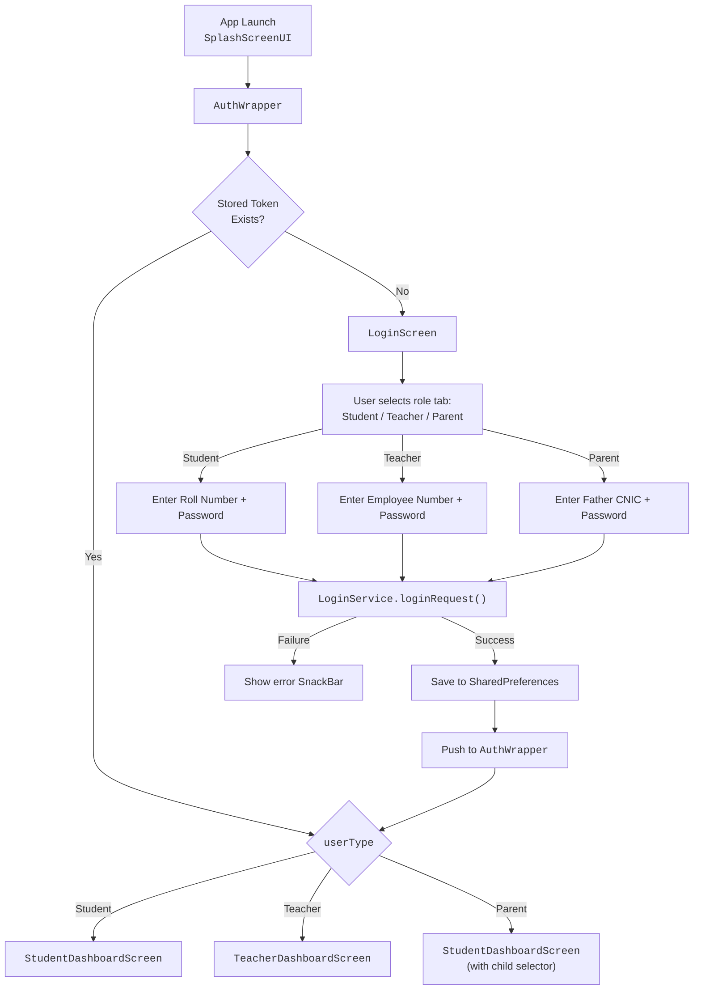
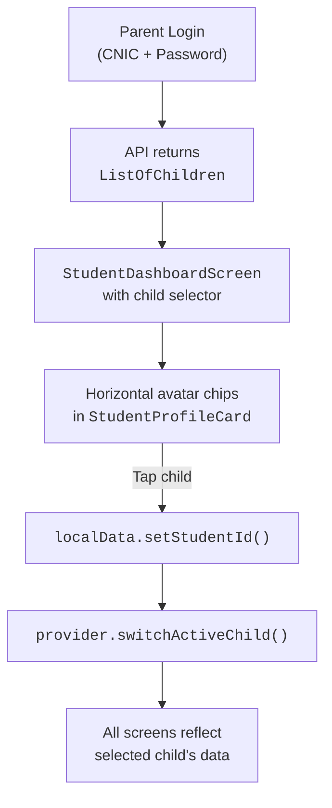

# Cityzens — School Management System

[](https://flutter.dev/)
[](https://dart.dev/)
[](https://github.com/tcsho/CityzensApp)
[](https://firebase.google.com/)

> A comprehensive, tri-role school management application for **The City School** network, built with Flutter. Teachers manage academic activities; students and parents monitor progress in real time — all integrated with the AIMS+ ERP system.

---

## Table of Contents

- [Architecture Overview](#architecture-overview)
- [User Roles & Authentication](#user-roles--authentication)
- [Teacher Portal](#-teacher-portal)
- [Student Portal](#-student-portal)
- [Parent Portal](#-parent-portal)
- [Technical Stack](#-technical-stack)
- [Project Structure](#-project-structure)
- [Getting Started](#-getting-started)
- [Build & Release](#-build--release)
- [Design System](#-design-system)
- [Security](#-security)
- [API Architecture](#-api-architecture)
- [Feature Status Matrix](#-feature-status-matrix)
- [Support & Contact](#-support--contact)

---

## Architecture Overview

Cityzens follows a **Provider-based MVVM** architecture with clear separation of concerns:

```
┌──────────────────────────────────────────────────┐
│                    Screens                        │  UI Layer (StatefulWidgets)
├──────────────────────────────────────────────────┤
│                   Components                      │  Reusable UI Compositions
├──────────────────────────────────────────────────┤
│                Custom Widgets                     │  Design System Primitives
├──────────────────────────────────────────────────┤
│            Providers (ChangeNotifier)              │  State Management
├──────────────────────────────────────────────────┤
│                   Services                        │  API Call Layer
├──────────────────────────────────────────────────┤
│                    Models                         │  Data Models (JSON ↔ Dart)
├──────────────────────────────────────────────────┤
│              Network (ApiBaseHelper)               │  HTTP Client + Error Handling
├──────────────────────────────────────────────────┤
│              SharedPreferences                    │  Local Session Persistence
└──────────────────────────────────────────────────┘
```

### Core Principles

| Principle | Implementation |
|---|---|
| **Teachers are Creators** | Teachers are the primary actors who create content (homework, attendance, circulars, results). |
| **Students & Parents are Consumers** | They receive a read-only, real-time view of all academic data. |
| **ERP Integration** | AIMS+ provides the source of truth for profiles, term results, fees, and library records. |
| **Role-Based Access** | The `AuthWrapper` routes users to role-specific dashboards based on `userType` stored in `LoginResponse`. |
| **Session Caching** | `LocalDataProvider` + `SharedPreferences` persist login sessions and user data across app restarts. |

---

## User Roles & Authentication

### Authentication Flow



### Login Credentials by Role

| Role | Username Field | Mask | Example |
|---|---|---|---|
| **Student** | Roll Number | `00000000` | `230935` |
| **Teacher** | Employee Number | `00000000` | `10045678` |
| **Parent** | Father CNIC | `00000-0000000-0` | `42101-1234567-1` |

### Password Management

- **Forgot Password** → Enter email/username → OTP verification → Set new password
- **Change Password** → Available from the navigation drawer after login
- **First-Time Login** → Some users receive a temporary password, forced to change on first use

---

## 👨‍🏫 Teacher Portal

Teachers are the **primary actors**. They create all academic content and manage classroom activities.

### Teacher Dashboard

The Teacher Dashboard (`TeacherDashboardScreen`) is a premium, Sliver-based interface with:

- **Teacher Profile Card** — Compact glassmorphic strip showing name, designation, and campus.
- **Smart Class & Section Card** — A unified hub for selecting the active class/section. Auto-selects the first available section and subject. State is shared globally across the app.
- **Navigation Guards** — Validates prerequisites (section/subject selection) before navigating to dependent screens.
- **Pull-to-Refresh** — Refreshes all dashboard data in a single gesture.

### Feature Breakdown

#### Mark Attendance
- Select from assigned class/section
- For **A-Level classes** (Grade IDs `19`, `20`): additionally select a subject
- Student list displayed with current date
- Mark each student: **Present (P)**, **Absent (A)**, **Leave (L)**, or **Unreconciled**
- View live pie chart statistics before submitting
- Submit → Confirmation → Data syncs to student/parent portals

#### Mark Unidentified Students
- For students physically present but not yet in the system roster
- Mark attendance with category/reason
- System admin can later map these records

#### Unified Academic Hub (`TeacherAcademicHubScreen`)
A single tabbed screen that consolidates:

| Tab | Create Screen | Purpose |
|---|---|---|
| **Homework** | `AddDiaryScreen` | Assign homework with optional file attachment. Auto-archives after 7 days. |
| **Classwork** | `AddAssignmentScreen` | Assign classwork/assignments with attachments. |
| **Circulars** | `AddCircularScreen` | Send announcements/notices to specific class/sections. |

- Each tab has a context-aware floating action button.
- Teachers can only see content they have created.
- All three support **Edit** mode via passing the existing record as route arguments.

#### Class Test Results
- Upload up to **3 test results** per session per class/section (Test 1, Test 2, Test 3)
- Enter student marks with input validation
- Results immediately available on the student/parent portal

#### Eye on Your Child (Early Years — Grades 1–4)
- Share student activities with photos (up to 3 images per update) and descriptive notes
- Select specific student(s) to share with
- Parents receive notifications and can view in real time

#### Timetable Management
- Select class/section
- Create/edit timetable in a **9 periods × 5 days** grid format
- Enter subject abbreviations for each cell
- Students view this as read-only

#### Other Teacher Features
- **Teacher Profile** — Read-only view of ERP-synced employee data
- **Parent Appointments** — Manage appointment requests from parents
- **Surveys** — Create and manage student surveys
- **School Events** — Create and publish school events

---

## 🎓 Student Portal

Students are **content consumers**. They view data created by teachers and fetched from the AIMS+ ERP system.

### Student Dashboard

The Student Dashboard (`StudentDashboardScreen`) features a premium profile card with:

- **Student Info** — Name, class, campus, with a tappable area linking to the full profile
- **Session Attendance** — Circular progress indicator showing the overall attendance percentage
- **Monthly Attendance** — Quick-tap to open the detailed calendar view
- **Action Grid** — Dashboard buttons for all features: Diary, Assignment, Results, Fee, Library, Timetable, etc.
- **Multi-Child Selector** (Parent view) — Horizontal avatar list for parents with multiple children

### Feature Breakdown

#### Attendance Tracking
- **Standard Students**: Direct calendar view with monthly navigation
- **A-Level Students** (Grade IDs `19`, `20`): Single-screen flow with:
  - Automatic subject fetch on screen entry (session-cached)
  - Auto-selection of the first subject
  - Horizontal scrollable subject chips for switching
  - Calendar + pie chart + legend for the selected subject
- **Calendar Indicators**: Present (🟢), Absent (🔴), Leave (🟡)
- **Monthly Summary**: Pie chart with legend chips showing counts
- **Month Navigation**: Reload attendance with a loading dialog on month change

#### Homework Diary
- View homework assigned by teachers
- Date-wise grouping under single date headers
- Shows teacher name, subject, description, and attachments
- Auto-hides after 7 days

#### Classwork / Assignments
- Same UI pattern as homework
- Date-wise organization with attachment support

#### Term Results (from AIMS+ ERP)
- Select Academic Session → Select Term
- View: Subject-wise marks/grades, teacher comments, overall grade, performance indicators, highest/lowest marks

#### Class Test Results
- View results uploaded by teachers (Test 1, 2, 3)
- Subject-wise marks and teacher feedback

#### Fee Bill & Payment
- **Two-Tab View**:
  - **Outstanding Challans**: Fetched from ERP, tap to redirect to payment gateway
  - **Receipts**: Last 5 payment receipts
- Secure WebView payment via `billing.thecityschool.edu.pk`

#### Library Records (from AIMS+ ERP)
- View issued books, due dates, fine status
- Tabs: Issued Books / Notifications (overdue alerts)

#### Timetable (Read-Only)
- View the class timetable created by the teacher
- 9×5 grid format (9 periods, Mon–Fri)

#### Student Profile
- Read-only ERP data: Name, Roll Number, Student ID, Class/Section, Campus, Contact, DOB
- Students cannot edit their own contact information
- Parents can edit selected contact fields

#### Other Student Features
- **School Events** — View published school events
- **Surveys** — Complete assigned surveys
- **Notifications / Circulars** — View school announcements
- **Individual Education Plan** — Specialized learning plans (if applicable)

---

## 👪 Parent Portal

Parents monitor their children's academic progress. They share the **Student Dashboard** with an additional child-selection layer.

### Multi-Child Support



### Parent-Specific Features

| Feature | Description | Status |
|---|---|---|
| **Child Selector** | Horizontal avatar list on the dashboard card | ✅ Active |
| **All Student Features** | Attendance, Homework, Results, Fee, etc. | ✅ Active |
| **Eye on Your Child** | Receive teacher updates for early years | ✅ Active |
| **Profile Editing** | Parents can edit student contact fields | ✅ Active |
| **Complaint & Query** | Submit categorized complaints with tracking | ✅ Active |
| **Appointment Booking** | Book parent-teacher meetings | 🚧 In Progress |
| **Withdrawal Request** | Submit student withdrawal | 🚧 In Progress |
| **Surveys** | Complete assigned parent surveys | ✅ Active |

---

## 🛠 Technical Stack

### Core Framework

| Technology | Version | Purpose |
|---|---|---|
| Flutter | `3.8.1` | Cross-platform UI framework |
| Dart | `^3.8.1` | Programming language |
| Provider | `^6.1.5` | State management (ChangeNotifier pattern) |

### Firebase Services

| Service | Package | Purpose |
|---|---|---|
| Core | `firebase_core: ^4.7.0` | Firebase initialization |
| Cloud Messaging | `firebase_messaging: ^16.2.0` | Push notifications |
| Crashlytics | `firebase_crashlytics: ^5.2.0` | Error tracking |
| Remote Config | `firebase_remote_config: ^6.4.0` | Feature flags, API URL management |
| Analytics | `firebase_analytics: ^12.3.0` | Usage tracking |
| Firestore | `cloud_firestore: ^6.3.0` | Real-time database |

### Key Dependencies

| Package | Purpose |
|---|---|
| `http` | HTTP client for REST API calls |
| `shared_preferences` | Local session persistence |
| `table_calendar` | Attendance calendar widget |
| `fl_chart` | Pie charts for attendance statistics |
| `percent_indicator` | Circular progress indicators |
| `animate_do` | Micro-animations and transitions |
| `cached_network_image` | Efficient image loading with caching |
| `image_picker` + `image_cropper` | Profile photo management |
| `webview_flutter` | In-app payment gateway |
| `upgrader` | Force-update mechanism |
| `lottie` | Premium loading animations |
| `connectivity_plus` | Network state monitoring |
| `flutter_local_notifications` | Local notification display |
| `freezed` + `json_serializable` | Code generation for models |

### Fonts

- **Axiforma** — Primary UI font (Regular 500, Light 400, Bold 700)
- **Nunito** — Secondary/alternative font

---

## 🏗 Project Structure

```
lib/
├── main.dart                          # App entry point, Firebase init
├── firebase_options.dart              # Firebase project configuration
│
├── components/                        # Feature-specific UI compositions
│   ├── StudentAttendanceComponents/   #   Calendar, pie chart, subject chips
│   ├── MarkAttendanceComponents/      #   Student list, attendance marking
│   ├── FeeChallanComponents/          #   Challan cards, receipt views
│   ├── ResultsComponents/            #   Term result display
│   ├── DiaryRecordComponents/        #   Homework/diary cards
│   ├── AssignmentComponents/         #   Assignment/classwork cards
│   ├── ClassTestResultComponents/    #   Test result entry/display
│   ├── EyeOnYourChildComponents/    #   Activity feed, photo gallery
│   ├── TimeTableComponents/         #   Timetable grid
│   └── ...26 component directories
│
├── custom_widgets/                    # Design system primitives
│   ├── CustomAppBar/                  #   Unified app bar
│   ├── CustomAppButton/               #   Primary action button
│   ├── CustomTextFormField/           #   Themed text inputs
│   ├── CustomCard/                    #   Card container
│   ├── GlassmorphicCard/             #   Premium glassmorphic card
│   ├── ShimmerEffect/                 #   Loading skeletons
│   ├── CustomBottomSheets/            #   Filter/selection sheets
│   ├── CustomDialogBoxes/             #   Loading dialogs
│   ├── CustomSnackbar/                #   Themed notifications
│   ├── UserTypeTabSelector/           #   Login role selector
│   ├── TeacherProfileCard/            #   Dashboard profile strip
│   └── ...38 widget directories
│
├── model/                             # Data models (JSON ↔ Dart)
│   ├── Login/login_response.dart      #   LoginResponse, UserInfo
│   ├── StudentAttendance/             #   MonthlyAttendance, Event
│   ├── FeeChallan/                    #   Challan, Receipt models
│   └── ...46 model directories
│
├── network/                           # HTTP abstraction layer
│   ├── api_base_helper.dart           #   GET, POST, PUT, PATCH, DELETE
│   └── app_exceptions.dart            #   Custom exception types
│
├── provider/                          # State management (ChangeNotifier)
│   ├── app_providers.dart             #   MultiProvider registration (30 providers)
│   ├── LocalData/                     #   Session data, login persistence
│   ├── Login/                         #   Authentication logic
│   ├── StudentDashboard/              #   Dashboard state, multi-child support
│   ├── StudentAttendance/             #   Standard + A-Level attendance
│   ├── MarkAttendance/                #   Teacher attendance marking
│   └── ...31 provider directories
│
├── routes/                            # Navigation
│   ├── app_navigation.dart            #   Navigator helper (push, replace, goBack)
│   ├── app_navigation_routes.dart     #   60+ route constants
│   └── route_generator.dart           #   Switch-case route generation with FadeTransition
│
├── screens/                           # Feature screens
│   ├── AuthWrapper/                   #   Post-login routing by role
│   ├── LoginScreen/                   #   Tri-role login UI
│   ├── SplashScreen/                  #   App launch splash
│   ├── Student/                       #   14 student screen directories
│   ├── Teacher/                       #   21 teacher screen directories
│   ├── Parent/                        #   6 parent screen directories
│   ├── NavigationalDrawer/            #   About Us, Feedback, Change Password
│   ├── ForgotPassword/                #   Password recovery flow
│   └── Registration/                  #   New user registration
│
├── services/                          # API service classes (static methods)
│   ├── InitServices/                  #   AppInitializer, FirebaseMaster, PushNotifications
│   ├── Login/                         #   LoginService
│   ├── Logout/                        #   LogoutService
│   └── ...54 service directories
│
├── shared_preference/                 # Local storage wrapper
│   └── shared_preference.dart         #   AppLocalData (get/set/remove)
│
├── push_notifications/                # FCM handling
├── repositories/                      # Repository layer (if used)
├── gen/                               # Generated assets (flutter_gen)
│
└── utils/                             # Constants and helpers
    ├── app_colors.dart                #   Complete premium color palette
    ├── app_constants.dart             #   API URLs, error messages, keys
    ├── app_themes.dart                #   ThemeData (light theme)
    ├── helper_function.dart           #   Date formatting, validators, utilities
    ├── media_query_util.dart          #   Responsive sizing
    ├── validators.dart                #   Form validation functions
    └── input_formatters.dart          #   Text input formatters
```

---

## 🚀 Getting Started

### Prerequisites

- Flutter SDK `^3.8.1`
- Xcode (for iOS)
- Android Studio / SDK (for Android)
- CocoaPods (for iOS dependencies)

### Installation

```bash
# 1. Clone the repository
git clone https://github.com/tcsho/CityzensApp.git
cd CityzensApp

# 2. Install dependencies
make get
# or: flutter pub get

# 3. Generate code (models, assets)
make generate
# or: dart run build_runner build --delete-conflicting-outputs

# 4. iOS pod install (first time / after dependency changes)
make pod-install
# or: cd ios/ && pod install

# 5. Run the app
flutter run
```

### Environment Configuration

The app currently uses the **Test API** by default:

```dart
// lib/utils/app_constants.dart
static String baseUrl = apiTestBaseURL;  // ← Active
static const String apiTestBaseURL = "https://testcityzenapi.csn.edu.pk";
static const String apiLiveBaseURL = "https://cityzenapi.csn.edu.pk";
```

To switch to production, change `baseUrl` to `apiLiveBaseURL`, or use the `CITYZENS_ENV` flag:

```bash
# Build test APK with environment flag
make test-apk
# Equivalent: flutter build apk --release --dart-define=CITYZENS_ENV=true
```

### Firebase Setup

Firebase config files are expected at:
- **Android**: `android/app/google-services.json`
- **iOS**: `ios/Runner/GoogleService-Info.plist`
- **Dart options**: `lib/firebase_options.dart` (auto-generated)

Firebase Project ID: `thecityschoolapp`

---

## 🔨 Build & Release

### Available `make` Commands

| Command | Description |
|---|---|
| `make get` | `flutter pub get` |
| `make clean` | Clean build + re-fetch dependencies |
| `make generate` | Run `build_runner` for code generation |
| `make watch` | Watch mode for code generation |
| `make gen` | Generate asset references via `flutter_gen` |
| `make apk` | Build release APK |
| `make test-apk` | Build release APK with test environment flag |
| `make appbundle` | Build release App Bundle (for Play Store) |
| `make pod-install` | Install iOS CocoaPods |
| `make reset-pod` | Delete Podfile.lock + reinstall |
| `make reset-pod-cache` | Nuclear pod reset (clear cache + repo update) |
| `make fast-pod` | Quick pod install (skip repo update) |
| `make fix` | Auto-fix lints + format + sort imports |
| `make git-config` | Display current git user config |

### Release Builds

```bash
# Android APK
flutter build apk --release

# Android App Bundle (Play Store)
flutter build appbundle --release

# iOS (via Xcode)
flutter build ios --release
# Then open ios/Runner.xcworkspace in Xcode and archive
```

---

## 🎨 Design System

The app uses a premium, custom design system defined in `lib/utils/app_colors.dart`:

### Brand Colors

| Token | Hex | Usage |
|---|---|---|
| `primaryBlue` | `#485CC7` | Primary brand, headers, active states |
| `primaryDarkBlue` | `#303F9F` | Dark variant, gradients |
| `goldenYellow` | `#F3CD50` | Secondary accent, badges, highlights |
| `primaryDark` | `#1E2A6B` | Deep backgrounds |

### Status Colors

| Token | Hex | Usage |
|---|---|---|
| `success` / `successGreen` | `#10B981` / `#07CDA5` | Present, positive states |
| `error` / `errorRed` | `#EF4444` / `#FF2B5F` | Absent, errors |
| `warning` | `#F59E0B` | Leave, warnings |

### Design Patterns

- **Glassmorphism** — Used for dashboard profile cards and premium sections (`GlassmorphicCard`)
- **Shimmer Loading** — Custom `DashboardShimmer` and `AttendanceShimmer` for skeleton screens
- **Micro-Animations** — `animate_do` (FadeIn, FadeInDown, FadeInUp) throughout the app
- **Gradient Cards** — `LinearGradient(primaryBlue → primaryDarkBlue)` for hero elements
- **Pill Chips** — Rounded subject/status selectors with animated state changes

---

## 🔒 Security

### Authentication

| Layer | Implementation |
|---|---|
| **Login** | Username + Password → `LoginService` → Token returned |
| **Session** | `TokenId` stored in `SharedPreferences` as JSON |
| **Auto-Logout** | Invalid Access Key in API response triggers global logout |
| **RBAC** | `AuthWrapper` routes users by `userType` field |
| **Upgrade Guard** | `upgrader` package forces minimum app version |

### Network Security

- All API calls over **HTTPS/TLS**
- Authorization headers: `Bearer <tokenId>` (though currently some endpoints send `null` — known issue)
- Custom exception handling for: `SocketException`, `FormatException`, `TimeoutException`
- HTTP status code mapping to typed exceptions (400 → `BadRequestException`, 401 → `InvalidInputException`, etc.)

### Local Data Security

- Login response (including `tokenId`) stored in `SharedPreferences`
- Teacher profile data cached locally with key `teacherProfileData`
- User images stored as local file paths

---

## 🌐 API Architecture

### Base Configuration

```
Base URL (Test):  https://testcityzenapi.csn.edu.pk/api/
Base URL (Live):  https://cityzenapi.csn.edu.pk/api/
```

### Request Pattern

All API calls flow through `ApiBaseHelper`:

```
Screen → Provider → Service (static method) → ApiBaseHelper → HTTP → Parse Response → Update Provider → Notify UI
```

### Common Headers

```json
{
  "Content-Type": "application/json; charset=UTF-8",
  "Accept": "application/json",
  "Authorization": "Bearer <tokenId>"
}
```

### Key Endpoints (from observed logs)

| Endpoint | Method | Purpose |
|---|---|---|
| `GetSubjectsByStudentId` | POST | Fetch A-Level subject list for a student |
| `GetMonthlyAttendance` | POST | Fetch monthly attendance for a subject |
| Login endpoint | POST | Authenticate user and return token |
| Various CRUD endpoints | POST | Homework, assignments, circulars, results |

### Error Response Handling

```
200 → Return JSON
400 → BadRequestException
401 → InvalidInputException
403 → UnAuthorizedException
404 → FetchDataException
500 → FetchDataException
```

---

## 📊 Feature Status Matrix

### Teacher Features

| Feature | Status | Key Files |
|---|---|---|
| Dashboard | ✅ Complete | `teacher_dashboard_screen.dart` |
| Mark Attendance | ✅ Complete | `mark_attendance_provider.dart` |
| Mark Unidentified | ✅ Complete | `mark_unverified_provider.dart` |
| Homework (Diary) | ✅ Complete | `diary_provider.dart` |
| Classwork (Assignment) | ✅ Complete | `assignment_provider.dart` |
| Circulars | ✅ Complete | `circular_provider.dart` |
| Class Test Results | ✅ Complete | `class_test_result_provider.dart` |
| Eye on Your Child | ✅ Complete | `eye_on_your_child_provider.dart` |
| Timetable | ✅ Complete | `timetable_provider.dart` |
| Profile | ✅ Complete | `teacher_profile_provider.dart` |
| Academic Hub | ✅ Complete | `teacher_academic_hub_screen.dart` |
| Surveys | ✅ Complete | `survey_provider.dart` |

### Student Features

| Feature | Status | Key Files |
|---|---|---|
| Dashboard | ✅ Complete | `student_dashboard_screen.dart` |
| Profile | ✅ Complete | `student_profile_provider.dart` |
| Attendance (Standard) | ✅ Complete | `student_attendance_provider.dart` |
| Attendance (A-Level) | ✅ Complete | `student_alevel_attendance_provider.dart` |
| Homework Diary | ✅ Complete | `diary_provider.dart` |
| Assignments | ✅ Complete | `assignment_provider.dart` |
| Term Results | ✅ Complete | `results_provider.dart` |
| Class Test Results | ✅ Complete | `class_test_result_provider.dart` |
| Fee & Payment | ✅ Complete | `feechallan_provider.dart` |
| Library | ✅ Complete | `library_provider.dart` |
| Timetable (Read-Only) | ✅ Complete | `timetable_provider.dart` |
| School Events | ✅ Complete | `school_event_provider.dart` |
| Surveys | ✅ Complete | `survey_provider.dart` |
| Circular Viewing | 🚧 Partial | `notification_provider.dart` |

### Parent Features

| Feature | Status | Key Files |
|---|---|---|
| Multi-Child Selection | ✅ Complete | `student_dashboard_provider.dart` |
| All Student Features | ✅ Complete | Shared with student portal |
| Eye on Your Child | ✅ Complete | `eye_on_your_child_provider.dart` |
| Profile Editing | ✅ Complete | `student_profile_provider.dart` |
| Complaint & Query | ✅ Complete | `complaint_query_provider.dart` |
| Appointment Booking | 🚧 In Progress | `appointment_provider.dart` |
| Withdrawal Request | 🚧 In Progress | `withdrawal_request_provider.dart` |

---

## 📞 Support & Contact

| Channel | Details |
|---|---|
| **Email** | appsupport@csn.edu.pk |
| **GitHub Issues** | [Report Issues](https://github.com/tcsho/CityzensApp/issues) |
| **App Store** | [iOS](https://apps.apple.com/us/app/cityzens/id1630070364) |
| **Play Store** | [Android](https://play.google.com/store/apps/details?id=com.tcs.tcsapp) |

---

**Last Updated**: 2026-05-19 | **Version**: 1.13.3+88 | **Status**: Active Development
