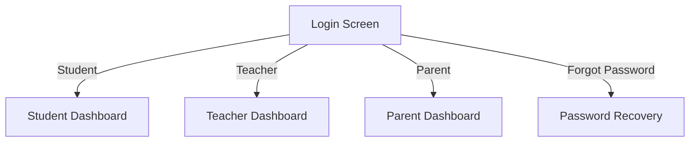

# Cityzens - School Management System

[](https://flutter.dev/)
[](https://dart.dev/)
[](https://github.com/tcsho/CityzensApp)
[](https://opensource.org/licenses/MIT)

A comprehensive school management application built with Flutter, connecting students, teachers, and parents in an educational ecosystem.

## 📱 Features

### 🔐 Authentication
- **Multi-role Login**: Separate flows for Students, Teachers, and Parents
- **Secure Authentication**: Firebase Authentication integration
- **Password Recovery**: Forgot password functionality
- **Session Management**: Secure token-based authentication

### 🎓 Student Portal
- **Dashboard**: Attendance overview and key metrics
- **Profile**: Personal information management
- **Timetable**: Class schedule and calendar view
- **Attendance**: View history and percentage
- **Grades**: Academic performance tracking
- **About Us**: School information
- **App Feedback**: Submit feedback directly from the app

### 👩‍🏫 Teacher Portal
- **Dashboard**: Quick access to classes and attendance
- **Attendance Management**:
  - Mark student attendance
  - Handle unidentified students
  - View attendance reports
- **Class Management**:
  - View assigned classes
  - Access timetable
- **Profile**: Professional information management
- **About Us & Feedback**: School information and feedback submission

### 👪 Parent Portal
- **Child Monitoring**:
  - Track attendance
  - View academic progress
  - Access timetable
- **Multiple Children**: Support for parents with multiple children
- **Notifications**: Important updates and announcements
- **Change Password**: Account security management

## 🛠 Technical Stack

### Frontend
- **Framework**: Flutter 3.8.1
- **State Management**: Provider Pattern
- **UI Components**:
  - Material Design 3
  - Custom Widget Library
  - Responsive Layouts
- **Local Storage**: Shared Preferences
- **Networking**: HTTP Client
- **Push Notifications**: Firebase Cloud Messaging

### Backend Integration
- **Authentication**: Firebase Auth
- **API**: RESTful Services
- **Real-time Updates**: Firebase Cloud Messaging
- **Error Tracking**: Firebase Crashlytics
- **Remote Configuration**: Firebase Remote Config

## 🚀 Getting Started

### Prerequisites
- Flutter SDK 3.8.1+
- Dart SDK 2.19.0+
- Android Studio / Xcode
- Firebase project

### Installation
1. **Clone the repository**
   ```bash
   git clone https://github.com/tcsho/CityzensApp.git
   cd CityzensApp
   ```

2. **Install dependencies**
   ```bash
   flutter pub get
   ```

3. **Configure Firebase**
   - Add `google-services.json` to `android/app/`
   - Add `GoogleService-Info.plist` to `ios/Runner/`

4. **Run the app**
   ```bash
   flutter run
   ```

## 🏗 Project Structure

```
lib/
├── Components/        # Reusable UI components
├── CustomWidgets/     # Custom widgets
├── Model/            # Data models
├── Network/          # API services
├── Provider/         # State management
├── Routes/           # Navigation
├── Screens/          # Feature screens
│   ├── Student/      # Student features
│   ├── Teacher/      # Teacher features
│   └── Parent/       # Parent features
└── Utils/            # Helper functions
```

## 📱 Screens

### Authentication Flow


### Key Features Implementation
- **Attendance System**: Real-time attendance marking with support for unidentified students
- **Profile Management**: Role-based profile views and updates
- **Navigation**: Custom drawer for easy access to all features
- **Feedback System**: Built-in app feedback collection

## 🤝 Contributing
1. Fork the repository
2. Create your feature branch (`git checkout -b feature/AmazingFeature`)
3. Commit your changes (`git commit -m 'Add some AmazingFeature'`)
4. Push to the branch (`git push origin feature/AmazingFeature`)
5. Open a Pull Request

## 📄 License
This project is licensed under the MIT License - see the [LICENSE](LICENSE) file for details.

---
<div align="center">
  Made with ❤️ by Cityzens Team
</div>
