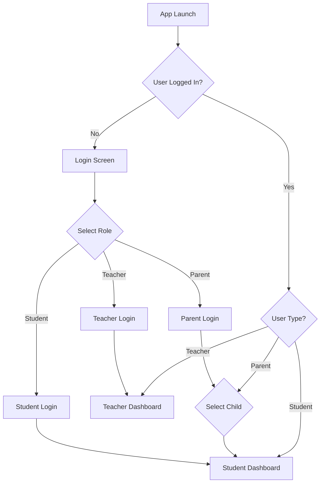
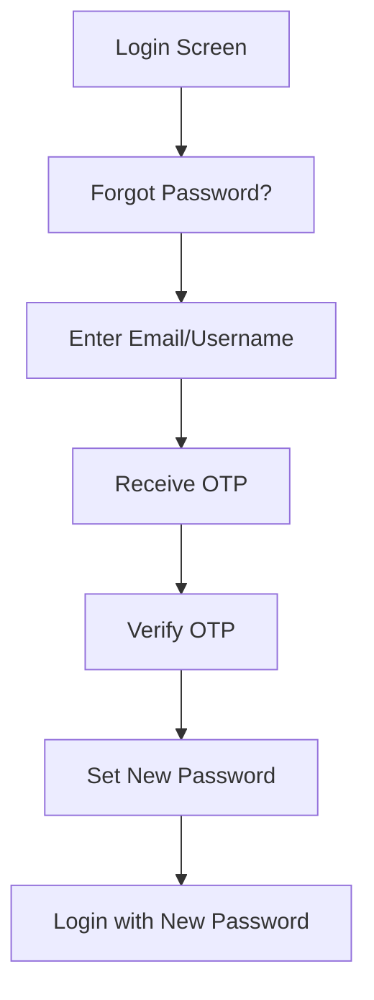
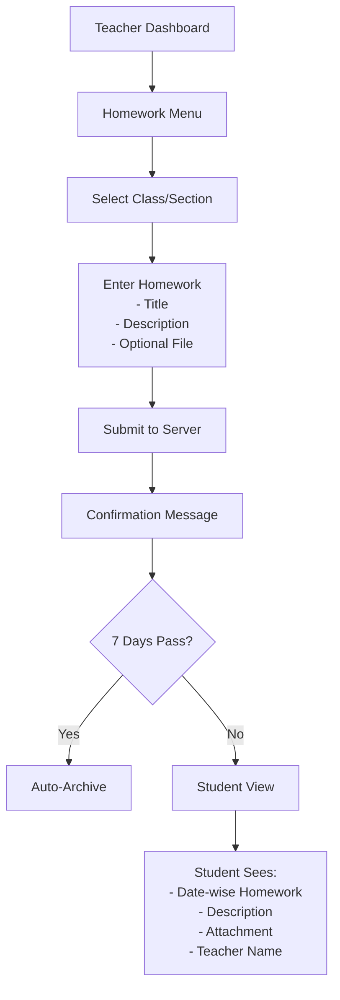
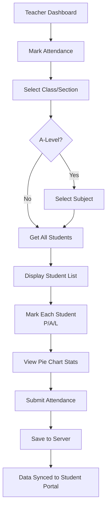
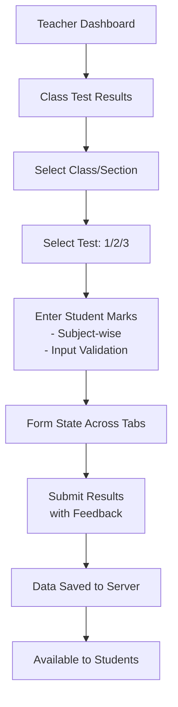

# Cityzens - School Management System

[](https://flutter.dev/)
[](https://dart.dev/)
[](https://github.com/tcsho/CityzensApp)
[](https://opensource.org/licenses/MIT)

A comprehensive school management application built with Flutter, enabling teachers to manage academic activities, while students and parents monitor their academic progress and attendance in a unified ecosystem.

## 📋 Table of Contents

- [Overview](#overview)
- [User Roles & Portal Flows](#user-roles--portal-flows)
- [Features by Role](#features-by-role)
- [🛠 Technical Stack](#-technical-stack)
- [🚀 Getting Started](#-getting-started)
- [🏗 Project Structure](#-project-structure)
- [🔒 Security Features](#-security-features)
- [📱 Feature Details](#-feature-details)
- [🤝 Contributing](#-contributing)
- [📄 License](#-license)

## Overview

Cityzens is a tri-role school management system designed to streamline communication and data management between **Teachers** (primary actors), **Students**, and **Parents**. The application integrates with the school's ERP system (AIMS+) to provide real-time access to academic records, attendance, assignments, and financial information.

### Core Philosophy
- **Teachers** are the primary content creators and managers
- **Students** and **Parents** are content consumers with real-time visibility
- **Seamless data synchronization** between app and ERP systems
- **Role-based access control** ensuring data privacy and security

---

## 🔄 User Roles & Portal Flows

### Authentication Flow



### Password Management Flow



---

## 📱 Features by Role

### 👨‍🏫 Teacher Portal (Primary Actor)

Teachers have full control over academic content creation and student management. They are the main initiators of all academic activities.

#### 1. **Profile Management**
- **File**: [teacher_profile_provider.dart](lib/Provider/TeacherProfile/teacher_profile_provider.dart)
- **Screen**: [teacher_profile_screen.dart](lib/Screens/Teacher/TeacherProfileScreen/teacher_profile_screen.dart)
- View employee information from ERP database
- Display: Name, Designation, Department, Address, Contact Details
- Read-only access to ERP-synced data

#### 2. **Timetable Management**
- **File**: [timetable_provider.dart](lib/Provider/TimeTable/timetable_provider.dart)
- **Component**: [teacher_timetable_component.dart](lib/Components/TimeTableComponents/teacher_timetable_component.dart)
- Create and manage class timetables
- **Current Implementation**: 9 periods × 5 days (Monday-Friday) format
- **Planned**: Support for alternate timetable formats
- Features:
  - Select class/section to create timetable
  - Enter subject abbreviations for each period
  - Auto-save functionality
  - Edit existing timetables
  - View-only mode for students

#### 3. **Mark Attendance**
- **File**: [mark_attendance_provider.dart](lib/Provider/MarkAttendance/mark_attendance_provider.dart)
- **Flow**: 
  - Select from class/section assigned to teacher
  - Select subject (A-Level students only)
  - Get student list with current date
  - Mark attendance: Present (P), Absent (A), Leave (L)
  - View attendance pie chart before submission
  - Submit and receive confirmation
- **Features**:
  - Only class teachers can mark attendance
  - Default to 'Present' if not marked
  - Visual attendance statistics
  - Ability to edit before submission

#### 4. **Mark Unidentified Students**
- **File**: [mark_unverified_provider.dart](lib/Provider/MarkUnverified/mark_unverified_provider.dart)
- Identify students present physically but not in the system
- Mark unidentified student attendance with reason/category
- Helps maintain accurate attendance records
- Admin/System can later map identified students

#### 5. **Homework Management**
- **File**: [diary_provider.dart](lib/Provider/Diary/diary_provider.dart)
- **Screens**: 
  - [add_diary_screen.dart](lib/Screens/Teacher/AddDiaryScreen/add_diary_screen.dart)
  - [teacher_diary_screen.dart](lib/Screens/Teacher/TeacherDiaryScreen/teacher_diary_screen.dart)
- **Features**:
  - Select class/section to assign homework
  - Add homework title and description
  - Optional file attachment (PDF, DOC, etc.)
  - Assign to multiple classes if taught in multiple sections
  - **Viewing**: Only see homework created by current teacher
  - **Duration**: Homework visible for 7 days, then archived
  - **Requested Features**:
    - Display section/class info with each homework
    - Edit functionality for existing homework
    - Delete functionality
    - Extend visibility period options

#### 6. **Classwork/Assignment Management**
- **File**: [assignment_provider.dart](lib/Provider/Assignment/assignment_provider.dart)
- **Screens**: 
  - [add_assignment_screen.dart](lib/Screens/Teacher/AddAssignmentScreen/add_assignment_screen.dart)
  - [teacher_assignment_screen.dart](lib/Screens/Teacher/TeacherAssignmentScreen/teacher_assignment_screen.dart)
- **Flow**: Identical to Homework management
- **Features**:
  - Create classwork assignments
  - Attach supporting documents
  - Target specific class/section
  - Track student submissions
  - **Planned**:
    - Section display with classwork
    - Edit/Delete options
    - Submission deadline tracking
    - Student submission view

#### 7. **Circulars**
- **File**: [circular_provider.dart](lib/Provider/Circular/circular_provider.dart)
- **Screen**: [add_circular_screen.dart](lib/Screens/Teacher/AddCircularScreen/add_circular_screen.dart)
- Send announcements and notices to specific class/sections
- **Features**:
  - Type: Notice, Announcement, Alert, etc.
  - Select recipient class/section(s)
  - Add detailed description
  - Optional attachment
  - **Current Status**: 
    - Teachers can create and view their own circulars
    - Student/Parent view NOT YET implemented
  - **Requested**: 
    - Show section/class info with circular
    - Edit/Delete options
    - Circular visibility on student portal

#### 8. **Class Test Results**
- **File**: [class_test_result_provider.dart](lib/Provider/ClassTestResult/class_test_result_provider.dart)
- **Screens**: 
  - [teacher_class_test_result_screen.dart](lib/Screens/Teacher/TeacherClassTestResultScreen/teacher_class_test_result_screen.dart)
  - [teacher_add_class_result_screen.dart](lib/Screens/Teacher/TeacherClassTestResultScreen/teacher_add_class_result_screen.dart)
- **Features**:
  - Upload up to 3 test results per session per class/section
  - Tests: Test 1, Test 2, Test 3
  - Enter student marks for each subject
  - Input constraints and validation
  - Save and submit results
  - Form state management across tabs
  - **Planned**:
    - Edit existing test results
    - Delete functionality
    - Feedback to students

#### 9. **Eye on Your Child**
- **File**: [eye_on_your_child_provider.dart](lib/Provider/EyeOnYourChild/eye_on_your_child_provider.dart)
- **Screen**: Early Years Education feature only (Grades 1-4)
- **Features**:
  - Share student activities and progress with parents
  - Upload up to 3 images per activity update
  - Add descriptive text/notes
  - Select student(s) to share with
  - Parents receive notifications
  - **Purpose**: Enhance parent engagement in early childhood education
  - Photos and notes visible to parents in real-time

#### 10. **Teacher Dashboard**
- **File**: [teacher_dashboard_screen.dart](lib/Screens/Teacher/TeacherDashboardScreen/teacher_dashboard_screen.dart)
- Quick access to all teaching features via dashboard buttons
- Display: Name, Campus, Current Date
- Navigation to Profile, Timetable, Attendance, Diary, Assignments, etc.
- Real-time sync with ERP data

---

### 🎓 Student Portal (Content Consumer)

Students view content created by teachers and access ERP data through the app.

#### 1. **Student Profile**
- **File**: [student_profile_provider.dart](lib/Provider/StudentProfile/student_profile_provider.dart)
- **Screen**: [student_profile_screen.dart](lib/Screens/Student/StudentProfileScreen/student_profile_screen.dart)
- Display student information from ERP:
  - Full Name, Roll Number, Student ID
  - Class/Section, Campus
  - Address, Contact Number
  - City, Region
  - Date of Birth
- Read-only data from ERP system

#### 2. **Attendance Tracking**
- **File**: [student_attendance_provider.dart](lib/Provider/StudentAttendance/student_attendance_provider.dart)
- **Screen**: [student_attendance_screen.dart](lib/Screens/Student/StudentAttendanceScreen/student_attendance_screen.dart)
- **Features**:
  - View attendance marked by teachers
  - **Monthly Calendar View**: Click on date to see attendance status
  - **Attendance Indicators**:
    - Present (P) - Green
    - Absent (A) - Red
    - Leave (L) - Amber
  - **Pie Chart Statistics**:
    - Total Present, Absent, Leave count
    - Calculate attendance percentage
  - **A-Level Students**: Subject-wise attendance view
    - Select subject from dropdown
    - View attendance for specific subject
  - **Export/Print**: Plan to add export functionality

#### 3. **Homework Diary**
- **File**: [diary_provider.dart](lib/Provider/Diary/diary_provider.dart)
- **Screen**: [student_diary_screen.dart](lib/Screens/Student/StudentDiaryScreen/student_diary_screen.dart)
- View homework assigned by teachers
- **Features**:
  - Date-wise grouping of homework
  - All homework for same date under single date header
  - Display teacher name, subject
  - View homework description
  - Download attachments if any
  - Homework auto-hides after 7 days

#### 4. **Classwork Assignments**
- **File**: [assignment_provider.dart](lib/Provider/Assignment/assignment_provider.dart)
- **Screen**: [student_assignment_screen.dart](lib/Screens/Student/StudentAssignmentScreen/student_assignment_screen.dart)
- View assignments created by teachers
- **Features**:
  - Similar to homework display
  - Date-wise organization
  - View assignment details and attachments
  - Track submission status (if implemented)
  - **Planned**: Submission upload interface

#### 5. **Term Results**
- **File**: [results_provider.dart](lib/Provider/Results/results_provider.dart)
- **Screen**: [academic_term_screen.dart](lib/Screens/Student/ResultScreen/academic_term_screen.dart)
- **Data Source**: AIMS+ ERP system (not app-uploaded)
- **Flow**:
  - Select Academic Session (Year)
  - Select Term (1st, 2nd, 3rd, etc.)
  - View compiled result
- **Information Displayed**:
  - Subject-wise marks and grades
  - Teacher comments
  - Promoted to next class/section
  - Overall grade and percentage
  - Performance indicators
  - Highest and lowest marks

#### 6. **Class Test Results**
- **File**: [class_test_result_provider.dart](lib/Provider/ClassTestResult/class_test_result_provider.dart)
- **Screen**: [student_class_result_screen.dart](lib/Screens/Student/StudentClassTestResultScreen/student_class_result_screen.dart)
- View test results uploaded by teachers (Test 1, 2, 3)
- **Information**:
  - Subject-wise test marks
  - Teacher feedback and comments
  - Performance analysis
  - Comparison with class average (if available)

#### 7. **Fee Bill & Payment**
- **File**: [feechallan_provider.dart](lib/Provider/FeeChallan/feechallan_provider.dart)
- **Screen**: [fee_challans_screen.dart](lib/Screens/Student/Feechallans/fee_challans_screen.dart)
- **Features**:
  - **Two Tab View**:
    - **Outstanding Challans**: Fetch from ERP, redirect to payment portal
    - **Receipts**: Display last 5 payment receipts
  - View challan details: Amount, Due Date, Period
  - Initiate payment (redirects to secure payment gateway)
  - Download receipt after payment
  - Payment history tracking

#### 8. **Circulars / Announcements**
- **File**: [notification_provider.dart](lib/Provider/Notifications/notification_provider.dart)
- **Screen**: [notifications_screen.dart](lib/Screens/Student/Notifications/notifications_screen.dart)
- View school circulars and announcements from teachers
- **Features**:
  - List all active circulars
  - View circular details
  - Categorize by type
  - **Status**: Teacher circular creation is active, but student viewing is NOT YET IMPLEMENTED
  - **Planned**: Display in notifications and circulars section

#### 9. **Library Records**
- **File**: [library_provider.dart](lib/Provider/Library/library_provider.dart)
- **Screen**: [library_screen.dart](lib/Screens/Student/LibraryScreen/library_screen.dart)
- **Data Source**: ERP Library Management System
- **Features**:
  - View issued books
  - Check due dates
  - View fine status (if any)
  - Book request functionality (if enabled)
  - **Tabs**:
    - Issued Books
    - Notifications (overdue alerts)

#### 10. **Timetable (Read-Only)**
- **File**: [timetable_provider.dart](lib/Provider/TimeTable/timetable_provider.dart)
- **Screen**: [student_timetable_screen.dart](lib/Screens/Student/StudentTimeTableScreen/student_timetable_screen.dart)
- View class timetable uploaded by teacher
- **Features**:
  - Read-only access
  - View period-wise subjects for each day
  - 9×5 grid format (9 periods, 5 days)
  - Download/print functionality (planned)

#### 11. **Student Dashboard**
- **File**: [dashboard_provider.dart](lib/Provider/Dashboard/dashboard_provider.dart)
- **Screen**: [student_dashboard_screen.dart](lib/Screens/Student/StudentDashboardScreen/student_dashboard_screen.dart)
- Quick stats dashboard showing:
  - Current attendance percentage (circular indicator)
  - Quick access to all features via dashboard buttons
  - Attendance breakdown (Present/Absent/Leave)
  - Recent announcements
  - Upcoming assignments
- Responsive design for mobile and tablet

---

### 👪 Parent Portal (Content Consumer)

Parents monitor their children's academic progress with multi-child support.

#### 1. **Multi-Child Selection**
- **File**: [parent_dashboard_provider.dart](lib/Provider/ParentDashboard/parent_dashboard_provider.dart)
- **Screen**: [parent_dashboard_screen.dart](lib/Screens/Parent/ParentDashboardScreen/parent_dashboard_screen.dart)
- **Feature**: Parents with multiple children in the school
- **Flow**:
  - Login as Parent
  - View list of enrolled children
  - Select a child
  - Access all child-related data (similar to student view)
  - Switch between children seamlessly
- **Implementation**: Select child once, then all screens show that child's data

#### 2. **Child Attendance Monitoring**
- **File**: [student_attendance_provider.dart](lib/Provider/StudentAttendance/student_attendance_provider.dart)
- View child's attendance history with same features as student view
- Monthly calendar, pie chart, and statistics
- Track parent notifications for low attendance

#### 3. **Homework & Assignment Tracking**
- View assignments given to child by different teachers
- Track submission status (if implemented)
- Help child with homework guidance

#### 4. **Academic Performance**
- View term results and class test results
- Track performance trends across terms
- Monitor subject-wise progress
- Identify weak areas

#### 5. **Fee & Payment Management**
- **File**: [feechallan_provider.dart](lib/Provider/FeeChallan/feechallan_provider.dart)
- View outstanding fee challans
- Make payments securely
- Track payment history
- Download receipts
- Receive payment reminders

#### 6. **Eye on Your Child** (Early Years Only)
- **File**: [eye_on_your_child_provider.dart](lib/Provider/EyeOnYourChild/eye_on_your_child_provider.dart)
- **Screen**: [parent_eye_on_your_child_component.dart](lib/Components/EyeOnYourChildComponents/parent_eye_on_your_child_component.dart)
- Receive updates from teachers about child's daily activities
- View photos and notes from classroom
- Real-time engagement in early childhood education

#### 7. **Circulars & Announcements**
- Receive school announcements and important notices
- Stay informed about school events and policies

#### 8. **Timetable View**
- View child's class timetable
- Plan homework and study schedules accordingly

#### 9. **Appointment Booking** (Planned)
- **File**: [appointment_provider.dart](lib/Provider/Appointment/appointment_provider.dart)
- **Screen**: [parent_appointment_screen.dart](lib/Screens/Parent/AppointmentScreen/book_an_appointment_screen.dart)
- Book parent-teacher meetings/consultations
- View available time slots
- Receive confirmation and reminders

#### 10. **Withdrawal Request** (Planned)
- **File**: [withdrawal_request_provider.dart](lib/Provider/WithdrawalRequest/withdrawal_request_provider.dart)
- Submit student withdrawal request
- Track withdrawal status
- Manage school leaving process

#### 11. **Complaint & Query**
- **File**: [complaint_query_provider.dart](lib/Provider/ComplaintQuery/complaint_query_provider.dart)
- **Screen**: [complaint_query_screen.dart](lib/Screens/Parent/ComplaintQueryScreen/complaint_query_screen.dart)
- Categorize complaints into types (Academic, Financial, Administrative, etc.)
- Submit complaints with detailed description
- Track complaint resolution status
- Provide feedback to school administration

---

## 🛠 Technical Stack

### Frontend
- **Framework**: [Flutter 3.8.1](https://flutter.dev/)
- **Language**: [Dart 2.19.0](https://dart.dev/)
- **State Management**: Provider Pattern (ChangeNotifier)
- **UI Components**:
  - Material Design 3
  - Custom Widget Library
  - Responsive Layouts (tablet & mobile)
  - Percent Indicator for charts
  - FL Chart for data visualization
  - Table Calendar for attendance view

### Backend Integration
- **Authentication**: 
  - Username/Password authentication
  - Token-based session management
  - Role-based access control (RBAC)
- **API**: RESTful Services (Custom HTTP Client)
- **ERP Integration**: 
  - AIMS+ School Management System
  - Real-time data synchronization
  - Student, Teacher, Fee, Attendance data
- **Local Storage**: Shared Preferences (caching and offline support)
- **Push Notifications**: Firebase Cloud Messaging
- **Error Tracking**: Firebase Crashlytics
- **Remote Configuration**: Firebase Remote Config

### Additional Libraries
- **url_launcher**: For opening external URLs and payment gateways
- **intl**: Date and time formatting
- **device_info_plus**: Device information for feedback
- **table_calendar**: Interactive calendar widget
- **fl_chart**: Charts and graphs (pie, bar, line)
- **percent_indicator**: Progress and measurement indicators

---

## 🚀 Getting Started

### Prerequisites
- Flutter SDK 3.8.1+
- Dart SDK 2.19.0+
- Xcode (for iOS development)
- Android Studio/SDK (for Android development)
- GitFlow for version control

### Installation

1. **Clone the repository**
   ```bash
   git clone https://github.com/tcsho/CityzensApp.git
   cd CityzensApp
   ```

2. **Install dependencies**
   ```bash
   flutter pub get
   ```

3. **Generate necessary files**
   ```bash
   flutter pub run build_runner build
   ```

4. **Run the application**
   ```bash
   # For development
   flutter run

   # For production build
   # iOS
   flutter run --release -t lib/main.dart

   # Android
   flutter build apk --release
   flutter build appbundle --release
   ```

### Environment Configuration
- Configure API endpoints in the network configuration
- Set up Firebase configuration files (google-services.json for Android, GoogleService-Info.plist for iOS)
- Configure ERP/AIMS+ API credentials
- Set up payment gateway integration

---

## 🏗 Project Structure

```
lib/
├── Components/                    # Reusable UI components
│   ├── StudentProfileComponents/
│   ├── TeacherProfileComponents/
│   ├── MarkAttendanceComponents/
│   ├── TimeTableComponents/
│   ├── DiaryRecordComponents/
│   ├── AssignmentComponents/
│   ├── ClassTestResultComponents/
│   ├── ResultsComponents/
│   ├── EyeOnYourChildComponents/
│   ├── AppointmentComponents/
│   ├── ComplaintQueryComponents/
│   └── ...more components
│
├── CustomWidgets/                  # Custom reusable widgets
│   ├── CustomAppBar/
│   ├── CustomLoader/
│   ├── CustomAppButton/
│   ├── CustomTextFormField/
│   ├── CustomDialog/
│   ├── CustomBottomSheets/
│   ├── CustomSnackbar/
│   └── ...more custom widgets
│
├── Model/                          # Data models
│   ├── StudentProfile/
│   ├── TeacherProfile/
│   ├── Appointment/
│   ├── Assignment/
│   ├── ClassTestResult/
│   ├── Diary/
│   ├── FeeChallan/
│   ├── Library/
│   ├── Results/
│   ├── StudentAttendance/
│   ├── TimeTable/
│   ├── UserData/
│   └── ...more models
│
├── Network/                        # API services
│   ├── api_base_helper.dart        # HTTP client wrapper
│   └── api_endpoints.dart          # API endpoints
│
├── Provider/                       # State management (ChangeNotifier)
│   ├── LocalData/                  # Local data caching and user session
│   ├── Login/
│   ├── StudentProfile/
│   ├── TeacherProfile/
│   ├── StudentAttendance/
│   ├── MarkAttendance/
│   ├── TimeTable/
│   ├── Diary/
│   ├── Assignment/
│   ├── Results/
│   ├── ClassTestResult/
│   ├── FeeChallan/
│   ├── Library/
│   ├── Appointment/
│   ├── ComplaintQuery/
│   ├── EyeOnYourChild/
│   ├── Circular/
│   ├── Dashboard/
│   ├── ParentDashboard/
│   ├── app_providers.dart          # MultiProvider setup
│   └── ...more providers
│
├── Routes/                         # Navigation
│   ├── app_navigation.dart         # Navigation helper
│   ├── app_navigation_routes.dart  # Route constants
│   ├── route_generator.dart        # Route generation logic
│   └── screen_arguments.dart       # Screen parameter passing
│
├── Screens/                        # Feature screens
│   ├── AuthWrapper/
│   ├── LoginScreen/
│   ├── Student/
│   │   ├── StudentDashboardScreen/
│   │   ├── StudentProfileScreen/
│   │   ├── StudentAttendanceScreen/
│   │   ├── StudentDiaryScreen/
│   │   ├── StudentAssignmentScreen/
│   │   ├── ResultScreen/
│   │   ├── StudentClassTestResultScreen/
│   │   ├── Feechallans/
│   │   ├── LibraryScreen/
│   │   ├── Notifications/
│   │   └── StudentTimeTableScreen/
│   ├── Teacher/
│   │   ├── TeacherDashboardScreen/
│   │   ├── TeacherProfileScreen/
│   │   ├── TeacherTimeTableScreen/
│   │   ├── AttendanceListScreen/
│   │   ├── TeacherSectionScreen/
│   │   ├── MarkUnidentifiedScreen/
│   │   ├── AddDiaryScreen/
│   │   ├── TeacherDiaryScreen/
│   │   ├── AddAssignmentScreen/
│   │   ├── TeacherAssignmentScreen/
│   │   ├── TeacherClassTestResultScreen/
│   │   ├── AddCircularScreen/
│   │   └── ParentAppointmentScreen/
│   ├── Parent/
│   │   ├── ParentDashboardScreen/
│   │   ├── AppointmentScreen/
│   │   ├── ComplaintQueryScreen/
│   │   ├── WithdrawalRequestScreen/
│   │   ├── ChallanPaymentScreen/
│   │   └── ParentEyeOnYourChildScreen/
│   ├── Registration/
│   ├── ForgotPassword/
│   ├── SplashScreen/
│   └── ...more screens
│
├── Services/                       # API service classes
│   ├── StudentProfile/
│   ├── TeacherProfile/
│   ├── StudentAttendance/
│   ├── MarkAttendance/
│   ├── TimeTable/
│   ├── StudentDiary/
│   ├── TeacherDiary/
│   ├── StudentAssignment/
│   ├── TeacherAssignment/
│   ├── Results/
│   ├── ClassTestResult/
│   ├── FeeChallan/
│   ├── Library/
│   ├── Appointment/
│   ├── ComplaintQuery/
│   └── ...more services
│
├── Utils/                          # Helper functions and constants
│   ├── app_colors.dart             # Color palette
│   ├── app_constants.dart          # App-wide constants
│   ├── helper_function.dart        # Utility functions (formatting, validation)
│   └── media_query_util.dart       # Responsive design utilities
│
├── assets/                         # Static assets
│   ├── images/
│   └── fonts/
│
└── main.dart                       # App entry point
```

---

## 🔒 Security Features

### Authentication & Authorization

1. **User Authentication**
   - Username/Password-based login
   - Secure token generation and storage
   - Session management with token validation
   - Automatic logout on token expiration
   - Multi-role authentication (Student/Teacher/Parent)

2. **Role-Based Access Control (RBAC)**
   - Teacher-specific features (Attendance marking, Grade entry)
   - Student/Parent read-only access to academic data
   - Segregated APIs based on user role
   - Prevention of unauthorized data access

3. **Data Security**
   - HTTPS/TLS encryption for all API calls
   - Secure local storage using Shared Preferences
   - Sensitive data encryption (tokens, passwords)
   - Regular security token refresh

4. **Password Management**
   - Secure password hashing
   - Password strength requirements
   - Forgot password with OTP verification
   - Change password functionality (after login)
   - Temporary password for first-time login

5. **Audit & Monitoring**
   - Firebase Crashlytics for error tracking
   - User action logging
   - API request/response logging (in development)
   - Suspicious activity detection

---

## 📱 Feature Details & Data Flow

### A. Complete Homework Workflow



### B. Attendance Marking Process



### C. Class Test Result Entry



---

## 📊 Key Statistics & Implementation Status

### Implemented Features ✅
- Teacher Profile View
- Timetable Creation (9×5 format)
- Attendance Marking (P/A/L)
- Mark Unidentified Students
- Homework Upload
- Classwork/Assignment Upload
- Circular Creation
- Class Test Results (up to 3 tests)
- Eye on Your Child (Early Years)
- Student Profile View
- Attendance Tracking (with Calendar & Pie Chart)
- Homework Viewing
- Classwork Viewing
- Term Results (from ERP)
- Class Test Results Viewing
- Fee Bill & Payment
- Library Records
- Timetable Viewing (Read-only)
- Multi-Child Parent Support

### In Progress / Planned Features 🚀
- Homework/Classwork/Circular View in Student Portal
- Edit/Delete for Homework, Classwork, Circulars
- Section Display in Teacher View
- Appointment Booking System
- Circular Notifications
- Student Assignment Submission
- Assignment Grading Interface
- Withdrawal Request Processing
- Complaint/Query Tracking
- Second Timetable Format Support
- Export/Print Functionality
- Advanced Analytics & Reporting

---

## 🤝 Contributing

We welcome contributions from the community. Please follow these guidelines:

1. **Fork the Repository**
   ```bash
   git clone https://github.com/yourusername/CityzensApp.git
   ```

2. **Create a Feature Branch**
   ```bash
   git checkout -b feature/AmazingFeature
   ```

3. **Commit Your Changes**
   ```bash
   git commit -m 'Add some AmazingFeature'
   ```

4. **Push to Branch**
   ```bash
   git push origin feature/AmazingFeature
   ```

5. **Open a Pull Request**
   - Provide clear description of changes
   - Link any related issues
   - Include testing evidence

### Code Standards
- Follow Dart naming conventions
- Document complex logic with comments
- Write unit tests for business logic
- Use meaningful commit messages
- Keep components modular and reusable

---

## 📄 License

This project is licensed under the MIT License - see the LICENSE file for details.

---

## 📞 Support & Contact

For support, feature requests, or bug reports:
- **Email**: appsupport@csn.edu.pk
- **GitHub Issues**: [Report Issues](https://github.com/tcsho/CityzensApp/issues)
- **Documentation**: [Wiki](https://github.com/tcsho/CityzensApp/wiki)

---

## 🙏 Acknowledgments

- Flutter & Dart communities
- AIMS+ ERP system integration
- School administrators and teachers for continuous feedback
- All contributors who have helped improve the application

---

**Last Updated**: 2026-02-27 | **Version**: 1.12.22 | **Status**: Active Development
