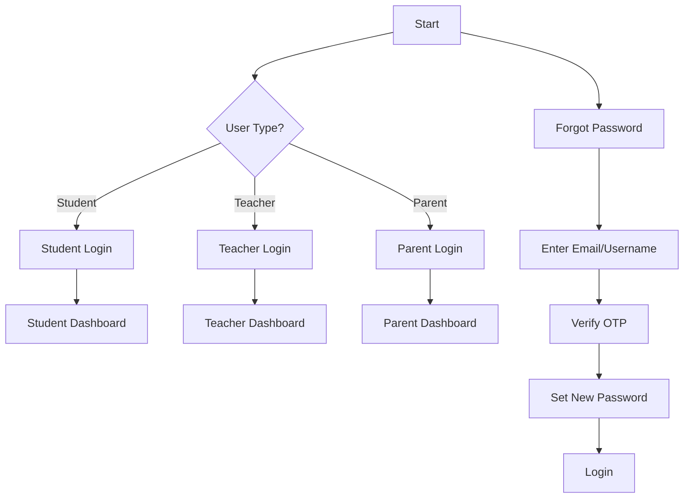
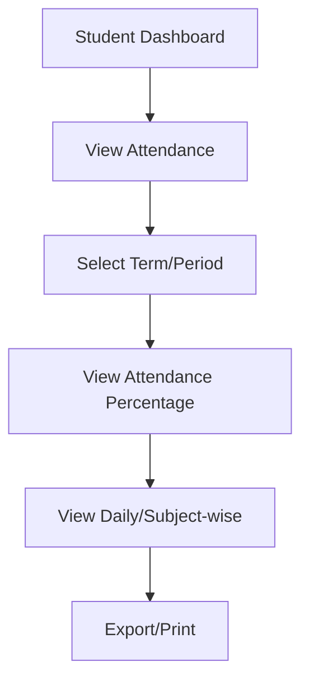
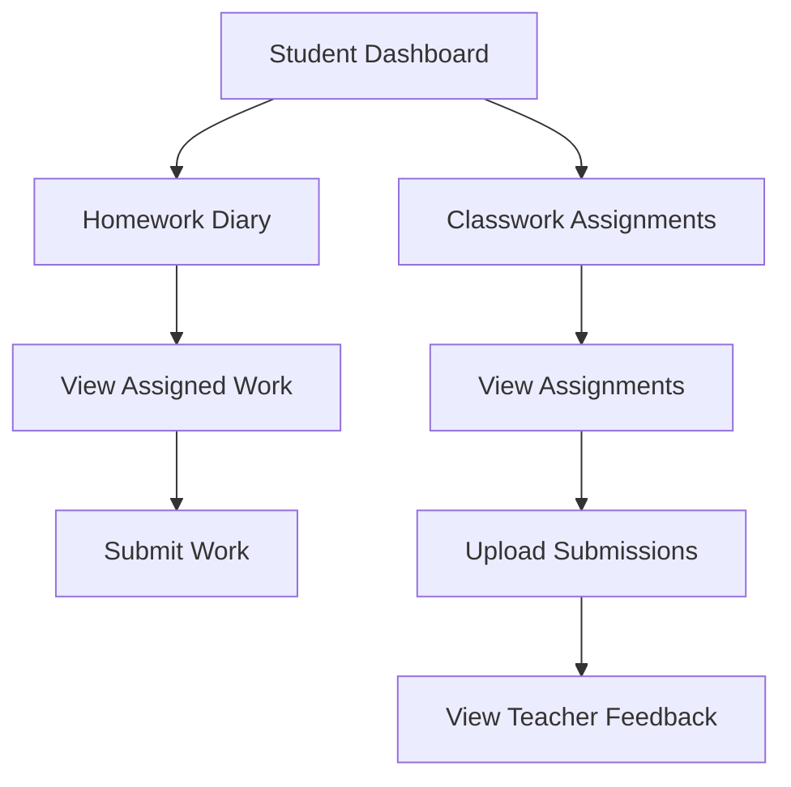
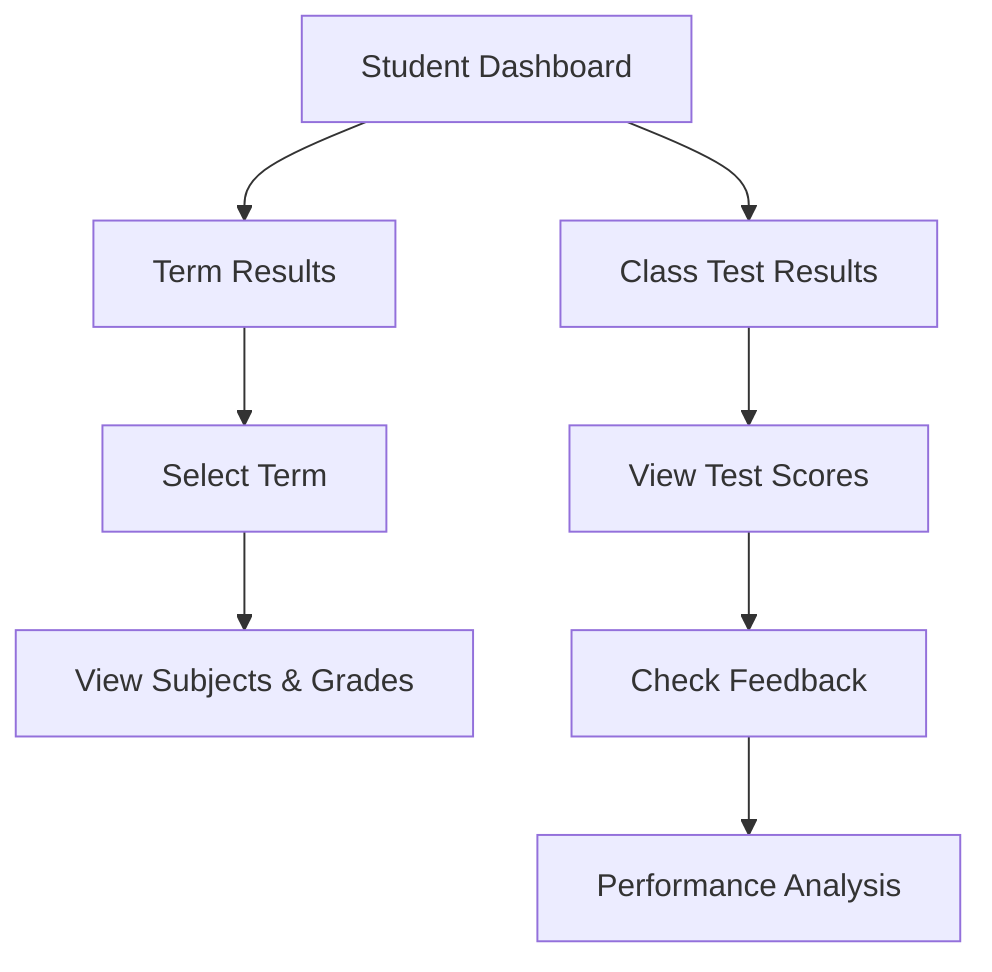
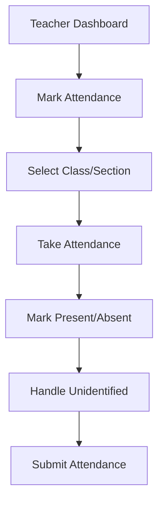
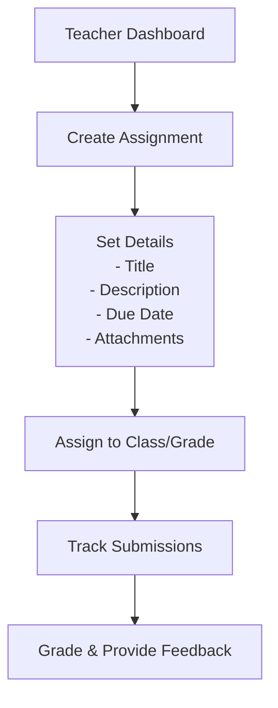
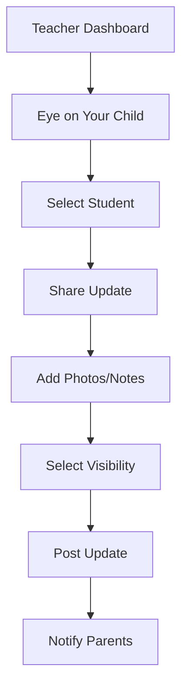
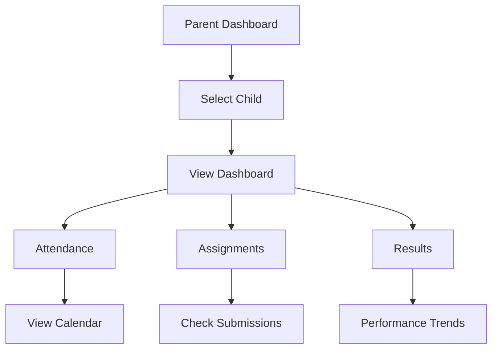
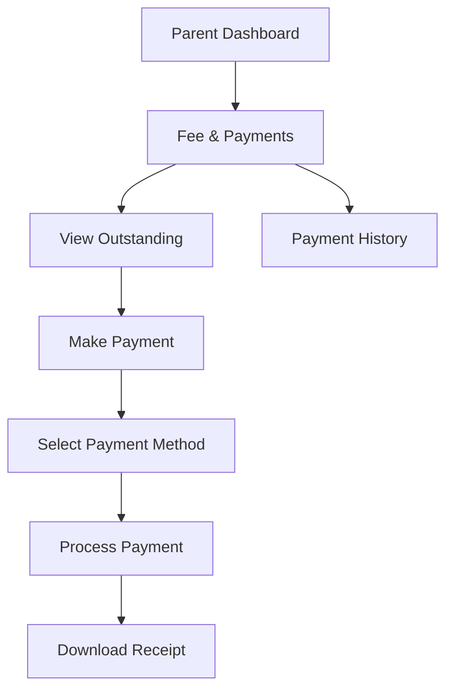
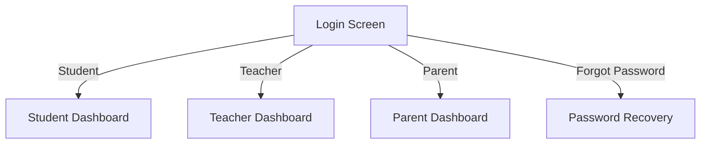

# Cityzens - School Management System

[](https://flutter.dev/)
[](https://dart.dev/)
[](https://github.com/tcsho/CityzensApp)
[](https://opensource.org/licenses/MIT)

A comprehensive school management application built with Flutter, connecting students, teachers, and parents in an educational ecosystem.

## 📱 Features & Screen Flows

### 🔄 Authentication Flow



### 🎓 Student Portal Flows

#### 1. Attendance Management



#### 2. Homework & Assignments



#### 3. Academic Performance



### 👩‍🏫 Teacher Portal Flows

#### 1. Student Attendance



#### 2. Assignment Management



#### 3. Eye on Your Child



### 👪 Parent Portal Flows

#### 1. Child Monitoring



#### 2. Fee Management



## 🔒 Security Features

### 🔐 Authentication Flows

#### User Registration

1. **New User Signup**
   - User selects role (Student/Teacher/Parent)
   - Enters personal details and contact information
   - Sets up security questions
   - Receives verification code via email/SMS
   - Creates a secure password

2. **Login Process**
   - Multi-role authentication (Student/Teacher/Parent)
   - Username/Password authentication
   - Secure session management
   - Role-based redirection after login

3. **Password Management**
   - **Forgot Password**
     - User enters registered email/username
     - Receives OTP for verification
     - Sets a new password

   - **Change Password** (Authenticated Users)
     - Current password verification
     - New password setup with strength requirements
     - Password confirmation

   - **Temporary Password**
     - First-time login with temporary password
     - Required password change on first login

4. **Security Features**
   - Secure token-based authentication
   - Role-based access control
   - Encrypted local storage for sensitive data
   - Secure API communication
   - Input validation and sanitization
   - Protected routes for authenticated users only

### 🎓 Student Portal

- **Dashboard**: Attendance overview with percentage
- **Profile**: View and manage personal information
- **Attendance**: Track attendance history and statistics
- **Homework Diary**: View and submit homework assignments
- **Classwork Assignments**: Access and submit class assignments
- **Term Results**: View academic performance by term
- **Class Test Results**: Check test scores and feedback
- **Fee & Payments**: View and manage fee payments
- **Circulars**: School announcements and notices
- **Library**: Access to library resources

### 👩‍🏫 Teacher Portal

- **Dashboard**: Quick access to essential functions
- **Timetable**: View class schedules
- **Attendance Management**:
  - Mark student attendance
  - Handle unidentified students
- **Homework Diary**: Assign and track homework
- **Classwork Assignments**: Create and manage assignments
- **Class Test Results**: Record and view test scores
- **Circulars**: Create and manage school notices
- **Eye on Your Child**: Share class activities with parents
- **Profile**: Manage professional information

### 👪 Parent Portal

- **Child Monitoring**: Track academic progress and attendance
  - Track attendance
  - View academic progress
  - Access timetable
- **Multiple Children**: Support for parents with multiple children
- **Notifications**: Important updates and announcements
- **Change Password**: Account security management

## 🛠 Technical Stack

### Frontend

- **Framework**: Flutter 3.8.1
- **State Management**: Provider Pattern
- **UI Components**:
  - Material Design 3
  - Custom Widget Library
  - Responsive Layouts
- **Local Storage**: Shared Preferences
- **Networking**: HTTP Client
- **Push Notifications**: Firebase Cloud Messaging

### Backend Integration

- **Authentication**: Firebase Auth
- **API**: RESTful Services
- **Real-time Updates**: Firebase Cloud Messaging
- **Error Tracking**: Firebase Crashlytics
- **Remote Configuration**: Firebase Remote Config

## 🚀 Getting Started

### Prerequisites

- Flutter SDK 3.8.1+
- Dart SDK 2.19.0+
- Android Studio / Xcode
- Firebase project

### Installation

1. **Clone the repository**

   ```bash
   git clone https://github.com/tcsho/CityzensApp.git
   cd CityzensApp
   ```

2. **Install dependencies**

   ```bash
   flutter pub get
   ```

3. **Configure Firebase**
   - Add `google-services.json` to `android/app/`
   - Add `GoogleService-Info.plist` to `ios/Runner/`

4. **Run the app**

   ```bash
   flutter run
   ```

## 🏗 Project Structure

```plaintext
lib/
├── Components/        # Reusable UI components
├── CustomWidgets/     # Custom widgets
├── Model/            # Data models
├── Network/          # API services
├── Provider/         # State management
├── Routes/           # Navigation
├── Screens/          # Feature screens
│   ├── Student/      # Student features
│   ├── Teacher/      # Teacher features
│   └── Parent/       # Parent features
└── Utils/            # Helper functions
```

## 📱 Screens

### Authentication Flow



### Key Features Implementation

- **Attendance System**: Real-time attendance marking with support for unidentified students
- **Profile Management**: Role-based profile views and updates
- **Navigation**: Custom drawer for easy access to all features
- **Feedback System**: Built-in app feedback collection

## 🤝 Contributing

1. Fork the repository
2. Create your feature branch (`git checkout -b feature/AmazingFeature`)
3. Commit your changes (`git commit -m 'Add some AmazingFeature'`)
4. Push to the branch (`git push origin feature/AmazingFeature`)
5. Open a Pull Request

## 📄 License

This project is licensed under the MIT License - see the [LICENSE](LICENSE) file for details.

---

### Made with ❤️ by Cityzens Team
