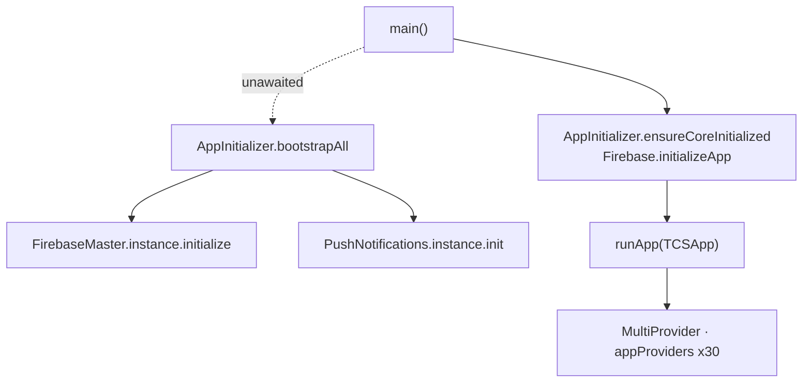

# Dependency Injection

> Back to [[Home]] · [[Architecture/Index|Architecture]] · [[Architecture/State Management|State Management]]

Cityzens has **no service locator** (`GetIt` / `injectable` / `kiwi` are absent). Dependencies are wired three ways.

## 1. MultiProvider (UI / state)

`lib/main.dart` wraps the app:

```dart
MultiProvider(
  providers: appProviders, // lib/provider/app_providers.dart
  child: MaterialApp(...),
)
```

Thirty `ChangeNotifierProvider` factories — see [[Architecture/Provider Map|Provider Map]]. Widgets obtain them via `Provider.of` / `Consumer`.

## 2. Static service methods

Almost all ERP API access is **stateless static** classes under `lib/services/`, e.g.:

- `ResultService.resultsRequest` / `allPDFResultsRequest`
- `FeeChallanService.*`
- `ApiBaseHelper.httpPostRequest` (network)

Providers and repositories call these directly — no constructor injection.

Repositories are also **constructed ad hoc** (`PromotionRepository()`, `StudentDashboardRepository()`, …), not registered in a container. See [[Architecture/Repositories|Repositories]].

## 3. Explicit singletons (Firebase / bootstrap)

| Type | Access | Path |
|---|---|---|
| `FirebaseMaster` | `FirebaseMaster.instance` | `lib/services/InitServices/firebase_master.dart` |
| `PushNotifications` | `PushNotifications.instance` | `lib/services/InitServices/push_notifications.dart` |
| `AppInitializer` | static façade (`ensureCoreInitialized`, `bootstrapAll`, `push`, `analyticsObserver`) | `lib/services/InitServices/app_initializer.dart` |



Background FCM isolate also calls `AppInitializer.ensureCoreInitialized()` then `AppInitializer.push.showFromBackgroundSafe`.

## What is not injected

| Pattern | Status |
|---|---|
| GetIt / injectable | **Not present** |
| Repository interface bindings | None — concrete classes only |
| `ConnectivityProvider` | Implemented but **not** in `appProviders` — [[Architecture/Provider Map\|Provider Map]] |

## Related pages

- [[Architecture/State Management|State Management]] · [[Architecture/Provider Map|Provider Map]]
- [[Diagrams/Startup Flow|Startup Flow]] · [[Diagrams/Notification Flow|Notification Flow]] · [[Diagrams/Configuration Flow|Configuration Flow]]
