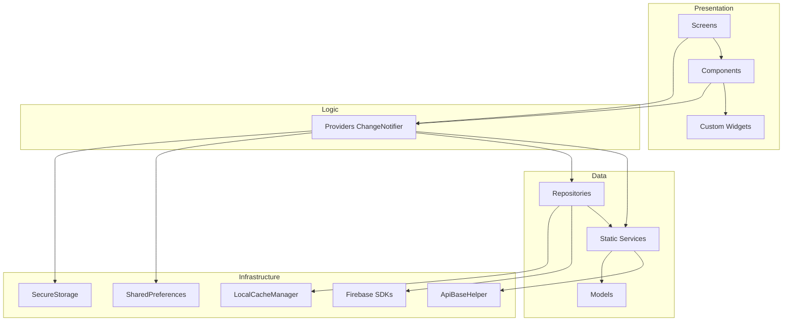

# Architecture Overview

> Master diagram: [[Home]] · [[Diagrams/Master Architecture|Master Architecture]]

Cityzens follows **Provider-based MVVM** with a hybrid data layer (static Services everywhere; Repositories for offline/Firestore subsets).

## Layered view

## Layer responsibilities

| Layer | Path | Role |
|---|---|---|
| Screens | `lib/screens/` | Pages, lifecycle, FutureBuilders |
| Components | `lib/components/` | Feature sections; `Consumer` |
| Custom widgets | `lib/custom_widgets/` | Reusable UI primitives |
| Providers | `lib/provider/` | State + business logic |
| Services | `lib/services/` | Stateless API wrappers |
| Repositories | `lib/repositories/` | Cache orchestration / Firestore |
| Models | `lib/model/` | JSON ↔ Dart |
| Network | `lib/network/` | HTTP + typed exceptions |

## Navigation

- String constants: `AppNavRoutes` (`lib/routes/app_navigation_routes.dart`)
- Switch mapper: `RouteGenerator` (`lib/routes/route_generator.dart`)
- Imperative helper: `AppNavigation` with global `navigatorKey`
- Transitions: Fade 300ms
- **Not used:** GoRouter, AutoRoute, Navigator 2.0, OS deep links

## Architecture pages

| Page | Topic |
|---|---|
| [[Architecture/Layers\|Layers]] | Presentation / Logic / Data / Network |
| [[Architecture/State Management\|State Management]] | Provider + `notifyListeners` lifecycle |
| [[Architecture/Provider Map\|Provider Map]] | 30 registered providers + gaps |
| [[Architecture/Navigation\|Navigation]] | `RouteGenerator`, `AppNavRoutes`, `AuthWrapper` |
| [[Architecture/Dependency Injection\|Dependency Injection]] | MultiProvider · static services · singletons |
| [[Architecture/Repositories\|Repositories]] | All 5 repos + `LocalCacheManager` |

## Related diagrams

- [[Diagrams/Master Architecture|Master Architecture]] · [[Diagrams/Startup Flow|Startup Flow]] · [[Diagrams/Notification Flow|Notification Flow]]
- [[Diagrams/Payment Flow|Payment Flow]] · [[Diagrams/Result Flow|Result Flow]] · [[Diagrams/Theme Flow|Theme Flow]]
- [[Diagrams/Configuration Flow|Configuration Flow]] · [[Diagrams/Deep Link Flow|Deep Link Flow]]

## Related hubs

- [[Home]] · [[API/Index|API]] · [[Firebase/Index|Firebase]] · [[Flutter/Index|Flutter]] · [[Diagrams/Index|Diagrams]]
