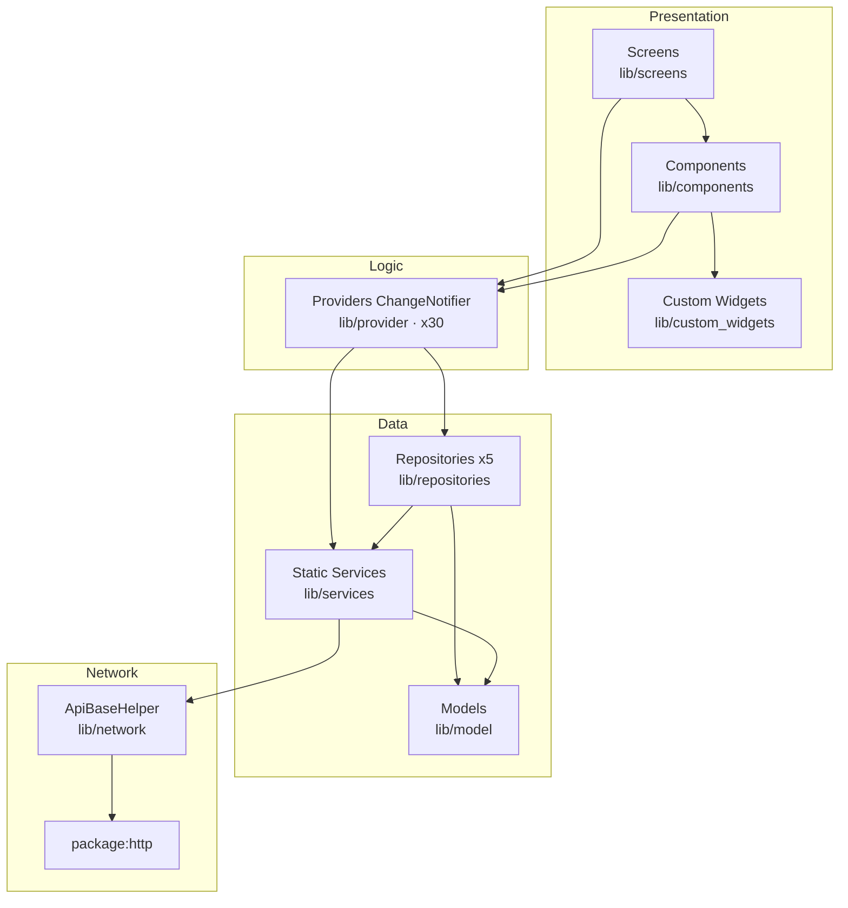

# Architecture Layers

> Back to [[Home]] · [[Architecture/Index|Architecture]] · [[Diagrams/Master Architecture|Master Architecture]]

Cityzens is a **Provider-based MVVM** client. UI lives under Presentation; Providers own state and orchestration; static Services + five Repositories form Data; `ApiBaseHelper` is the Network boundary.

## Layer responsibilities

| Layer | Path | Role | Evidence |
|---|---|---|---|
| Presentation | `lib/screens/`, `lib/components/`, `lib/custom_widgets/` | Pages, feature sections, reusable UI | e.g. `student_dashboard_screen.dart` |
| Logic | `lib/provider/` | `ChangeNotifier` state + business orchestration | `app_providers.dart` (30 providers) |
| Data | `lib/services/`, `lib/repositories/`, `lib/model/` | Stateless API wrappers; offline/Firestore repos; DTOs | See [[Architecture/Repositories\|Repositories]] |
| Network | `lib/network/` | HTTP verbs + typed exceptions | `api_base_helper.dart` |

## Cross-cutting infrastructure

Not a fifth “layer” in the MVVM sense, but consumed across Data/Logic:

| Concern | Path |
|---|---|
| SharedPreferences cache keys | `lib/services/LocalCache/local_cache_manager.dart` |
| Session prefs | `lib/shared_preference/` |
| Secure storage / biometrics | used from Login / LocalData |
| Firebase SDKs | `lib/services/InitServices/` — see [[Architecture/Dependency Injection\|DI]] |
| Theme / colors | `lib/utils/app_themes.dart`, `lib/utils/app_colors.dart` — [[Diagrams/Theme Flow\|Theme Flow]] |
| Constants / base URL | `lib/utils/app_constants.dart` — [[Diagrams/Configuration Flow\|Configuration Flow]] |

## Related pages

- [[Architecture/State Management|State Management]] · [[Architecture/Provider Map|Provider Map]] · [[Architecture/Repositories|Repositories]]
- [[Architecture/Navigation|Navigation]] · [[Architecture/Dependency Injection|DI]]
- [[Diagrams/Master Architecture|Master Architecture]]
