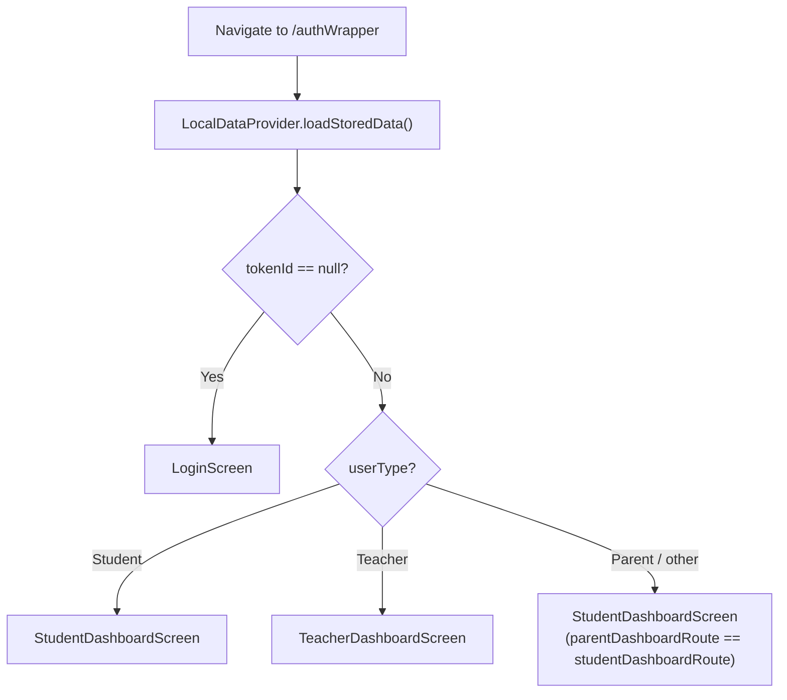

# Navigation

> Back to [[Home]] · [[Architecture/Index|Architecture]] · [[Diagrams/Startup Flow|Startup Flow]]

Imperative **named routes** via Flutter Navigator 1.0. **Not used:** GoRouter, AutoRoute, Navigator 2.0, OS deep links ([[Diagrams/Deep Link Flow|Deep Link Flow]]).

## Building blocks

| Piece | Path | Role |
|---|---|---|
| `AppNavRoutes` | `lib/routes/app_navigation_routes.dart` | String route constants + `isRouteAvailable()` |
| `RouteGenerator` | `lib/routes/route_generator.dart` | `onGenerateRoute` switch → screens |
| `AppNavigation` | `lib/routes/app_navigation.dart` | `navigatorKey`, push / replace / kill-all helpers |
| `AuthWrapper` | `lib/screens/AuthWrapper/auth_wrapper.dart` | Session guard after splash/promotion |

Wired in `lib/main.dart`:

- `initialRoute: AppNavRoutes.initialRoute` (`/`)
- `navigatorKey: AppNavigation.navigatorKey`
- `onGenerateRoute: RouteGenerator.generateRoute`
- `home: SplashScreenUI()` (also mapped for `/`)

Transitions: `PageRouteBuilder` + `FadeTransition`, **300ms** (`routeScreen` / `_errorRoute`).

## Parent == Student dashboard route

```dart
static const studentDashboardRoute = '/studentDashboard';
static const parentDashboardRoute = '/studentDashboard';
```

Both constants resolve to the **same** path. `AuthWrapper` routes Parent (non-Student, non-Teacher) and Student to `StudentDashboardScreen`.

## AuthWrapper guard



On mobile (non-web), the chosen screen is wrapped in `UpgradeAlert` (`upgrader`, `AppConstants.appVersion`).

Evidence: `lib/screens/AuthWrapper/auth_wrapper.dart`.

## Startup path

`main` → Splash → optional Promotion → AuthWrapper — see [[Diagrams/Startup Flow|Startup Flow]].

## FCM payload routing

Push taps call `PushNotifications.handleNotificationTap` → `AppNavigation.navigateTo` for `route` / known aliases (`Diary`, `Classwork`) or `openUrl`. This is **not** OS deep linking. See [[Diagrams/Notification Flow|Notification Flow]] · [[Diagrams/Deep Link Flow|Deep Link Flow]].

## Related pages

- [[Architecture/Layers|Layers]] · [[Architecture/Dependency Injection|DI]]
- [[Flows/Authentication Flow|Authentication Flow]] · [[Diagrams/Startup Flow|Startup Flow]]
