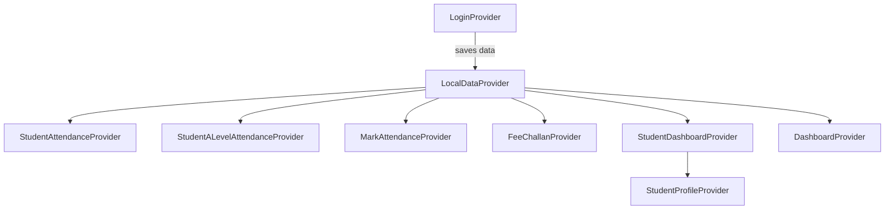

# Provider Map

All 30 providers are registered globally in `lib/provider/app_providers.dart` via `MultiProvider`.

## Provider Registry

| # | Provider | Purpose | Key State |
|---|---|---|---|
| 1 | `LoginProvider` | Authentication form + login logic | `userType`, `formKey`, `login()` |
| 2 | `LocalDataProvider` | Session persistence + user context | `userData`, `studentId`, `gradeId` |
| 3 | `ForgotPasswordProvider` | Password recovery flow | OTP verification state |
| 4 | `RegistrationProvider` | New user registration | Registration form state |
| 5 | `StudentProfileProvider` | Student profile data + caching | Profile fields, session cache |
| 6 | `DashboardProvider` | Legacy dashboard data | Attendance %, quick stats |
| 7 | `LibraryProvider` | Library records from ERP | Issued books, fines |
| 8 | `FeeChallanProvider` | Fee bills + payment | Outstanding challans, receipts |
| 9 | `NotificationProvider` | Circulars/announcements | Notification list |
| 10 | `TeacherProfileProvider` | Teacher ERP profile | Employee info |
| 11 | `MarkAttendanceProvider` | Teacher attendance marking | Student list, P/A/L/U status, pie data |
| 12 | `ResultsProvider` | Term results (ERP) | Academic sessions, terms, marks |
| 13 | `OSRegistrationProvider` | Online student registration | Registration form state |
| 14 | `StudentAttendanceProvider` | Standard student attendance | Calendar events, pie chart |
| 15 | `StudentALevelAttendanceProvider` | A-Level subject-wise attendance | Subjects (cached), calendar, auto-select |
| 16 | `MarkUnverifiedProvider` | Mark unidentified students | Unverified student list |
| 17 | `DiaryProvider` | Homework management | Diary records, sections |
| 18 | `AssignmentProvider` | Classwork/assignment management | Assignment records |
| 19 | `SchoolEventProvider` | School events | Event list |
| 20 | `ClassTestResultProvider` | Class test results (create/view) | Test 1/2/3, marks |
| 21 | `AppointmentProvider` | Parent appointment booking | Time slots, bookings |
| 22 | `EyeOnYourChildProvider` | Teacher → Parent activity feed | Photos, notes, students |
| 23 | `TimeTableProvider` | Timetable CRUD | 9×5 grid data |
| 24 | `SurveyProvider` | Survey management | Survey questions, answers |
| 25 | `WithdrawalRequestProvider` | Student withdrawal | Request form state |
| 26 | `ComplaintQueryProvider` | Parent complaints | Complaint categories, tracking |
| 27 | `CircularProvider` | Circular announcements | Circular records |
| 28 | `SupportFormProvider` | App feedback/support | Feedback form |
| 29 | `SplashProvider` | Splash screen logic | Init state |
| 30 | `StudentDashboardProvider` | Student dashboard + multi-child | `activeChildData`, `switchActiveChild()` |

## Provider Dependency Graph

> **Note**: Most providers access `LocalDataProvider` directly via `Provider.of<LocalDataProvider>(AppNavigation.currentContext!, listen: false)` in their constructor body. This is a tight coupling pattern — providers depend on the global navigation context being available at construction time.

## Related Pages

- [[Architecture/Index|Architecture Overview]]
- [[API/Endpoint Reference|Endpoint Reference]]
