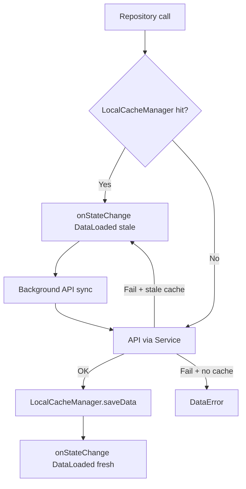

# Repositories

> Back to [[Home]] · [[Architecture/Index|Architecture]] · [[Architecture/Layers|Layers]]

Most features call **static Services** directly. Five repositories exist for promotions, Firestore feature flags, and offline-first ERP subsets.

## Inventory

| # | Repository | Path | Source | Cache |
|---|---|---|---|---|
| 1 | `PromotionRepository` | `lib/repositories/Promotion/promotion_repository.dart` | ERP `GetAllLaunchPromotions` / CRUD | None (network only) |
| 2 | `FeatureConfigRepository` | `lib/repositories/FeatureConfig/feature_config_repository.dart` | Firestore `newFeatures` / `newPaymentFlow` | Firestore live |
| 3 | `StudentDashboardRepository` | `lib/repositories/StudentDashboard/student_dashboard_repository.dart` | Multiple student services | `LocalCacheManager` · ~15 min bundle TTL |
| 4 | `TeacherSectionRepository` | `lib/repositories/TeacherSection/teacher_section_repository.dart` | `TeacherSectionService` | `LocalCacheManager` · offline-first |
| 5 | `SectionSubjectRepository` | `lib/repositories/SectionSubject/section_subject_repository.dart` | `SectionSubjectService` | `LocalCacheManager` · offline-first |

## LocalCacheManager

Path: `lib/services/LocalCache/local_cache_manager.dart`

SharedPreferences helper used by dashboard / teacher section / subject repos (and result PDF index):

| API | Purpose |
|---|---|
| `saveData(key, jsonData, dataType)` | Persist JSON + last-sync timestamp |
| `getData` / `getLastSyncTime` / `cacheExists` | Read |
| `clearCache` / `clearAllCaches` | Evict (logout clears all via `LocalDataProvider`) |
| `getTimeSinceLastSync` | Human-readable stale label |

Prefixes: `cityzens_cache_`, `cityzens_last_sync_`.

## Per-repository notes

### PromotionRepository

- `getActivePromotion()` — prefers `promotionKey == 'launchPromotion'`
- Used by `SplashProvider` to decide promotion vs auth — [[Diagrams/Startup Flow|Startup Flow]]
- Debug-only write APIs for promotion management

### FeatureConfigRepository

- Reads `FirebaseFirestore.instance.collection('newFeatures').doc('newPaymentFlow')`
- Also `getNewFeaturesList`, `streamNewPaymentFeature`, `addNewFeature`
- **Call sites in app UI:** none found at verification time; payment screen flag is currently hardcoded in `outstanding_fee_component.dart` (`isNewPaymentFlowEnabled: true`). Repository remains the Firestore SSOT for the flag — [[Diagrams/Payment Flow|Payment Flow]]

### StudentDashboardRepository

- Offline-first `ChildDashboardData` bundle per student
- Cache hit → UI immediately → `_backgroundSync`
- Aggregates profile, attendance, fees, diary, assignments, circulars, subjects via static services

### TeacherSectionRepository / SectionSubjectRepository

- Pattern: cache → `DataLoaded(isStale: true)` → background API → update cache / `DataLoaded(isStale: false)`
- Section subjects drop subject ID `55` after fetch
- Emit via `DataState<T>` callbacks (`lib/model/OfflineState/data_state.dart`)

## Related pages

- [[Architecture/Layers|Layers]] · [[Architecture/State Management|State Management]]
- [[Diagrams/Payment Flow|Payment Flow]] · [[Diagrams/Startup Flow|Startup Flow]] · [[Flutter/Storage and Caching|Storage & Caching]]
