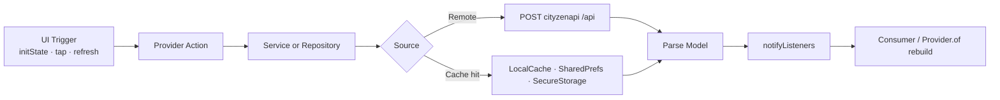

# State Management

> Back to [[Home]] · [[Architecture/Index|Architecture]] · [[Architecture/Provider Map|Provider Map]]

Cityzens uses **`provider` + `ChangeNotifier`** exclusively. There is no Bloc, Riverpod, GetX, or Redux.

## Registration

All **30** providers are created once at app root via `MultiProvider` in `lib/main.dart` → `appProviders` (`lib/provider/app_providers.dart`).

```dart
MultiProvider(
  providers: appProviders,
  child: MaterialApp(...),
)
```

Each entry is `ChangeNotifierProvider(create: (_) => SomeProvider())`. Full table: [[Architecture/Provider Map|Provider Map]].

## Consumer pattern

Screens and components read state with:

- `Consumer<T>` / `Consumer2` — rebuild on `notifyListeners`
- `Provider.of<T>(context, listen: false)` — one-shot / actions
- Many providers resolve `LocalDataProvider` in their constructor via `AppNavigation.currentContext`

## Lifecycle (matches [[Home]] SSOT)

Canonical reactive cycle from the master diagram:



### Example — Results

1. UI calls `ResultsProvider.loadAllPDFResults()` / `downloadResultPdf()`
2. Provider calls static `ResultService` / `ResultPdfDownloadService`
3. Response parsed into `AllPDFResultsResponse` / `SavedResultPdf`
4. `notifyListeners()` rebuilds `AllPDFResultsListComponent`

Evidence: `lib/provider/Results/results_provider.dart`, `lib/services/Results/`.

### Example — Offline-first dashboard

1. `StudentDashboardProvider` → `StudentDashboardRepository.fetchChildDataOfflineFirst`
2. Cache hit → populate UI immediately → background sync
3. Network → save via `LocalCacheManager` → `notifyListeners`

Evidence: `lib/repositories/StudentDashboard/student_dashboard_repository.dart`.

## Coupling note

Most feature providers hold a `LocalDataProvider` reference obtained at construction time from the global navigator context. Providers therefore assume `AppNavigation.navigatorKey` is mounted before first use.

## Related pages

- [[Architecture/Provider Map|Provider Map]] · [[Architecture/Layers|Layers]] · [[Architecture/Dependency Injection|DI]]
- [[Diagrams/Master Architecture|Master Architecture]] · [[Diagrams/Result Flow|Result Flow]]
