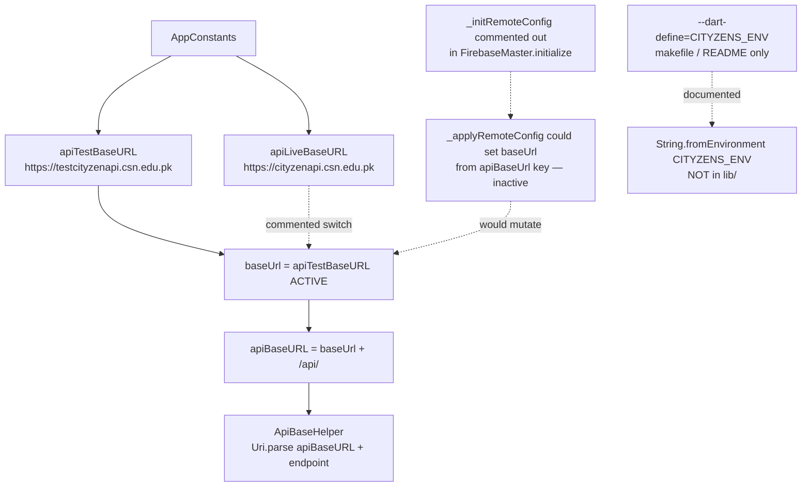

# Configuration Flow

> Back to [[Home]] · [[Diagrams/Index|Diagrams]] · [[Architecture/Dependency Injection|DI]]

Runtime API host and related constants live in `AppConstants`. Remote Config and `CITYZENS_ENV` are **not** driving the active URL today.

## Mermaid



## Active base URL

Evidence `lib/utils/app_constants.dart`:

```dart
// static String baseUrl = apiLiveBaseURL;
static String baseUrl = apiTestBaseURL;
static String apiBaseURL = "$baseUrl/api/";
```

| Host | Constant | Status |
|---|---|---|
| `https://testcityzenapi.csn.edu.pk` | `apiTestBaseURL` | **Active** |
| `https://cityzenapi.csn.edu.pk` | `apiLiveBaseURL` | Present; switch commented |

## Remote Config — disabled

`FirebaseMaster.initialize()` runs Crashlytics, Analytics, FCM in parallel. `_initRemoteConfig()` is **commented out** in the `Future.wait` list.

When enabled, `_applyRemoteConfig` would rewrite `AppConstants.baseUrl` / `apiBaseURL` from Remote Config key `apiBaseUrl`. That path is dormant until `_initRemoteConfig` is re-enabled.

Evidence: `lib/services/InitServices/firebase_master.dart`.

## `CITYZENS_ENV` — unused in Dart

| Location | Usage |
|---|---|
| `makefile` | `flutter build apk --release --dart-define=CITYZENS_ENV=true` |
| `README.md` | Documents flag as env switch |
| `lib/**/*.dart` | **No** `String.fromEnvironment('CITYZENS_ENV')` (or similar) |

Changing environment today requires editing `AppConstants.baseUrl` (or re-enabling Remote Config), not the dart-define alone.

## Other constants of note

| Constant | Purpose |
|---|---|
| `appVersion` | `'2.0.0'` — `UpgradeAlert` min version |
| `paymentGatewayURL` / `paymentGatewayNewURL` | Billing WebView — [[Diagrams/Payment Flow\|Payment Flow]] |
| `appHeaders` | JSON Accept/Content-Type for `ApiBaseHelper` |

## Related pages

- [[Architecture/Layers|Layers]] · [[Diagrams/Startup Flow|Startup Flow]] · [[Diagrams/Payment Flow|Payment Flow]]
- [[API/Index|API Catalog]] · [[Home]]
