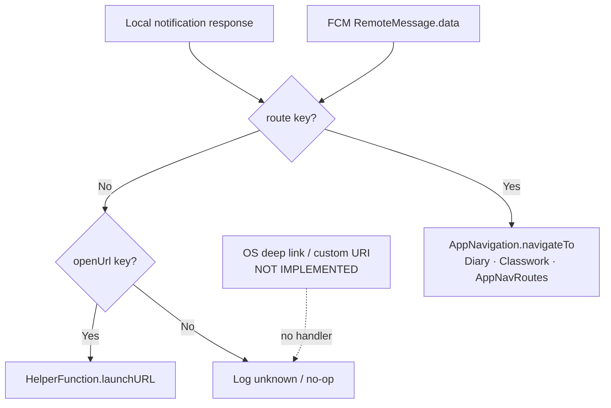

# Deep Link Flow

> Back to [[Home]] · [[Diagrams/Index|Diagrams]] · [[Architecture/Navigation|Navigation]]

## Status: **Not implemented**

There is **no** OS-level deep linking in this codebase:

| Mechanism | Present? |
|---|---|
| `uni_links` / `app_links` / `go_router` deepLink | **No** |
| Custom URL scheme / App Links / Universal Links handlers in Dart | **No** |
| Navigator 2.0 / declarative route parsing from URI | **No** |

Verified by absence of those packages/APIs under `lib/` and dependency usage for deep links.

## What exists instead — FCM payload routing

Push notification data can open an in-app route or external URL after tap. That is **notification routing**, not deep linking.

Evidence: `lib/services/InitServices/push_notifications.dart` (`handleNotificationTap`, `_handlePayload`). Full diagram: [[Diagrams/Notification Flow|Notification Flow]].

## Related pages

- [[Diagrams/Notification Flow|Notification Flow]] · [[Architecture/Navigation|Navigation]]
- [[Firebase/Messaging|Messaging]]
