# Master Architecture

> Back to [[Home]] · [[Diagrams/Index|Diagrams]]

```mermaid
flowchart TB
  subgraph Layers["Architecture Layers"]
    direction TB
    Pres["Presentation<br/>Screens · Components · CustomWidgets"]
    Logic["Logic<br/>30 ChangeNotifiers · MultiProvider"]
    Data["Data<br/>Static Services · 5 Repositories · Models"]
    Net["Network<br/>ApiBaseHelper · package http"]
    Pres <--> Logic
    Logic <--> Data
    Data <--> Net
  end

  subgraph Journeys["Primary Navigation and User Journeys"]
    direction TB
    MainEntry["main.dart<br/>Firebase + AppInitializer"]
    Splash["SplashScreenUI<br/>SplashProvider"]
    Promo{"Active Launch<br/>Promotion?"}
    AuthW["AuthWrapper<br/>tokenId guard"]
    Login["LoginScreen<br/>Student · Teacher · Parent"]
    StudDash["StudentDashboard<br/>Student + Parent"]
    TeachDash["TeacherDashboard"]
    StudMods["Student Modules<br/>Attendance · Hub · Results · Fees · Library"]
    TeachMods["Teacher Modules<br/>Mark Attendance · Academic Hub · Tests · Timetable"]
    ParentMods["Parent Modules<br/>Eye · Complaints · Appointments · Withdrawal · Pay"]
    MainEntry --> Splash --> Promo
    Promo -->|Yes| PromoUI["PromotionScreen"]
    Promo -->|No| AuthW
    PromoUI --> AuthW
    AuthW -->|No token| Login
    AuthW -->|Student| StudDash
    AuthW -->|Teacher| TeachDash
    AuthW -->|Parent| StudDash
    Login --> AuthW
    StudDash --> StudMods
    StudDash --> ParentMods
    TeachDash --> TeachMods
  end

  subgraph Lifecycle["Reactive Data and State Lifecycle"]
    direction LR
    Trig["UI Trigger<br/>initState · tap · refresh"]
    Act["Provider Action"]
    Call["Service or Repository"]
    Src{"Source"}
    API["POST cityzenapi /api"]
    Cache["LocalCache · SharedPrefs · SecureStorage"]
    Model["Parse Model"]
    Emit["notifyListeners"]
    Rebuild["Consumer / Provider.of rebuild"]
    Trig --> Act --> Call --> Src
    Src -->|Remote| API --> Model
    Src -->|Cache hit| Cache --> Model
    Model --> Emit --> Rebuild
  end

  subgraph External["External Integrations and Services"]
    direction TB
    FCM["Firebase Messaging + Local Notifications"]
    Crash["Crashlytics"]
    Anal["Analytics + NavigatorObserver"]
    FS["Firestore newFeatures<br/>payment flag"]
    RC["Remote Config apiBaseUrl<br/>init DISABLED"]
    ERP["AIMS+ ERP REST<br/>test or live host"]
    Bill["Billing WebView<br/>thecityschool.edu.pk"]
    Bio["local_auth + SecureStorage"]
    Upg["upgrader force update"]
  end

  Layers -.->|renders| Journeys
  Journeys -.->|mutates via| Lifecycle
  Lifecycle -->|HTTP| ERP
  Lifecycle -->|feature flag| FS
  External --> Layers
  FCM -->|route or openUrl| Journeys
  Bio --> Login
  Upg --> AuthW
  Bill --> ParentMods
  Net --> ERP

  classDef layer fill:#1E2A6B,stroke:#F3CD50,stroke-width:2px,color:#FFFFFF
  classDef journey fill:#485CC7,stroke:#F3CD50,stroke-width:2px,color:#FFFFFF
  classDef life fill:#303F9F,stroke:#FFF6D2,stroke-width:2px,color:#FFFFFF
  classDef ext fill:#003875,stroke:#F3CD50,stroke-width:2px,color:#FFFFFF
  classDef decision fill:#F3CD50,stroke:#1E2A6B,stroke-width:2px,color:#1E2A6B

  class Pres,Logic,Data,Net layer
  class MainEntry,Splash,AuthW,Login,StudDash,TeachDash,StudMods,TeachMods,ParentMods,PromoUI journey
  class Trig,Act,Call,API,Cache,Model,Emit,Rebuild life
  class FCM,Crash,Anal,FS,RC,ERP,Bill,Bio,Upg ext
  class Promo,Src decision
```

## Evidence

- Entry: `lib/main.dart`
- Providers: `lib/provider/app_providers.dart`
- Routes: `lib/routes/route_generator.dart`
- Network: `lib/network/api_base_helper.dart`
- Init: `lib/services/InitServices/`
