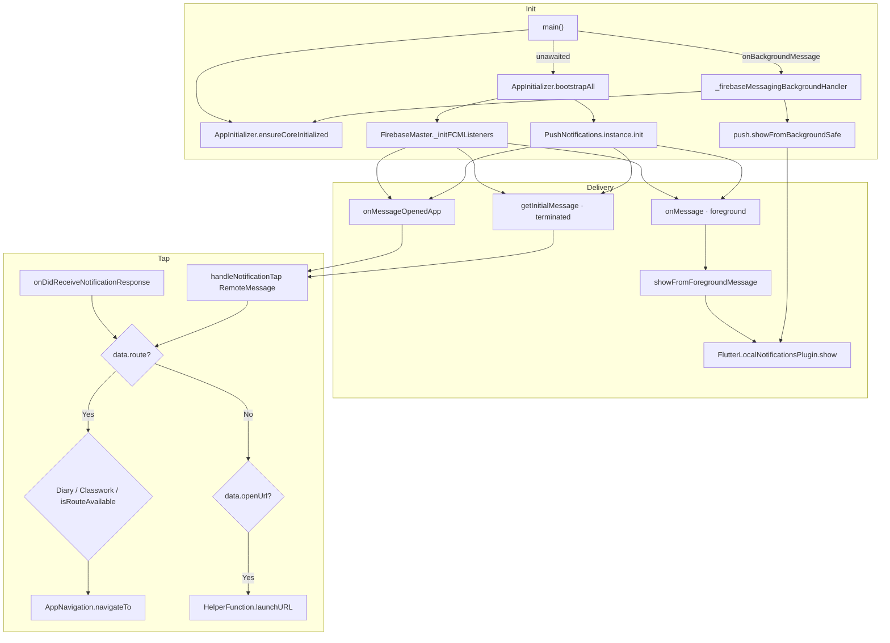

# Notification Flow

> Back to [[Home]] · [[Diagrams/Index|Diagrams]] · [[Architecture/Dependency Injection|DI]]

Firebase Cloud Messaging + local notifications. No OS deep-link scheme — tap routing is **payload-driven** only ([[Diagrams/Deep Link Flow|Deep Link Flow]]).

## Mermaid

## Payload contract

| Key | Behavior | Evidence |
|---|---|---|
| `route` | Navigate; aliases `Diary` → `studentDiaryRoute`, `Classwork` → `studentAssignmentRoute`; else `AppNavRoutes.isRouteAvailable` | `push_notifications.dart` `_handlePayload` |
| `openUrl` | External browser / launch URL | same |
| Local `payload` | Same route string or `http…` link | `onDidReceiveNotificationResponse` |

`Challan` route case is **commented out** in source.

User preference: SharedPreferences `notifications_enabled` (default `true`); foreground show respects `isEnabled()`.

## Key files

| File | Role |
|---|---|
| `lib/main.dart` | Background handler registration |
| `lib/services/InitServices/app_initializer.dart` | Bootstrap |
| `lib/services/InitServices/firebase_master.dart` | FCM stream listeners |
| `lib/services/InitServices/push_notifications.dart` | Local plugin + tap routing |

## Related pages

- [[Diagrams/Deep Link Flow|Deep Link Flow]] · [[Diagrams/Startup Flow|Startup Flow]]
- [[Architecture/Navigation|Navigation]] · [[Firebase/Messaging|Messaging]]
