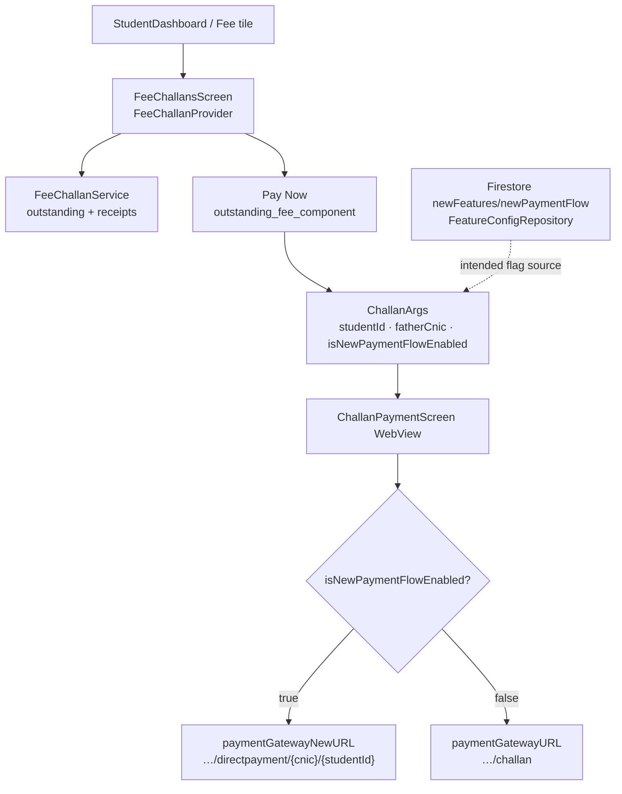

# Payment Flow

> Back to [[Home]] · [[Diagrams/Index|Diagrams]] · [[Flows/Fee and Payment Flow|Fee and Payment Flow]]

Outstanding challans from ERP → **Pay Now** → `ChallanPaymentScreen` WebView on `billing.thecityschool.edu.pk`.

## Mermaid

## Billing URLs (`AppConstants`)

| Constant | URL |
|---|---|
| `paymentGatewayURL` | `https://billing.thecityschool.edu.pk/challan` |
| `paymentGatewayNewURL` | `https://billing.thecityschool.edu.pk/directpayment/` |

When new flow is enabled, WebView loads:

`{paymentGatewayNewURL}{fatherCnic}/{studentId}`

Evidence: `lib/screens/Parent/ChallanPaymentScreen/challan_payment_screen.dart`.

## Firestore `newPaymentFlow`

`FeatureConfigRepository.getNewPaymentFlow()` / `streamNewPaymentFeature()` read:

`FirebaseFirestore.instance.collection('newFeatures').doc('newPaymentFlow')`

Model: `FeatureConfigModel` (`isLive`, `isTest`, `isTesting`, dates).

**Code-verified gap:** UI currently passes `isNewPaymentFlowEnabled: true` hardcoded in `lib/components/FeeChallanComponents/outstanding_fee_component.dart`. No call site invokes `FeatureConfigRepository` yet; the repository remains the designed Firestore SSOT for the flag.

## Key files

| File | Role |
|---|---|
| `lib/provider/FeeChallan/feechallan_provider.dart` | List state |
| `lib/screens/Student/Feechallans/fee_challans_screen.dart` | Tabs |
| `lib/components/FeeChallanComponents/outstanding_fee_component.dart` | Pay Now |
| `lib/routes/challan_args.dart` | Route args |
| `lib/screens/Parent/ChallanPaymentScreen/challan_payment_screen.dart` | WebView |
| `lib/repositories/FeatureConfig/feature_config_repository.dart` | Firestore flag |
| `lib/utils/app_constants.dart` | Gateway URLs |

## Related pages

- [[Architecture/Repositories|Repositories]] · [[Diagrams/Configuration Flow|Configuration Flow]]
- [[Flows/Fee and Payment Flow|Fee and Payment Flow]] · [[Flows/Parent Flow|Parent Flow]]
