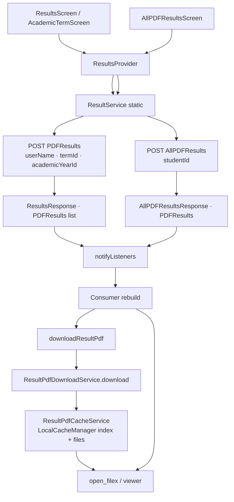

# Result Flow

> Back to [[Home]] · [[Diagrams/Index|Diagrams]] · [[Flows/Term Results Flow|Term Results Flow]]

Term and archive PDF results via `ResultsProvider`, ERP endpoints `PDFResults` / `AllPDFResults`, and local PDF download/cache.

## Mermaid

## API surface

| Method | Endpoint | Request model | Provider entry |
|---|---|---|---|
| `ResultService.resultsRequest` | `PDFResults` | `ResultsRequest` | Term-scoped result load |
| `ResultService.allPDFResultsRequest` | `AllPDFResults` | `AllPDFResultsRequest` | `loadAllPDFResults()` |

Evidence: `lib/services/Results/result_service.dart`.

## Download / cache

1. `ResultsProvider.downloadResultPdf(item)` marks `downloadingPdfKeys`, `notifyListeners`
2. `ResultPdfDownloadService.download` → network file + `ResultPdfCacheService.save`
3. `ResultPdfCacheService` keeps an index via `LocalCacheManager` and files on disk
4. `openCachedResultPdf` / `OpenFilex` for offline open
5. Analytics: `AppAnalyticsService.logResultPdfEvent`

Routes: `AppNavRoutes.resultsRoute`, `academicTermRoute`, `allPDFResultsRoute` (`RouteGenerator`).

## Key files

| File | Role |
|---|---|
| `lib/provider/Results/results_provider.dart` | State + download orchestration |
| `lib/services/Results/result_service.dart` | ERP POSTs |
| `lib/services/Results/result_pdf_download_service.dart` | Download pipeline |
| `lib/services/Results/result_pdf_cache_service.dart` | Disk + index cache |
| `lib/screens/Student/ResultScreen/*` | UI |
| `lib/components/ResultsComponents/*` | List / eye detail |

## Related pages

- [[Architecture/State Management|State Management]] · [[Architecture/Provider Map|Provider Map]]
- [[API/Index|API Catalog]] · [[Flows/Term Results Flow|Term Results Flow]]
