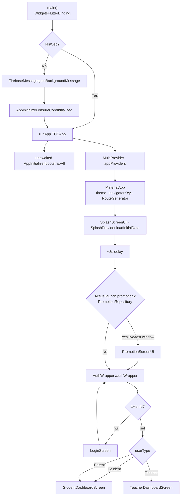

# Startup Flow

> Back to [[Home]] · [[Diagrams/Index|Diagrams]] · [[Architecture/Navigation|Navigation]]

Cold start path from `main()` through splash, optional launch promotion, then auth.

## Mermaid

## Promotion decision (`SplashProvider`)

After `PromotionRepository().getActivePromotion()`:

- **Release:** `isLive` and `startDate`/`endDate` contain `now`
- **Debug:** `isTesting`
- Web skips promotion fetch → AuthWrapper after delay

Evidence: `lib/provider/Splash/splash_provider.dart`.

## Bootstrap vs first frame

| Step | Blocking? |
|---|---|
| `ensureCoreInitialized` (native) | Yes — before `runApp` |
| `bootstrapAll` (Crashlytics, Analytics, FCM listeners, Push init) | No — `unawaited` |
| Splash 3s + promotion fetch | Parallel with bootstrap |

## Key files

| File | Role |
|---|---|
| `lib/main.dart` | Entry |
| `lib/services/InitServices/app_initializer.dart` | Firebase core + bootstrap |
| `lib/screens/SplashScreen/splash_screen_ui.dart` | Splash UI |
| `lib/provider/Splash/splash_provider.dart` | Promotion gate |
| `lib/screens/AuthWrapper/auth_wrapper.dart` | Session guard |
| `lib/repositories/Promotion/promotion_repository.dart` | Launch promotions API |

## Related pages

- [[Architecture/Navigation|Navigation]] · [[Architecture/Dependency Injection|DI]]
- [[Diagrams/Notification Flow|Notification Flow]] · [[Diagrams/Configuration Flow|Configuration Flow]]
- [[Flows/Authentication Flow|Authentication Flow]]
