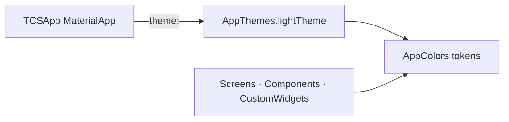

# Theme Flow

> Back to [[Home]] · [[Diagrams/Index|Diagrams]] · [[Design System/Index|Design System]]

Single light theme applied at `MaterialApp`. Colors are centralized in `AppColors` (no raw color literals in UI by convention).

## Mermaid

## AppThemes

Path: `lib/utils/app_themes.dart`

| Property | Value |
|---|---|
| `scaffoldBackgroundColor` | `AppColors.white` |
| `brightness` | `Brightness.light` |
| `primaryColor` | `AppColors.primaryColor` |
| `drawerTheme.backgroundColor` | `AppColors.primaryColor` |
| `appBarTheme.iconTheme` | `AppColors.primaryBlue` |
| `colorScheme` | light · primary/secondary = `primaryColor` |

Dark theme block is a stub comment only — **no dark `ThemeData` shipped**.

Wired in `lib/main.dart`: `theme: AppThemes.lightTheme`.

## AppColors (SSOT)

Path: `lib/utils/app_colors.dart` — private constructor `AppColors._()`.

Notable brand tokens:

| Token | Hex (approx) | Role |
|---|---|---|
| `primaryBlue` | `#485CC7` | Brand blue |
| `primaryDarkBlue` | `#303F9F` | Deep brand |
| `primaryColor` | `#617FFF` | Theme primary |
| `secondaryColor` | `#F3CD50` | Gold accent |
| `navyBlue` | `#003875` | Navy |
| Surfaces | `white`, `slate50`, `slate100`, … | Backgrounds |

UI imports `AppColors` directly for gradients, cards, text (e.g. `AuthWrapper` scaffold gradient).

## Related pages

- [[Design System/Index|Design System]] · [[Architecture/Layers|Layers]]
- [[Diagrams/Master Architecture|Master Architecture]]
