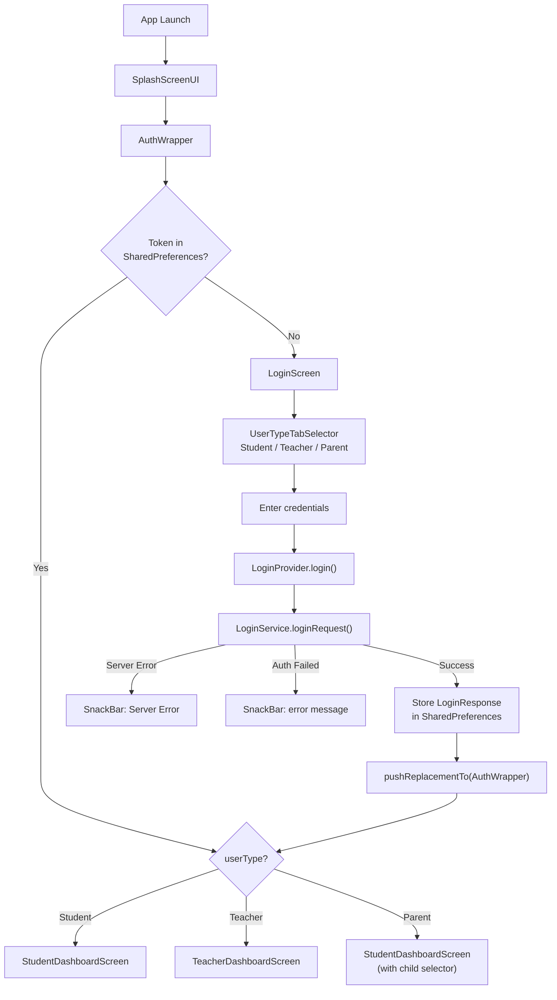
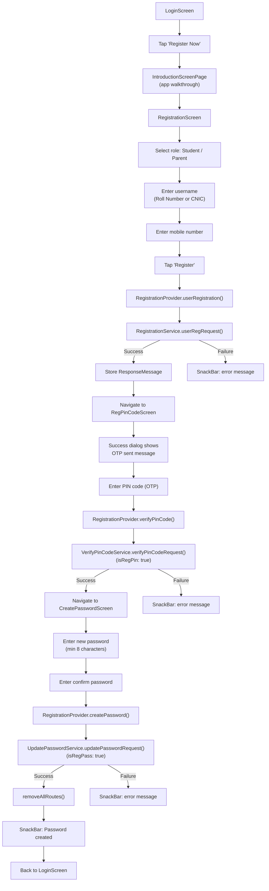
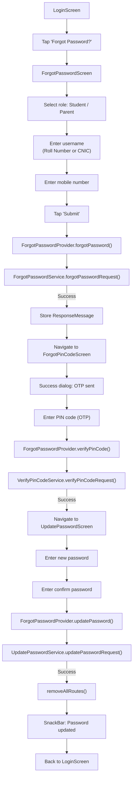
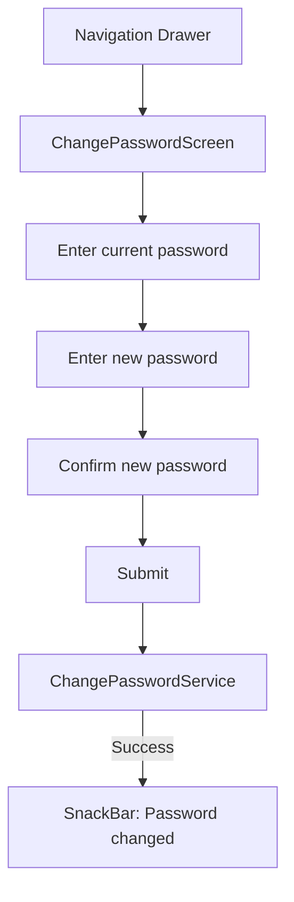

# Authentication Flow

## Overview

The app supports three user roles with distinct login credentials:

| Role | Username | Format |
|---|---|---|
| Student | Roll Number | `230935` |
| Teacher | Employee Number | `10045678` |
| Parent | Father CNIC | `42101-1234567-1` |

---

## Login Flow



### Login Response Model

```dart
class LoginResponse {
  String? tokenId;       // Session token
  String? name;          // Display name
  int? id;               // User ID
  UserInfo? info;        // Nested: Name, StudentId, ClassName, CenterName, RegionName, FatherEmail, Grade_Id
  String? userType;      // 'Student' | 'Teacher' | 'Parent'
  String? userName;      // Login username
  int? gradeId;          // Grade ID (for A-Level detection: 19/20)
  bool? isSuccessful;
  String? message;
}
```

### Key Implementation Details

- `LoginProvider` uses `MaskedTextController` for input formatting
  - Student/Teacher: `00000000` (8-digit numeric)
  - Parent: `00000-0000000-0` (CNIC format)
- `UserTypeTabSelector` is the inline role picker (no bottom sheet)
- On success: `LoginResponse` serialized as JSON string → `SharedPreferences` key `userData`
- After save: `pushReplacementTo(AuthWrapper)` — AuthWrapper reads the stored data and routes

---

## Registration Flow

New users must register before they can log in. Registration is available for **Students** and **Parents** only (first 2 user types).



### Registration Steps

| Step | Screen | Provider Method | Service | Validation |
|---|---|---|---|---|
| 1. Enter info | `RegistrationScreen` | `userRegistration()` | `RegistrationService.userRegRequest()` | Username + mobile number |
| 2. Verify OTP | `RegPinCodeScreen` | `verifyPinCode()` | `VerifyPinCodeService.verifyPinCodeRequest(isRegPin: true)` | PIN code |
| 3. Set password | `CreatePasswordScreen` | `createPassword()` | `UpdatePasswordService.updatePasswordRequest(isRegPass: true)` | Password ≥ 8 chars + match |

### Important Notes

- Registration only supports **Student** and **Parent** roles (`userTypeList.take(2)`)
- Teachers are pre-registered via the admin system
- The `isRegPin: true` and `isRegPass: true` flags differentiate registration from forgot-password flows on the backend
- On successful password creation, all routes are cleared and user returns to a clean login state
- The `RegistrationProvider` reads `LoginProvider.userType` to pre-select the role tab

---

## Forgot Password Flow

Existing users who forget their password follow a similar OTP-verified flow.



### Forgot Password Steps

| Step | Screen | Provider Method | Service |
|---|---|---|---|
| 1. Request reset | `ForgotPasswordScreen` | `forgotPassword()` | `ForgotPasswordService.forgotPasswordRequest()` |
| 2. Verify OTP | `ForgotPinCodeScreen` | `verifyPinCode()` | `VerifyPinCodeService.verifyPinCodeRequest()` |
| 3. New password | `UpdatePasswordScreen` | `updatePassword()` | `UpdatePasswordService.updatePasswordRequest()` |

### Key Differences from Registration

| Aspect | Registration | Forgot Password |
|---|---|---|
| Roles available | Student, Parent only | Student, Parent only |
| OTP verify flag | `isRegPin: true` | `isRegPin: false` (default) |
| Password set flag | `isRegPass: true` | `isRegPass: false` (default) |
| Entry point | "Register Now" button | "Forgot Password?" link |
| Intro screen | Yes (app walkthrough) | No |

---

## Change Password (Post-Login)

Available from the Navigation Drawer for all logged-in users.



---

## Session Management

| Action | Implementation |
|---|---|
| **Store session** | `LoginResponse` → JSON → `SharedPreferences('userData')` |
| **Read session** | `LocalDataProvider.loadStoredData()` → parse JSON → `LoginResponse` |
| **Logout** | `LogoutService.logoutRequest(tokenId)` → clear SharedPreferences → push AuthWrapper |
| **Auto-logout** | API returns "Invalid Access Key" → global interceptor triggers logout |
| **Upgrade guard** | `upgrader` package checks `minAppVersion` on AuthWrapper |
| **Teacher cache** | Teacher profile also cached under key `teacherProfileData` |

---

## A-Level Detection

Grade IDs `19` and `20` indicate A-Level students. This affects:
- Student attendance routing → subject-wise (chips) instead of direct calendar
- Teacher attendance → requires subject selection before marking
- Time lock bypass → A-Level classes are exempt from the 10 AM attendance cutoff

---

## Key Files

| File | Purpose |
|---|---|
| `lib/screens/LoginScreen/login_screen.dart` | Login UI with inline role tabs |
| `lib/provider/Login/login_provider.dart` | Login state + API call + role switching |
| `lib/provider/Registration/registration_provider.dart` | Registration 3-step flow |
| `lib/provider/ForgotPassword/forgot_password_provider.dart` | Forgot password 3-step flow |
| `lib/model/Login/login_response.dart` | `LoginResponse` + `UserInfo` model |
| `lib/screens/AuthWrapper/auth_wrapper.dart` | Post-login routing by role |
| `lib/provider/LocalData/local_data_provider.dart` | Session persistence + logout |
| `lib/screens/Registration/RegistrationScreen/` | Step 1: Enter username + mobile |
| `lib/screens/Registration/RegPinCodeScreen/` | Step 2: OTP verification |
| `lib/screens/Registration/CreatePasswordScreen/` | Step 3: Set password |
| `lib/screens/ForgotPassword/ForgotPasswordScreen/` | Step 1: Request reset |
| `lib/screens/ForgotPassword/ForgotPinCodeScreen/` | Step 2: OTP verification |
| `lib/screens/ForgotPassword/UpdatePasswordScreen/` | Step 3: Set new password |
| `lib/screens/Introduction/introduction_screen.dart` | App walkthrough before registration |

## Related Pages

- [[Teacher Flow]]
- [[Student Flow]]
- [[Parent Flow]]
