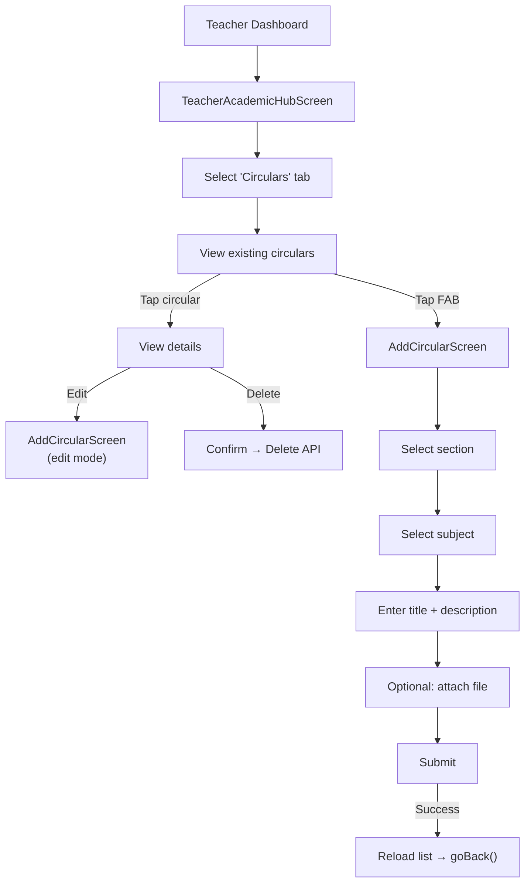
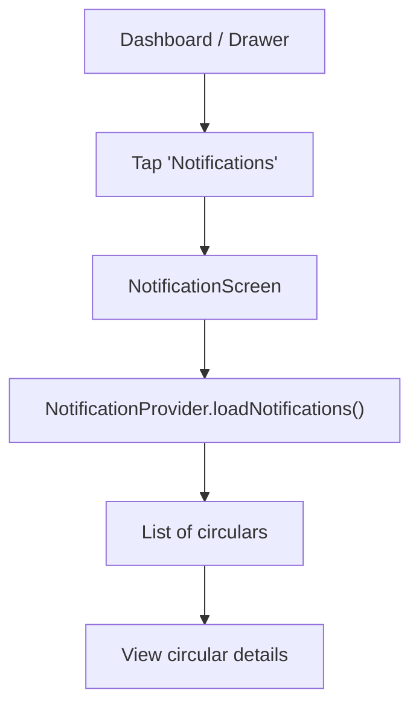

# Circulars Flow

## Overview

Teachers create and manage school circulars/announcements for specific class/sections. Students receive circulars through the notification system. Circulars follow the same CRUD pattern as Homework and Assignments.

## Teacher Flow

## Student Flow

## Key Files

| File | Purpose |
|---|---|
| `provider/Circular/circular_provider.dart` | Circular CRUD state |
| `provider/Notification/notification_provider.dart` | Student notification list |
| `screens/Teacher/TeacherCircularScreen/` | Teacher circular list |
| `screens/Teacher/AddCircularScreen/` | Create/edit circular |
| `screens/Student/Notifications/` | Student notification view |

## Related Pages

- [[Teacher Flow]]
- [[Student Flow]]
- [[Homework and Classwork Flow]]
