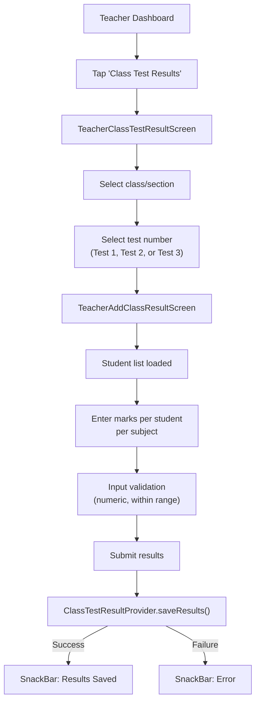
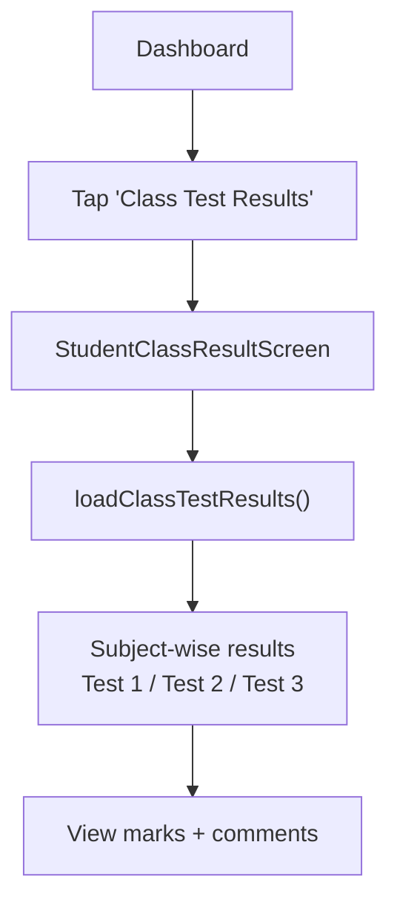

# Class Test Results Flow

## Overview

Teachers upload class test results (up to 3 tests per term per class/section). Students view their marks per subject. This flow is distinct from Term Results which come from the AIMS+ ERP.

## Teacher Flow: Enter Results

## Student Flow: View Results

## Key Files

| File | Purpose |
|---|---|
| `provider/ClassTestResult/class_test_result_provider.dart` | Test result state |
| `screens/Teacher/TeacherClassTestResultScreen/` | Teacher result entry |
| `screens/Student/StudentClassTestResultScreen/` | Student result view |
| `services/ClassTestResult/class_test_result_service.dart` | API calls |

## Related Pages

- [[Teacher Flow]]
- [[Student Flow]]
- [[Term Results Flow]]
