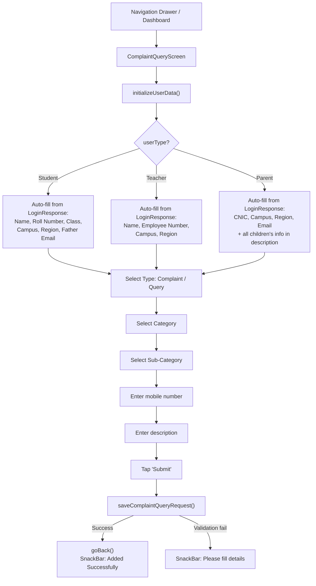

# Complaint & Query Flow

## Overview

Students and parents can submit categorized complaints and queries. The system auto-fills user information based on the logged-in user's role. For parents with multiple children, all children's information is automatically included.

## Flow Diagram



## Parent Multi-Child Auto-Fill

When a parent submits a complaint, all their children's information is automatically added to the description field:

```
Children Information:
1. Student Name: Ahmed Khan
   Class: Grade 5A
   Campus: North Campus
   Region: Karachi
   Student ID: 230935
   Father Email: father@email.com

2. Student Name: Sara Khan
   Class: Grade 3B
   ...
```

This is built by `_buildChildrenInfo()` using `multiChildResponse.children`.

## Category Selection

- **Type**: Complaint or Query (toggle)
- **Category**: First-level selection
- **Sub-Category**: Second-level selection under the chosen category

> **Note**: The backend integration is currently **commented out** in the provider. The form validates and shows a success message, but the actual API call to `AddWithdrawalRequestService` is not active.

## Key Files

| File | Purpose |
|---|---|
| `provider/ComplaintQuery/complaint_query_provider.dart` | Full form state + auto-fill logic |
| `screens/Parent/ComplaintQueryScreen/` | Form UI |
| `services/WithdrawalRequest/withdrawal_request_service.dart` | API (shared with withdrawal) |
| `model/WithdrawalRequest/withdrawal_response.dart` | Response model |
| `model/MultiChild/multi_child_response.dart` | Multi-child data |

## Related Pages

- [[Parent Flow]]
- [[Student Flow]]
