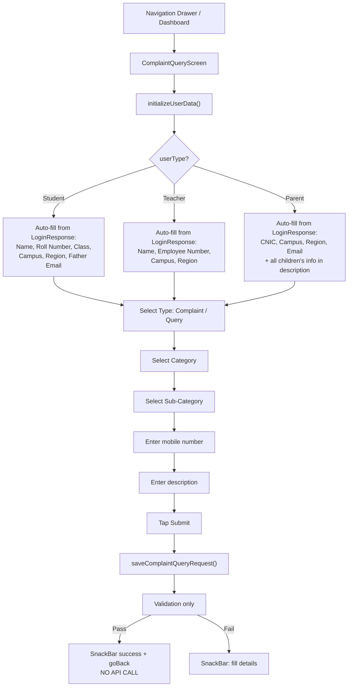

# Complaint & Query Flow

> Back to [[Home]] · [[Flows/Index|Flows]] · [[Flows/Parent Flow|Parent Flow]]

Students and parents can open a categorized complaint/query form. User fields are auto-filled from the session. For parents with multiple children, children’s info is appended into the description.

## Flow Diagram



## Save path — incomplete / mocked

`ComplaintQueryProvider.saveComplaintQueryRequest` (**code-verified**):

1. Shows loading dialog; validates form + type/sub-category.
2. On pass: `showSnackBar('Complaint Query Added Successfully')` and `goBack()` after 1s.
3. The real `AddWithdrawalRequestService.addWithdrawalRequest(...)` block is **fully commented out**.
4. No network call is made on submit.

Treat Complaint save as **not production-wired**.

## Load path — `GetWithdrawalReasons`

`loadComplaintQuery()` calls:

```dart
WithdrawalRequestService.getWithdrawalReasons(id: userId ?? 0)
```

Endpoint: `POST GetWithdrawalReasons` (shared with Withdrawal reasons load). Screen init uses this Future for category/reason data.

## Parent Multi-Child Auto-Fill

When a parent submits, `_buildChildrenInfo()` using `multiChildResponse.children` appends child blocks into the description (name, class, campus, region, student ID, father email).

## Category Selection

- **Type**: Complaint or Query
- **Category** / **Sub-Category**: driven by loaded withdrawal-reasons response structure

## Key Files

| File | Purpose |
|---|---|
| `provider/ComplaintQuery/complaint_query_provider.dart` | Form state; mocked save; `loadComplaintQuery` |
| `screens/Parent/ComplaintQueryScreen/` | Form UI |
| `services/WithdrawalRequest/withdrawal_request_service.dart` | `GetWithdrawalReasons` |
| `services/AddWithdrawalRequest/add_withdrawal_request_service.dart` | Intended save API (commented at call site) |
| `model/WithdrawalRequest/withdrawal_response.dart` | Response model |
| `model/MultiChild/multi_child_response.dart` | Multi-child data |

## Related Pages

- [[Parent Flow]]
- [[Student Flow]]
- [[Features/Index|Features]] — Complaint marked incomplete
