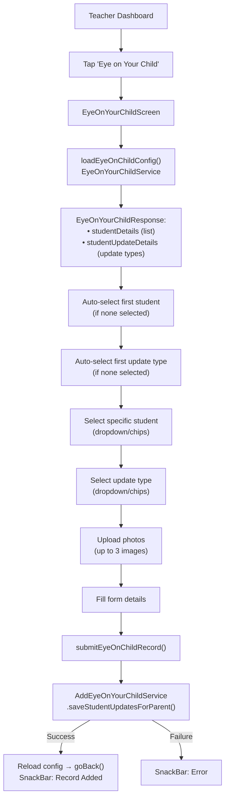
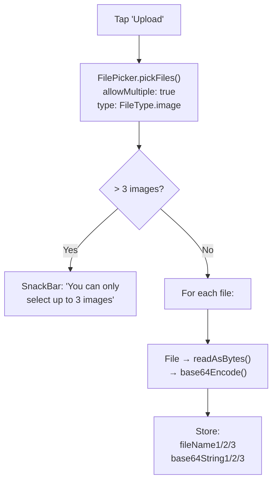
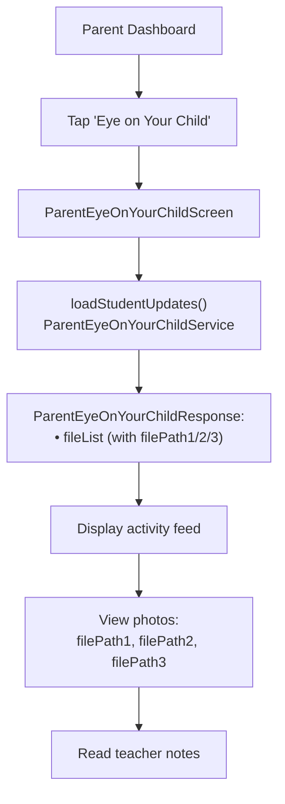

# Eye on Your Child Flow

## Overview

"Eye on Your Child" is an early-years feature (typically Grades 1–4) where teachers share student activity updates with photos. Parents receive these updates and can view them in real-time.

## Teacher Flow: Create Activity Update

## Photo Upload

The system supports up to **3 images** per activity update:

- Images are encoded as base64 strings and sent in the request body
- Each slot (`fileName1`/`base64String1`, etc.) maps to one image
- `removeAttachment(index)` removes a specific slot and reassigns the remaining

## Parent Flow: View Activity Updates

## Key Files

| File | Purpose |
|---|---|
| `provider/EyeOnYourChild/eye_on_your_child_provider.dart` | Teacher + parent state |
| `screens/Teacher/EyeOnYourChildScreen/` | Teacher create view |
| `screens/Parent/ParentEyeOnYourChildScreen/` | Parent view |
| `services/AddEyeOnYourChild/add_eye_on_your_child_service.dart` | Submit update API |
| `services/EyeOnYourChild/eye_on_your_child_service.dart` | Config/student list API |
| `services/ParentEyeOnYourChild/parent_eye_on_your_child_service.dart` | Parent view API |

## Related Pages

- [[Teacher Flow]]
- [[Parent Flow]]
