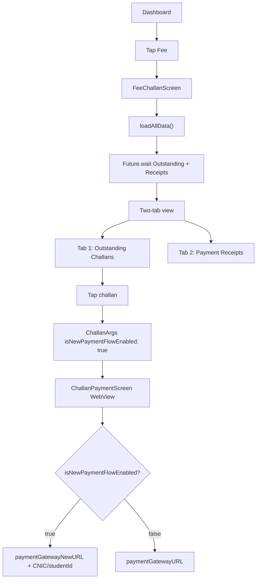

# Fee & Payment Flow

> Back to [[Home]] · [[Flows/Index|Flows]] · Diagram: [[Diagrams/Payment Flow|Payment Flow]]

Students and parents view outstanding fee challans from AIMS+ ERP and pay via an in-app WebView. Receipts for past payments are also listed.

## Flow Diagram

## Data Loading

`FeeChallanProvider.loadAllData()` uses `Future.wait()`:

- `loadOutstandingRecords()` → `FeeChallanService.outStandingChallanRequest()`
- `loadReceiptRecords()` → `FeeChallanService.challanReceiptRequest()`

Pull-to-refresh reloads both tabs.

## Payment flag — hardcoded

Code-verified gap:

| Piece | Status |
|---|---|
| `outstanding_fee_component.dart` | Passes `isNewPaymentFlowEnabled: true` in `ChallanArgs` |
| `FeatureConfigRepository` | Reads Firestore `newFeatures` / `newPaymentFlow` |
| UI pay path | **Does not call** `FeatureConfigRepository` |

Designed Firestore SSOT exists; Pay navigation currently always uses the new URL branch.

## WebView URLs

From `AppConstants` (`lib/utils/app_constants.dart`):

| Constant | URL | When used |
|---|---|---|
| `paymentGatewayNewURL` | `https://billing.thecityschool.edu.pk/directpayment/` | Flag true → appended `{fatherCnic}/{studentId}` |
| `paymentGatewayURL` | `https://billing.thecityschool.edu.pk/challan` | Flag false |

`ChallanPaymentScreen` builds `urlLink` in `initState`, loads via `webview_flutter`, 30s load timeout.

## Key Files

| File | Purpose |
|---|---|
| `provider/FeeChallan/feechallan_provider.dart` | Dual-tab data |
| `screens/Student/Feechallans/fee_challans_screen.dart` | Two-tab screen |
| `screens/Parent/ChallanPaymentScreen/challan_payment_screen.dart` | WebView payment |
| `components/FeeChallanComponents/outstanding_fee_component.dart` | Hardcoded flag |
| `repositories/FeatureConfig/feature_config_repository.dart` | Unused on Pay path |
| `services/FeeChallan/feechallan_service.dart` | Outstanding + receipt APIs |
| `routes/challan_args.dart` | `ChallanArgs` |

## Related Pages

- [[Student Flow]]
- [[Parent Flow]]
- [[Firebase/Firestore|Firestore]]
- [[Diagrams/Payment Flow|Payment Flow diagram]]
