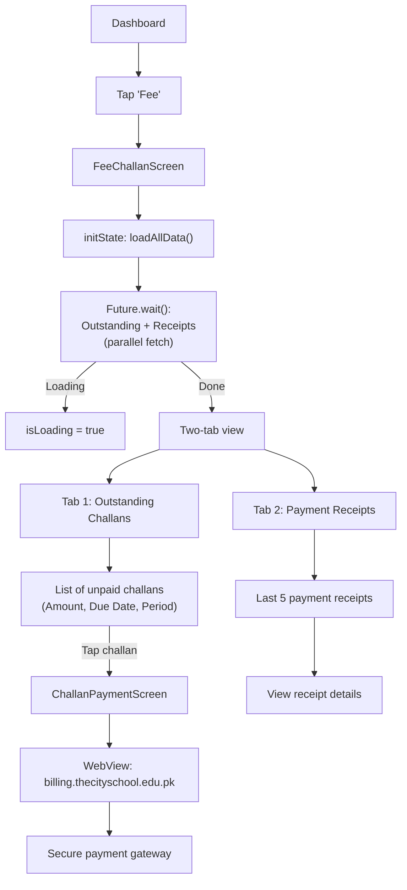

# Fee & Payment Flow

## Overview

Students and parents view outstanding fee challans from the AIMS+ ERP system and make payments via a secure WebView gateway. Receipts for past payments are also displayed.

## Flow Diagram



## Data Loading

`FeeChallanProvider.loadAllData()` uses `Future.wait()` to fetch both tabs concurrently:

```dart
await Future.wait([
  loadOutstandingRecords(),  // FeeChallanService.outStandingChallanRequest()
  loadReceiptRecords(),      // FeeChallanService.challanReceiptRequest()
]);
```

- `isLoading` flag manages the loading state
- `loadError` captures any error for display
- Pull-to-refresh triggers `loadAllData()` again from any tab

## Payment Gateway

| Key | Value |
|---|---|
| **URL** | `https://billing.thecityschool.edu.pk/challan` |
| **Direct Payment** | `https://billing.thecityschool.edu.pk/directpayment/` |
| **Implementation** | `webview_flutter` package |
| **Screen** | `ChallanPaymentScreen` |
| **Arguments** | `ChallanArgs` passed via route arguments |

## Key Files

| File | Purpose |
|---|---|
| `provider/FeeChallan/feechallan_provider.dart` | Dual-tab data + loading state |
| `screens/Student/Feechallans/fee_challans_screen.dart` | Two-tab screen |
| `screens/Parent/ChallanPaymentScreen/challan_payment_screen.dart` | WebView payment |
| `services/FeeChallan/feechallan_service.dart` | Outstanding + receipt APIs |
| `model/FeeChallan/outstanding_challan_response.dart` | Outstanding model |
| `model/FeeChallan/challan_receipts_response.dart` | Receipt model |
| `routes/challan_args.dart` | Payment screen arguments |

## Related Pages

- [[Student Flow]]
- [[Parent Flow]]
