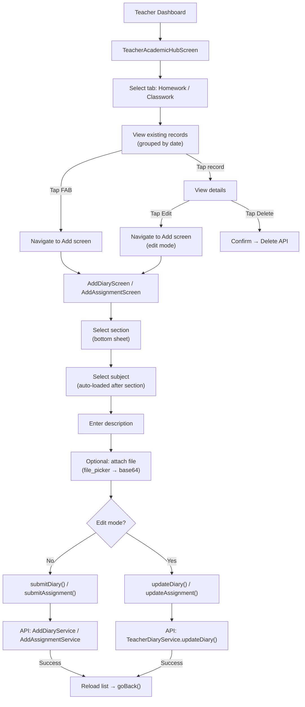
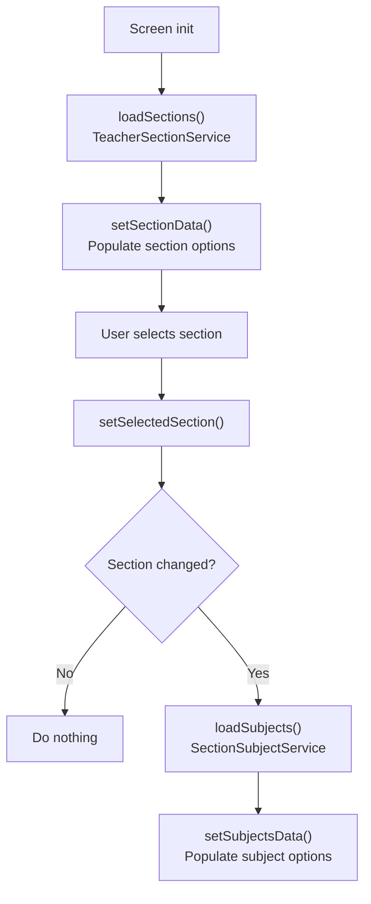
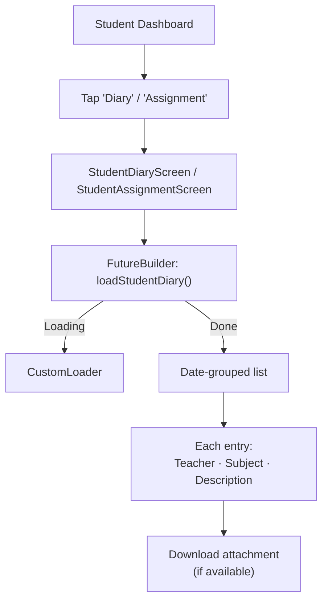

# Homework & Classwork Flow

## Overview

Teachers create homework (Diary) and classwork (Assignments) for their assigned sections. Students view them in date-grouped lists. Both follow an identical CRUD pattern with the same UI components, but use separate API endpoints.

## Teacher: Create / Edit / Delete



## Teacher: Loading Sections & Subjects



## Edit Mode

When editing an existing record, the route passes the record object as `settings.arguments`:

```dart
// In RouteGenerator
case AppNavRoutes.addDiaryRoute:
  return routeScreen(
    child: AddDiaryScreen(
      editRecord: settings.arguments is DiaryRecords
          ? settings.arguments as DiaryRecords
          : null,
    ),
  );
```

The provider's `initForEdit()` method:
1. Sets `isEdit = true`
2. Pre-fills subject, description, section, date from the existing record
3. `resolveIds()` maps section/subject names back to IDs

**Important**: `initForEdit()` does NOT call `notifyListeners()` — `resolveIds()` fires a single notification at the end.

## Delete Flow

```dart
// DiaryProvider.deleteDiary(id)
1. Show loading
2. Call TeacherDiaryService.deleteDiary(DeleteActionRequest)
3. On success: reload list + SnackBar
4. On failure: SnackBar error
```

## Student: Viewing



### Date Grouping

- Uses `grouped_list` package
- All records with the same date appear under a single date header
- Auto-hidden after 7 days (server-side filtering)

## Attachment Handling

| Operation | Implementation |
|---|---|
| **Pick file** | `file_picker` package → `FilePickerResult` |
| **Encode** | File → `readAsBytes()` → `base64Encode()` |
| **Send** | `fileName` + `filePath` (base64 string) in request body |
| **Remove** | `removeAttachment()` → sets both to null |

## Key Files

### Homework (Diary)

| File | Purpose |
|---|---|
| `provider/Diary/diary_provider.dart` | Full CRUD state + section/subject loading |
| `screens/Teacher/AddDiaryScreen/add_diary_screen.dart` | Create/edit UI |
| `screens/Teacher/TeacherDiaryScreen/teacher_diary_screen.dart` | Teacher list view |
| `screens/Student/StudentDiaryScreen/student_diary_screen.dart` | Student list view |
| `services/AddDiary/add_diary_service.dart` | Create API |
| `services/TeacherDiary/teacher_diary_service.dart` | List + update + delete APIs |
| `services/StudentDiary/student_diary_service.dart` | Student fetch API |

### Classwork (Assignment)

| File | Purpose |
|---|---|
| `provider/Assignment/assignment_provider.dart` | Full CRUD state (mirrors Diary pattern) |
| `screens/Teacher/AddAssignmentScreen/add_assignment_screen.dart` | Create/edit UI |
| `screens/Teacher/TeacherAssignmentScreen/teacher_assignment_screen.dart` | Teacher list view |
| `screens/Student/StudentAssignmentScreen/student_assignment_screen.dart` | Student list view |
| `services/AddAssignment/add_assignment_service.dart` | Create API |
| `services/TeacherAssignment/teacher_assignment_service.dart` | List + update + delete APIs |
| `services/StudentAssignment/student_assignment_service.dart` | Student fetch API |

## Related Pages

- [[Teacher Flow]]
- [[Student Flow]]
- [[Circulars Flow]]
