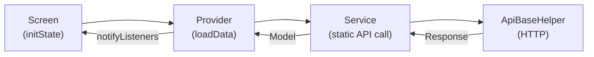

# User Flow Documentation

> Back to [[Home]] · App version **2.0.0+89** (`pubspec.yaml`)

This section documents the complete user journeys for each role and every major feature in the Cityzens app.

> [!note] Documentation version
> Flow pages in this folder were refreshed **2026-08-04** against code. Prefer these pages and [[Diagrams/Index|Diagrams]] over stale README journey notes.

---

## Platform / cross-cutting

| Flow | Description |
|---|---|
| [[Splash and Startup Flow]] | SplashProvider, promotion gate, AuthWrapper |
| [[Promotion Flow]] | `GetAllLaunchPromotions`, PromotionScreenUI |
| [[Notification Flow]] | FCM + `Notifications` API inbox |
| [[Result PDF Flow]] | PDFResults, AllPDFResults, ResultPdfDownloadService |

---

## Role Flows

| Flow | Description |
|---|---|
| [[Authentication Flow]] | Login, Registration (3-step OTP), Forgot Password, Change Password, Session Management |
| [[Teacher Flow]] | Dashboard, content creation, navigation guards |
| [[Student Flow]] | Dashboard, viewing academic data, multi-child support |
| [[Parent Flow]] | Multi-child selection, monitoring, complaints |

---

## Feature Flows

### Attendance

| Flow | Actor(s) | Description |
|---|---|---|
| [[Mark Attendance Flow]] | Teacher | Mark P/A/L/U, live pie chart, time lock, A-Level subjects |
| [[Student Attendance Flow]] | Student/Parent | Calendar view, subject chips (A-Level), shimmer loading, session caching |

### Academic Content

| Flow | Actor(s) | Description |
|---|---|---|
| [[Homework and Classwork Flow]] | Teacher (CRUD), Student (view) | Create/edit/delete diary & assignments, file attachments, date grouping |
| [[Circulars Flow]] | Teacher (CRUD), Student (view) | Announcements, notifications |
| [[Class Test Results Flow]] | Teacher (enter), Student (view) | Test 1/2/3 marks entry, per-subject results |
| [[Term Results Flow]] | Student/Parent | AIMS+ ERP results, academic session/term selection, eye results |

### Management

| Flow | Actor(s) | Description |
|---|---|---|
| [[Timetable Flow]] | Teacher (CRUD), Student (view) | 9×5 grid, subject abbreviations |
| [[Eye on Your Child Flow]] | Teacher (create), Parent (view) | Activity updates with photos (up to 3), early years |
| [[Fee and Payment Flow]] | Student/Parent | Outstanding challans, receipts, WebView payment gateway |
| [[Complaint and Query Flow]] | Student/Parent | Categorized complaints; save path currently mocked |

---

## Flow Architecture Pattern

All feature flows follow a consistent pattern:

1. **Screen** calls the provider method in `initState()` or via `FutureBuilder`
2. **Provider** calls the static service method
3. **Service** makes the HTTP call via `ApiBaseHelper`
4. Response is parsed into a **Model** and stored in the provider
5. `notifyListeners()` triggers a UI rebuild

## Related

- [[Features/Index|Feature Status Matrix]]
- [[Diagrams/Index|Diagrams]]
- [[Architecture/State Management|State Management]]
