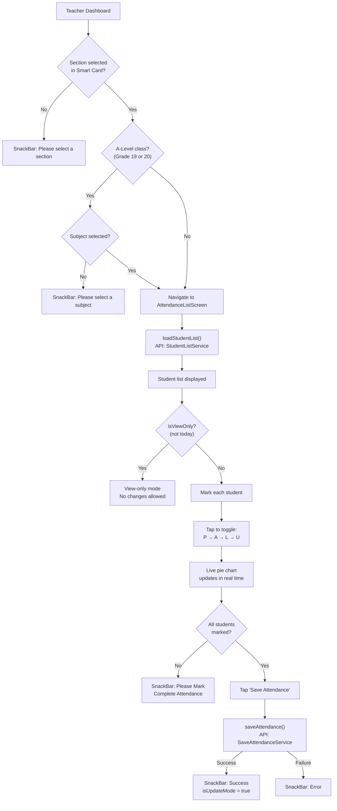

# Mark Attendance Flow

## Overview

Teachers mark daily attendance for students in their assigned class/sections. A-Level classes (Grade 19/20) require subject selection. The system supports 4 attendance statuses and includes a visual pie chart preview before submission.

## Flow Diagram



## Attendance Status Types

| Status | Letter | Type ID | Color |
|---|---|---|---|
| Present | `P` | `1` | 🟢 Green |
| Absent | `A` | `2` | 🔴 Red |
| Leave | `L` | `3` | 🟡 Amber |
| Unreconciled | `U` | `35` | ⚫ Grey |

## Important Business Rules

- **Default to Present**: If today's date, all unmarked students default to `P` (attnTypeId = 1)
- **View-Only Mode**: Past dates are read-only — `isViewOnly` returns true if `selectedDate != today`
- **Weekend Guard**: Saturday and Sunday are flagged via `isWeekend`
- **Time Lock**: On production, standard classes cannot mark attendance after 10:00 AM
  - Bypassed on test environment
  - Bypassed for A-Level classes (19/20)
- **Update Mode**: If any student already has attendance from the API (`attnTypeId != 0`), `isUpdateMode = true` — this shows "Update" instead of "Save"
- **Dirty Flag**: `isDirty` tracks whether any change has been made since load, preventing accidental back navigation

## Live Statistics

`getLiveStatistics()` counts P/A/L/U in real-time:

```dart
Map<String, int> getLiveStatistics() {
  // Iterates students list, counts by attnTypeId
  // Returns: {'Present': n, 'Absent': n, 'Leave': n, 'Unreconciled': n}
}
```

The pie chart (`fl_chart`) is generated from `generateAttendanceGraph()` and updates with every status toggle.

## Key Files

| File | Purpose |
|---|---|
| `provider/MarkAttendance/mark_attendance_provider.dart` | All attendance state + business logic |
| `screens/Teacher/AttendanceListScreen/attendance_list_screen.dart` | Student list UI |
| `components/MarkAttendanceComponents/` | Attendance row, pie chart, submit button |
| `services/StudentList/student_list_service.dart` | Fetch student list API |
| `services/SaveAttendance/save_attendance_service.dart` | Submit attendance API |
| `model/StudentAttendance/save_attendance_request.dart` | Request model |
| `model/StudentAttendance/student_list_response.dart` | Response model |

## Related Pages

- [[Teacher Flow]]
- [[Student Attendance Flow]]
