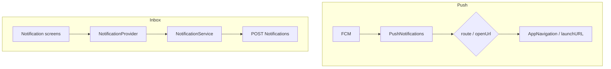

# Notification Flow

> Back to [[Home]] · [[Flows/Index|Flows]] · Diagram: [[Diagrams/Notification Flow|Notification Flow]] · [[Firebase/Messaging|Messaging]]

Two complementary systems: **push** (FCM + local notifications) and **in-app inbox** (`Notifications` API).

## 1. Push (FCM)

Bootstrap: `main.dart` background handler → `AppInitializer` → `FirebaseMaster._initFCMListeners` + `PushNotifications.init`.

| Path | Handler |
|---|---|
| Foreground | `onMessage` → local notification show |
| Background | `_firebaseMessagingBackgroundHandler` → `showFromBackgroundSafe` |
| Opened / terminated | `onMessageOpenedApp` / `getInitialMessage` → tap routing |

### Tap payload

| Key | Action |
|---|---|
| `route` | Navigate; aliases `Diary` → student diary, `Classwork` → student assignment; else `AppNavRoutes.isRouteAvailable` |
| `openUrl` | External URL via `HelperFunction.launchURL` |
| `Challan` | Commented out in source |

Preference: SharedPreferences `notifications_enabled` (default `true`).

### Token refresh

`FcmTokenRefreshService.refreshToken` → `POST RefreshToken`. In `kDebugMode`, returns early **without** calling the API. Login also sends FCM tokens on `Auth`.

Android channel: `cityzens_notifications` / icon `ic_notification`.

## 2. In-app Notifications API

| Piece | Detail |
|---|---|
| Service | `NotificationService.notificationRequest` |
| Endpoint | `POST Notifications` |
| Body | `UserDataRequest` (`userName`, `tokenId`, `group`) |
| Provider | `NotificationProvider.loadNotificationData(NotificationGroup)` |

### Groups

| Enum | `groupId` |
|---|---|
| `challan` | `1` |
| `library` | `2` |
| `circulars` | `3` |

UI surfaces: notification components, library provider hooks, academic hub, message / challan notification screens.

## Mermaid (combined)

## Key files

| File | Role |
|---|---|
| `lib/services/InitServices/push_notifications.dart` | Local plugin + tap routing |
| `lib/services/InitServices/firebase_master.dart` | FCM listeners |
| `lib/services/FCMTokenRefresh/fcm_token_refresh_service.dart` | `RefreshToken` |
| `lib/services/Notifications/notification_service.dart` | Inbox API |
| `lib/provider/Notifications/notification_provider.dart` | Inbox state |

## Related

- [[Diagrams/Notification Flow|Notification Flow diagram]]
- [[Diagrams/Deep Link Flow|Deep Link Flow]] — payload-only; no OS scheme
- [[Firebase/Messaging|Messaging]]
