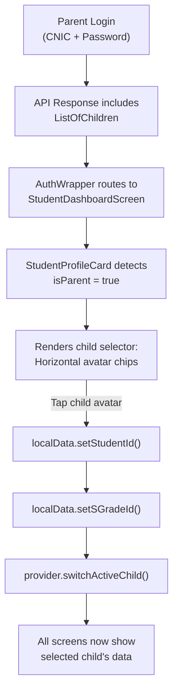
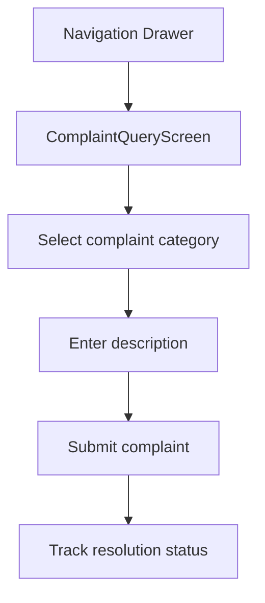
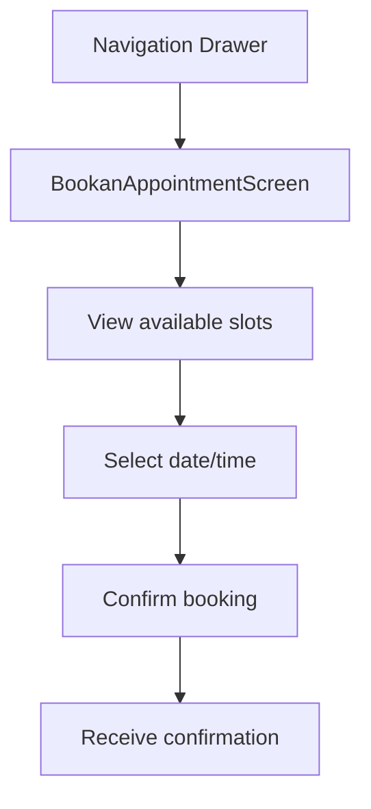
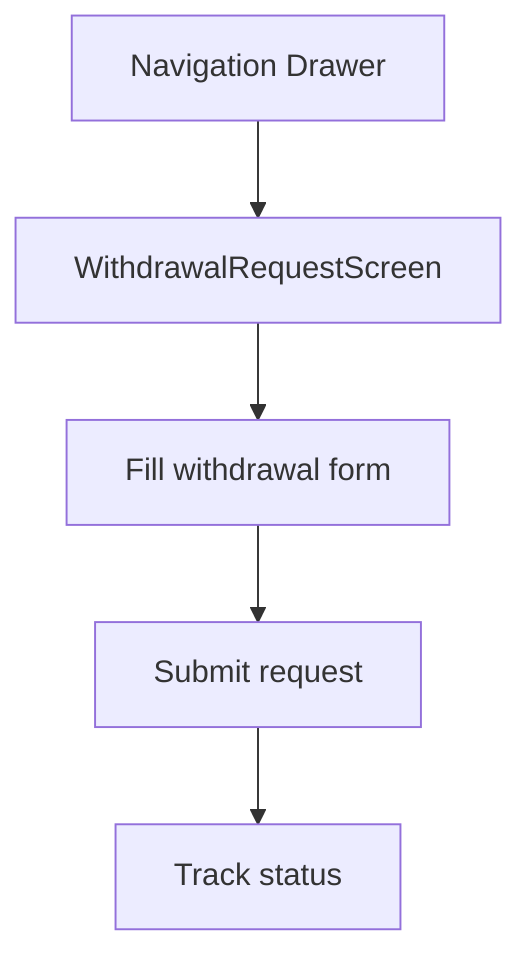

# Parent Flow

## Overview

Parents share the **Student Dashboard** with an additional child-selection layer. They can:
- Switch between multiple children seamlessly
- View all student features for the selected child
- Edit student contact information
- Submit complaints and book appointments

## Multi-Child Authentication

## Dashboard UI — Parent View

The `StudentProfileCard` renders differently for parents:

1. **"SELECT CHILD" header** with child count badge
2. **Horizontal scrollable avatar list** — each child's photo in a circular frame
3. **Active child** highlighted with `goldenYellow` border (2px)
4. **Tapping a new child** triggers:
   - `HapticFeedback.lightImpact()`
   - Student ID update
   - Grade ID update
   - Dashboard data reload (profile, attendance, cached data)

## Parent-Exclusive Features

### 1. Profile Editing
- Unlike students, parents **can** edit contact information
- The `StudentProfileComponent` checks `userType` via `LocalDataProvider`
- Students see disabled fields; parents see editable fields with a "SAVE CHANGES" button

### 2. Complaint & Query

### 3. Appointment Booking (🚧 In Progress)

### 4. Withdrawal Request (🚧 In Progress)

### 5. Eye on Your Child (Early Years)
- Parents **receive** activity updates created by teachers
- View photos and descriptive notes
- Different screen from teacher: `ParentEyeOnYourChildScreen`

### 6. Surveys
- Complete parent-specific surveys via `ParentSurveyScreen`

## Data Scoping

When a parent selects a child, the `studentId` is set globally in `LocalDataProvider`. Every provider that needs student-specific data reads from `localDataProvider.studentId`. This means:

- Switching children is instant — no re-authentication required
- All screens automatically reflect the active child
- Session-cached data (like A-Level subjects) is per-session, so switching children may need a data refresh

## Key Files

| File | Purpose |
|---|---|
| `screens/Student/StudentDashboardScreen/components/student_profile_card.dart` | Child selector UI |
| `provider/StudentDashboard/student_dashboard_provider.dart` | `switchActiveChild()` |
| `provider/LocalData/local_data_provider.dart` | `setStudentId()`, `setSGradeId()` |
| `screens/Parent/ComplaintQueryScreen/` | Complaint submission |
| `screens/Parent/AppointmentScreen/` | Appointment booking |
| `screens/Parent/WithdrawalRequestScreen/` | Withdrawal request |
| `screens/Parent/ParentEyeOnYourChildScreen/` | View teacher updates |

## Related Pages

- [[Authentication Flow]]
- [[Teacher Flow]]
- [[Student Flow]]
