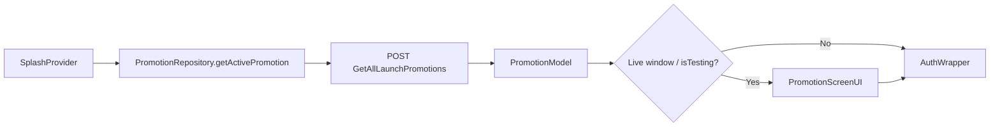

# Promotion Flow

> Back to [[Home]] · [[Flows/Index|Flows]] · [[Flows/Splash and Startup Flow|Splash & Startup]]

Launch ads shown between splash and auth when an active promotion exists.

## Data source

`PromotionRepository` (`lib/repositories/Promotion/promotion_repository.dart`):

| Method | Endpoint | Notes |
|---|---|---|
| `getActivePromotion()` | `POST GetAllLaunchPromotions` | Prefers item with `promotionKey == 'launchPromotion'`; else first item |
| `getActivePromotionList()` | `POST GetAllLaunchPromotions` | Full list for management UI |
| `addPromotion` / `updatePromotion` / `deletePromotion` | Create / Update / DeleteLaunchPromotion | **Debug-only** (`kDebugMode`); support JSON or multipart (`file`) |

No Firestore on this path — promotions are ERP API-backed.

## Display UI

Route: `AppNavRoutes.promotionRoute` (`/promotion`) → `PromotionScreenUI`.

Source: `lib/screens/Promotion/promotion_screen_ui.dart`.

1. Reads `SplashProvider.activePromotion` (already loaded at splash).
2. Logs impression via `AdAnalyticsService.logAdImpression`.
3. **Video** (`promotionType` matches video): `VideoPlayerController.asset` + progress listener.
4. **Image / other**: timer based on `displayDuration`.
5. On complete / skip → `AppNavigation.pushReplacementTo(authWrapperRoute)`.
6. Optional tap link via `HelperFunction.launchURL` when `tapLinkURL` is set.

## Management (debug tooling)

| Screen | Role |
|---|---|
| `PromotionManagementScreen` | List / manage promotions via repository |
| `PromotionFormScreen` | Create / edit |
| `PromotionWrapper` / `PromotionDialog` | Supporting wrappers |

CRUD is guarded to debug builds in the repository.

## Flow diagram

## Key files

| File | Role |
|---|---|
| `lib/repositories/Promotion/promotion_repository.dart` | API + CRUD |
| `lib/model/Promotion/promotion_model.dart` | Freezed model |
| `lib/screens/Promotion/promotion_screen_ui.dart` | Launch display |
| `lib/provider/Splash/splash_provider.dart` | Fetch + gate |

## Related

- [[Flows/Splash and Startup Flow|Splash and Startup Flow]]
- [[Diagrams/Startup Flow|Startup Flow diagram]]
- [[Flutter/Analytics and Logging|Analytics]]
