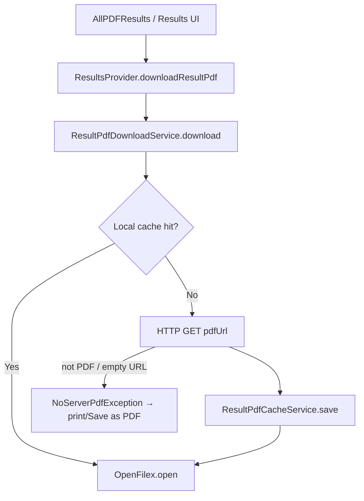

# Result PDF Flow

> Back to [[Home]] · [[Flows/Index|Flows]] · Diagram: [[Diagrams/Result Flow|Result Flow]] · [[Flows/Term Results Flow|Term Results Flow]]

Student/parent term results and PDF archive download/cache.

## API surface

| Provider method | Service | Endpoint | Model |
|---|---|---|---|
| Term load (`resultsRequest` path) | `ResultService.resultsRequest` | `POST PDFResults` | `ResultsResponse` with `List<PDFResults>` + EyeResult |
| `loadAllPDFResults()` | `ResultService.allPDFResultsRequest` | `POST AllPDFResults` | `AllPDFResultsResponse` / `PDFResultItem` list |
| `downloadResultPdf(item)` | `ResultPdfDownloadService.download` | HTTP GET `pdfUrl` | `SavedResultPdf` |

Evidence: `lib/services/Results/result_service.dart`, `lib/provider/Results/results_provider.dart`.

## Archive list UI

1. Dashboard / nav → `AppNavRoutes.allPDFResultsRoute`.
2. `AllPDFResultsScreen` calls `ResultsProvider.loadAllPDFResults()`.
3. In-memory cache keyed by `studentId` (`_allResultsCache`); `forceRefresh` bypasses cache.
4. `AllPDFResultsListComponent` renders `allPDFResultsResponse?.pdfResults`.

## Download pipeline

| Behavior | Detail |
|---|---|
| Cache | `ResultPdfCacheService` index + files; skip network unless `forceRedownload` |
| Validation | Bytes must look like PDF; else `NoServerPdfException` |
| State | `downloadingPdfKeys`, `downloadedPdfKeys`, `pdfDownloadErrors` |
| Analytics | `AppAnalyticsService.logResultPdfEvent` |

## Key files

| File | Role |
|---|---|
| `lib/provider/Results/results_provider.dart` | Load + download orchestration |
| `lib/services/Results/result_service.dart` | ERP POSTs |
| `lib/services/Results/result_pdf_download_service.dart` | Download + cache write |
| `lib/services/Results/result_pdf_cache_service.dart` | Disk cache |
| `lib/screens/Student/ResultScreen/all_pdf_results_screen.dart` | Archive screen |
| `lib/components/ResultsComponents/all_pdf_results_list_component.dart` | List UI |
| `lib/model/Results/results_response.dart` | `PDFResults` |
| `lib/model/Results/all_pdf_results_response.dart` | Archive response |

## Related

- [[Diagrams/Result Flow|Result Flow diagram]]
- [[Flows/Term Results Flow|Term Results Flow]]
- [[Flutter/Storage and Caching|Storage and Caching]]
