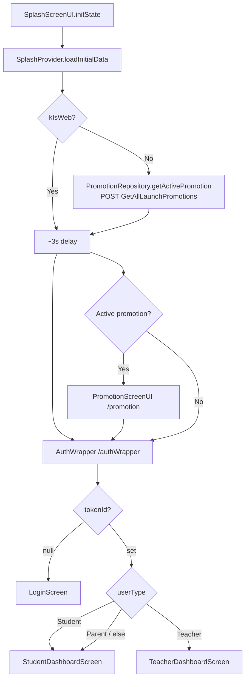

# Splash and Startup Flow

> Back to [[Home]] · [[Flows/Index|Flows]] · Diagram: [[Diagrams/Startup Flow|Startup Flow]]

Cold-start path after `main()` → `TCSApp` → `SplashScreenUI`.

## Sequence

## SplashProvider

Source: `lib/provider/Splash/splash_provider.dart`.

| Step | Behavior |
|---|---|
| Web | Skips promotion fetch; after 3s → `authWrapperRoute` |
| Mobile | `Future.wait([PromotionRepository().getActivePromotion()])` stores `_activePromotion` |
| Navigation | After 3s delay, either `promotionRoute` or `authWrapperRoute` via `AppNavigation.pushReplacementTo` |

### Promotion gate (mobile)

Navigates to promotion when `_activePromotion != null` **and**:

- **Release**: `isLive` and `startDate` before now and `endDate` after now, **or**
- **Debug**: `isTesting` is true

Otherwise → AuthWrapper.

## AuthWrapper

Source: `lib/screens/AuthWrapper/auth_wrapper.dart`.

1. `LocalDataProvider.loadStoredData()` restores session.
2. Mobile wraps child in `UpgradeAlert` (`Upgrader(minAppVersion: AppConstants.appVersion)` → `2.0.0`).
3. `tokenId == null` → `LoginScreen`.
4. Else by `userType`: Student → `StudentDashboardScreen`; Teacher → `TeacherDashboardScreen`; Parent (and any other) → `StudentDashboardScreen`.

## Key files

| File | Role |
|---|---|
| `lib/screens/SplashScreen/splash_screen_ui.dart` | UI + calls `loadInitialData` |
| `lib/provider/Splash/splash_provider.dart` | Promotion check + navigation |
| `lib/repositories/Promotion/promotion_repository.dart` | `GetAllLaunchPromotions` |
| `lib/screens/AuthWrapper/auth_wrapper.dart` | Session + role routing |
| `lib/routes/app_navigation_routes.dart` | `promotionRoute`, `authWrapperRoute` |

## Related

- [[Flows/Promotion Flow|Promotion Flow]]
- [[Flows/Authentication Flow|Authentication Flow]]
- [[Flutter/Lifecycle|Lifecycle]]
- [[Diagrams/Startup Flow|Startup Flow diagram]]
