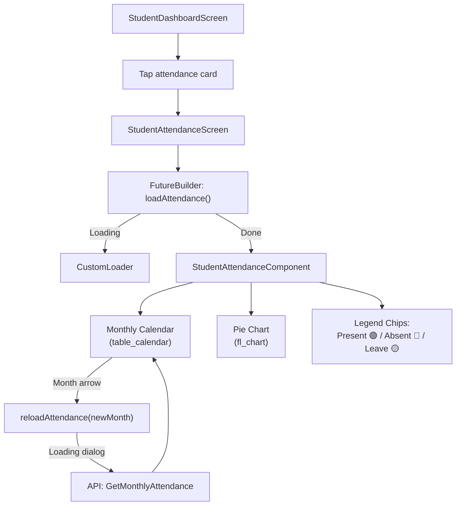
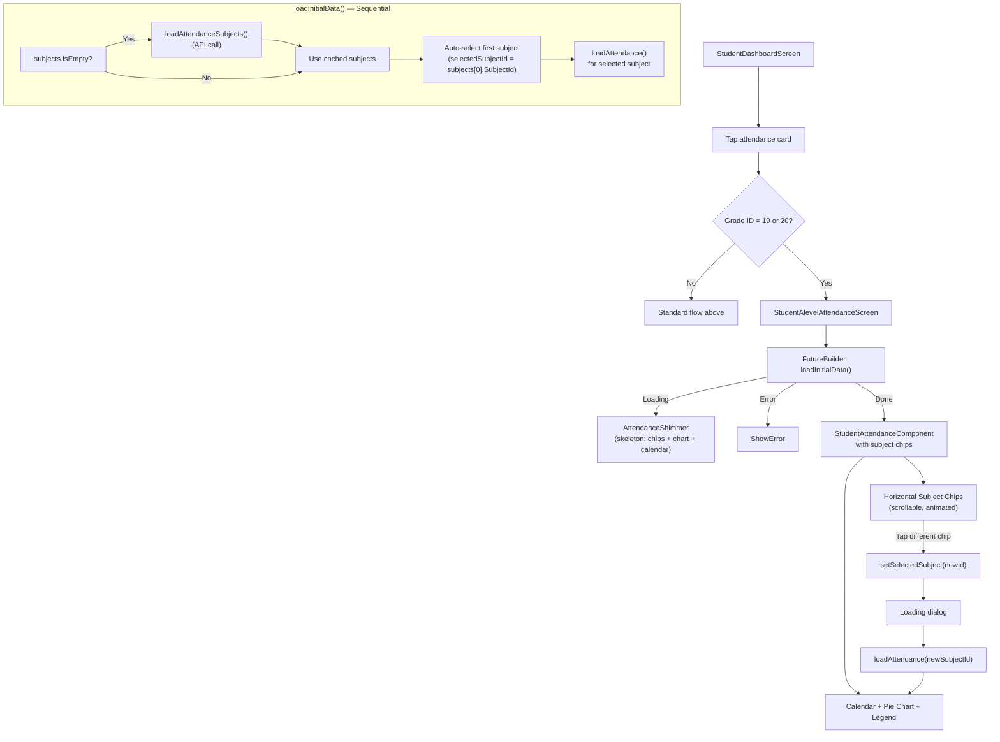

# Student Attendance Flow

## Overview

Students view their attendance history through a monthly calendar with color-coded indicators and a pie chart summary. Standard students see a direct calendar; A-Level students (Grade 19/20) get a single-screen flow with subject chips and session caching.

## Standard Attendance (Non A-Level)

## A-Level Attendance (Grade 19/20)

## Subject Chip Design

The subject chips are horizontal `AnimatedContainer` widgets:

| State | Style |
|---|---|
| **Active** | `primaryBlue` background, white text, elevated shadow |
| **Inactive** | White background, `primaryBlue` text, subtle border |
| **Transition** | 200ms `AnimatedContainer` for smooth switching |

## Session Caching

- Subjects are fetched **once per session** and stored in `StudentALevelAttendanceProvider.subjects`
- Subsequent screen visits skip the API call and use the cached list
- Only the attendance calendar data is re-fetched on subject switch

## Shimmer Loading

`AttendanceShimmer` displays a skeleton layout matching the real content:
1. **Subject chips row** — 4 rounded placeholder containers
2. **Monthly summary** — 250px tall placeholder
3. **Calendar** — 350px tall placeholder

Uses the same `ShaderMask` + `LinearGradient` animation pattern as `DashboardShimmer`.

## Calendar Indicators

| Status | Color | Indicator |
|---|---|---|
| Present | `#10B981` (green) | Green dot/highlight |
| Absent | `#EF4444` (red) | Red dot/highlight |
| Leave | `#F59E0B` (amber) | Yellow dot/highlight |

## Key Files

| File | Purpose |
|---|---|
| `provider/StudentAttendance/student_attendance_provider.dart` | Standard attendance state |
| `provider/StudentAttendance/student_alevel_attendance_provider.dart` | A-Level flow + subject caching |
| `screens/Student/StudentAttendanceScreen/student_attendance_screen.dart` | Standard attendance screen |
| `screens/Student/StudentAttendanceScreen/student_alevel_attendance_screen.dart` | A-Level attendance screen |
| `components/StudentAttendanceComponents/` | Calendar, pie chart, subject chips, legend |
| `custom_widgets/ShimmerEffect/attendance_shimmer.dart` | Skeleton loading effect |

## Related Pages

- [[Mark Attendance Flow]]
- [[Student Flow]]
