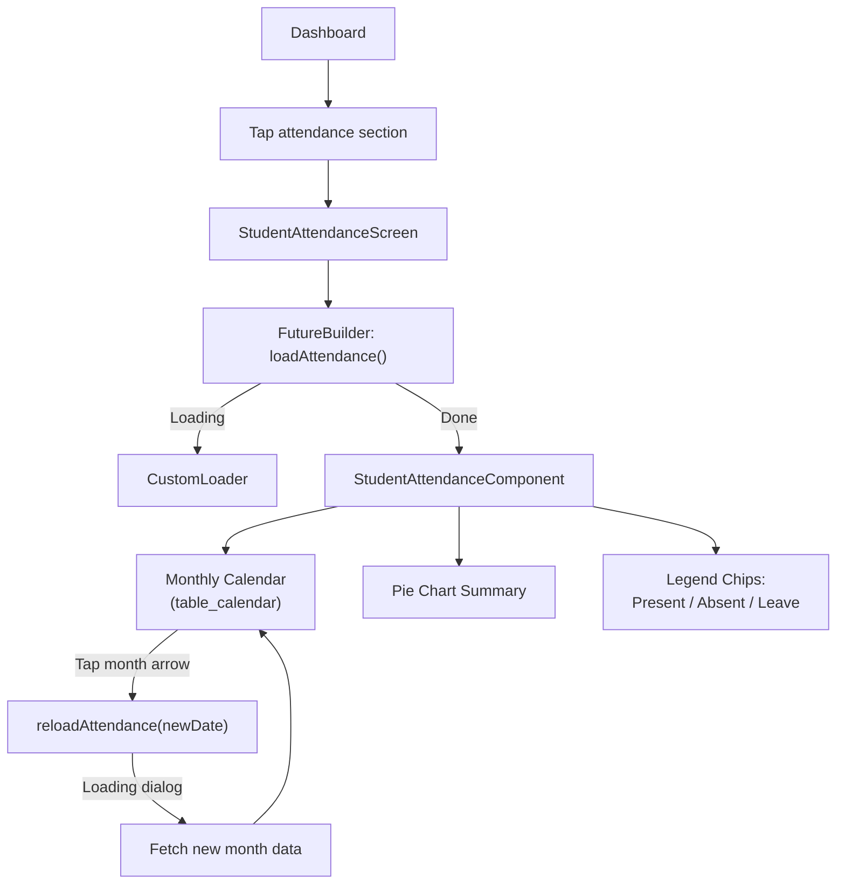
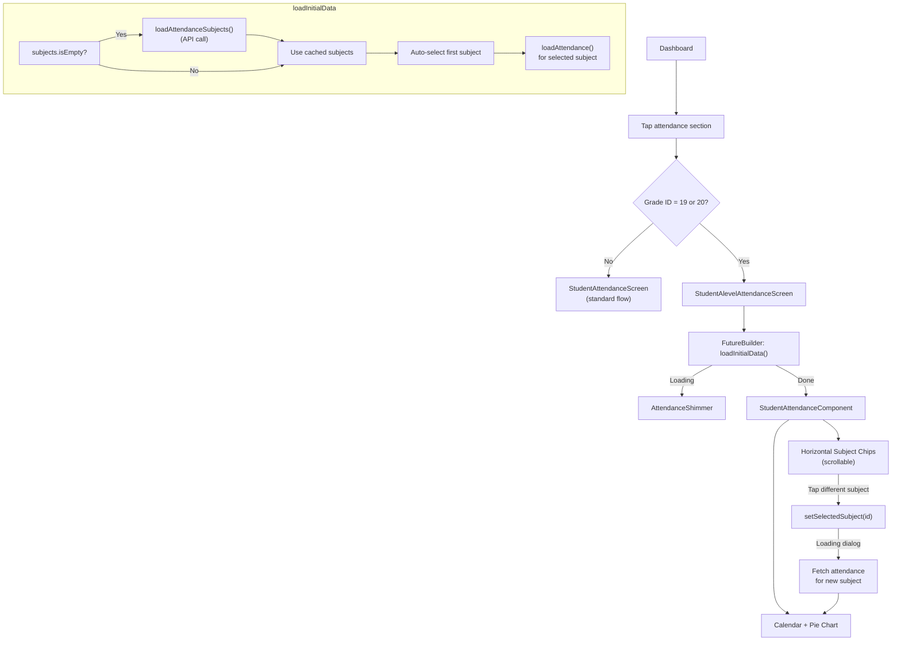
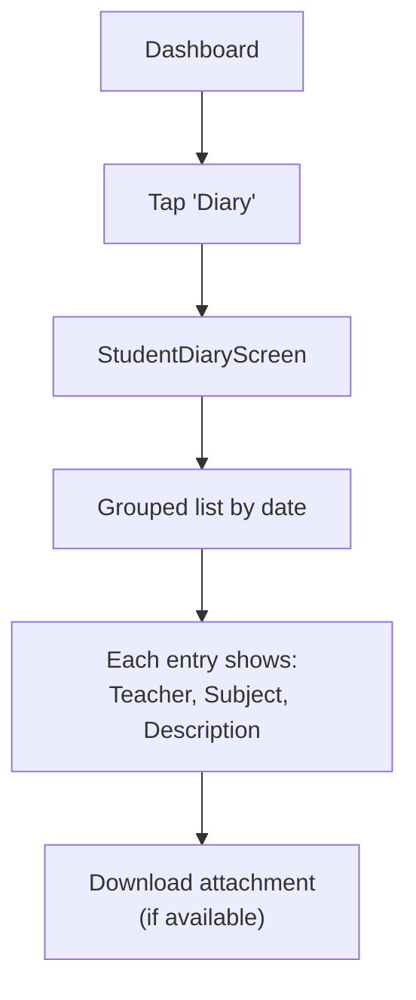
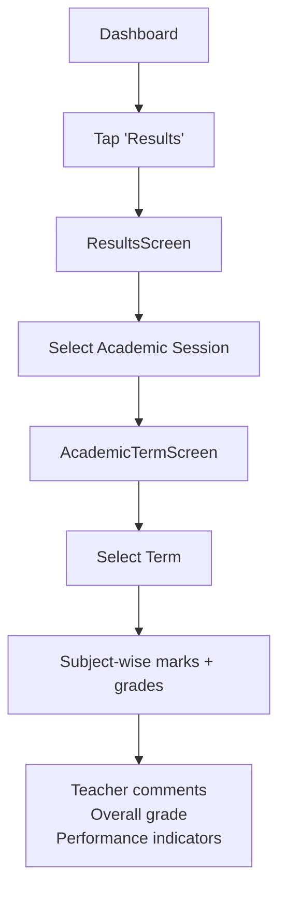
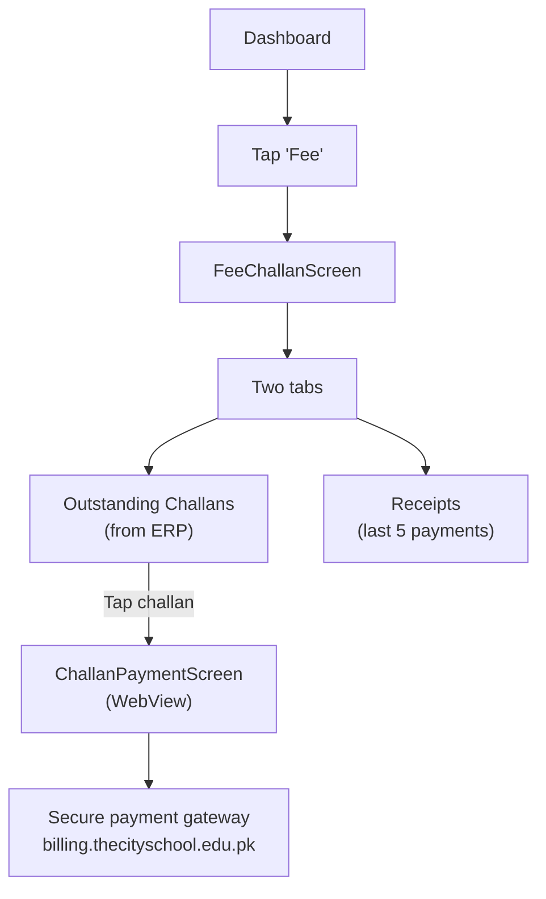
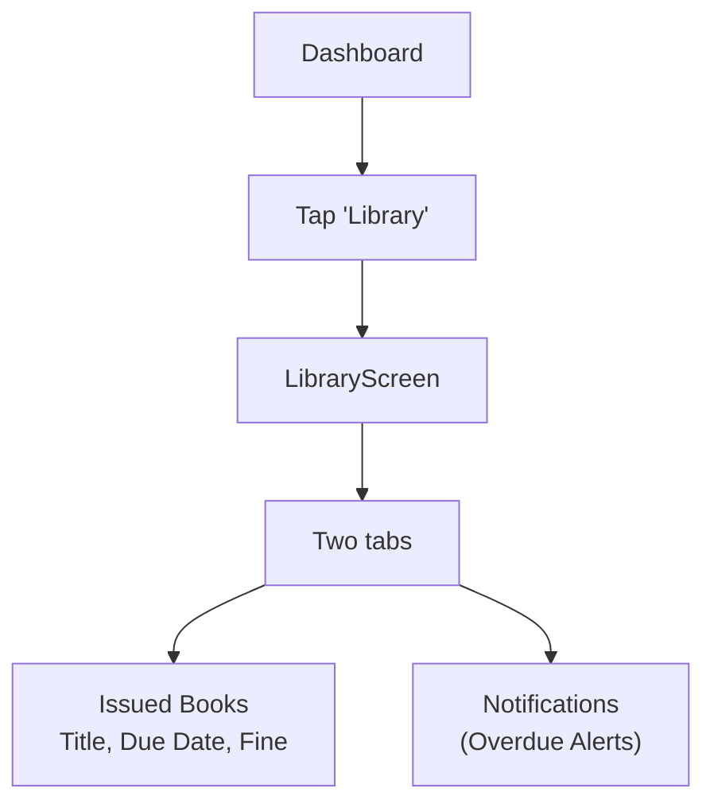

# Student Flow

## Dashboard

The Student Dashboard (`StudentDashboardScreen`) features:

1. **Profile Card** — Premium card with name, class, campus, attendance gauge
2. **Session Attendance** — Circular progress indicator (tappable → attendance screen)
3. **Action Grid** — Tiles for: Diary, Assignment, Results, Fee, Library, Timetable, Events, Surveys

## Core Flows

### 1. Attendance — Standard Students

### 2. Attendance — A-Level Students (Grade ID 19 or 20)

**Key Design Decisions**:
- Subject list is **session-cached** — only fetched once, then reused
- First subject is **auto-selected** on screen entry
- No intermediate subject selection screen — direct to calendar
- Subject switching via horizontal chips at the top

### 3. Homework Diary

- Homework auto-hides after 7 days
- All homework for the same date grouped under a single header

### 4. Term Results (from AIMS+ ERP)

### 5. Fee & Payment

### 6. Library

### 7. Student Profile

- Read-only view of ERP data
- Fields: Name, Roll Number, Class/Section, Campus, Contact, DOB
- **Students cannot edit** their contact information (enforced by role check)
- Profile photo: local-only (stored via `SharedPreferences` file path)

### 8. Other Student Features

| Feature | Screen | Notes |
|---|---|---|
| Classwork/Assignments | `StudentAssignmentScreen` | Same pattern as Diary |
| Class Test Results | `StudentClassResultScreen` | View Test 1/2/3 marks |
| Timetable | Read-only 9×5 grid | Created by teacher |
| School Events | `StudentSchoolEventScreen` | Published events |
| Surveys | `StudentSurveyScreen` | Complete assigned surveys |
| Notifications | `NotificationScreen` | School announcements |

## Key Files

| File | Purpose |
|---|---|
| `screens/Student/StudentDashboardScreen/` | Dashboard + profile card |
| `provider/StudentDashboard/student_dashboard_provider.dart` | Dashboard state + multi-child |
| `provider/StudentAttendance/student_attendance_provider.dart` | Standard attendance |
| `provider/StudentAttendance/student_alevel_attendance_provider.dart` | A-Level attendance + caching |
| `provider/StudentProfile/student_profile_provider.dart` | Profile data + session cache |

## Related Pages

- [[Authentication Flow]]
- [[Teacher Flow]]
- [[Parent Flow]]
