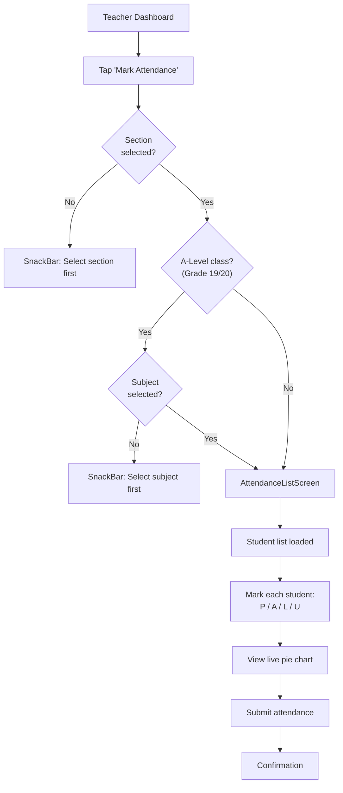
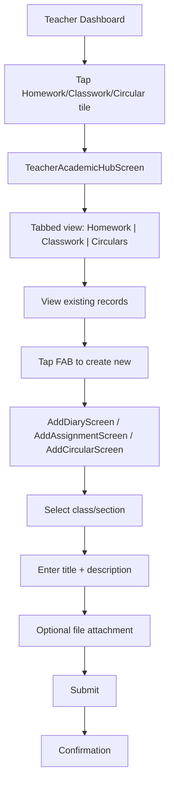
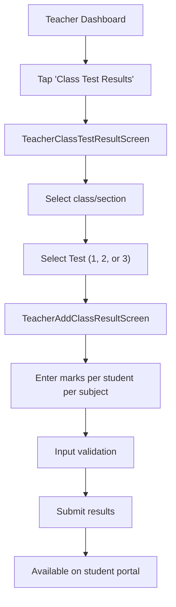
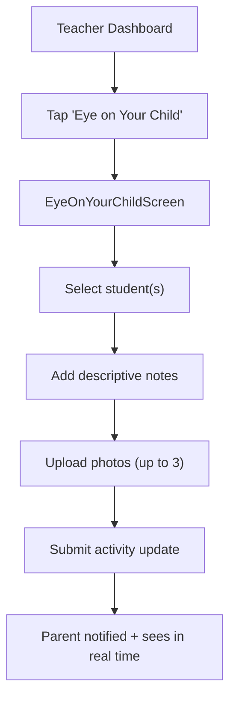
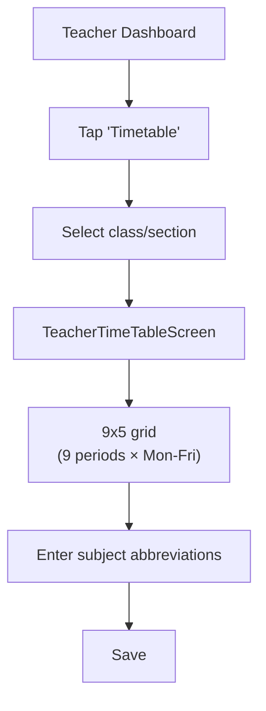

# Teacher Flow

## Dashboard

The Teacher Dashboard (`TeacherDashboardScreen`) is the central hub with:

1. **Profile Strip** — Glassmorphic card showing teacher name, designation, campus
2. **Smart Class & Section Card** — Unified selection hub for the active section/subject
3. **Action Grid** — Quick-access tiles for all teacher features
4. **Pull-to-Refresh** — Single gesture refreshes all dashboard data

## Core Flows

### 1. Mark Attendance

**Key Provider**: `MarkAttendanceProvider`
- Holds student list, attendance status per student
- Live pie chart updates as teacher marks
- 4 statuses: Present, Absent, Leave, Unreconciled

### 2. Homework / Classwork / Circulars (Academic Hub)

- FAB dynamically changes context based on active tab
- Teachers only see their own created content
- Edit mode: pass existing record as route argument
- Homework auto-archives after 7 days

### 3. Class Test Results

### 4. Eye on Your Child (Early Years)

### 5. Timetable

## Navigation Guards

The dashboard validates prerequisites before navigation:
- **Section-dependent screens** (Attendance, Timetable, Academic Hub): Requires active section selection
- **A-Level subject-dependent screens**: Requires subject selection in addition to section
- Clear SnackBar feedback when prerequisites are missing

## Key Files

| File | Purpose |
|---|---|
| `screens/Teacher/TeacherDashboardScreen/` | Dashboard screen + components |
| `provider/MarkAttendance/mark_attendance_provider.dart` | Attendance marking state |
| `provider/Diary/diary_provider.dart` | Homework management |
| `provider/Assignment/assignment_provider.dart` | Classwork management |
| `provider/Circular/circular_provider.dart` | Circular management |
| `provider/ClassTestResult/class_test_result_provider.dart` | Test results |
| `provider/EyeOnYourChild/eye_on_your_child_provider.dart` | Activity feed |
| `provider/TimeTable/timetable_provider.dart` | Timetable CRUD |

## Related Pages

- [[Authentication Flow]]
- [[Student Flow]]
- [[Parent Flow]]
