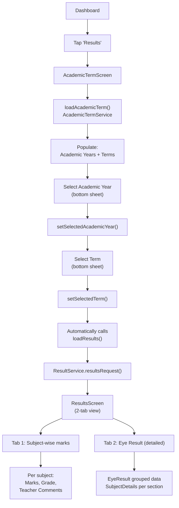

# Term Results Flow

## Overview

Students and parents view academic term results fetched from the AIMS+ ERP system. The flow involves selecting an academic session and term, then viewing subject-wise marks, grades, and performance indicators.

## Flow Diagram



## Data Flow

### Step 1: Load Academic Terms
```dart
AcademicTermService.academicTermRequest(userName, token)
→ AcademicTermResponse { session: [...], term: [...] }
```

### Step 2: Select Year & Term
- Year selection → `setSelectedAcademicYear()` → stores `selectAcademicYear` ID
- Term selection → `setSelectedTerm()` → stores `selectedTerm` ID → **auto-triggers** `loadResults()`

### Step 3: Fetch Results
```dart
ResultService.resultsRequest(userName, token, academicYearId, termId)
→ { ResultsResponse + EyeResult (Map) }
```

The `EyeResult` is a dynamic map parsed into `List<EyeResult>` with nested `SubjectDetails`.

## Key Files

| File | Purpose |
|---|---|
| `provider/Results/results_provider.dart` | Academic term + results state |
| `screens/Student/ResultScreen/academic_term_screen.dart` | Year/term selection |
| `screens/Student/ResultScreen/results_screen.dart` | Results display (2 tabs) |
| `services/AcademicTerm/academic_term_service.dart` | Fetch sessions/terms |
| `services/Results/result_service.dart` | Fetch results |
| `model/AcademicTerm/academic_term_response.dart` | Session/term model |
| `model/Results/results_response.dart` | Results + EyeResult model |

## Related Pages

- [[Student Flow]]
- [[Class Test Results Flow]]
