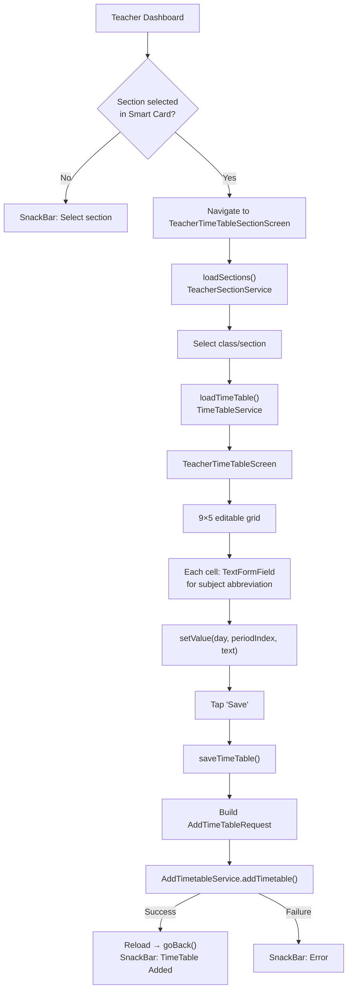
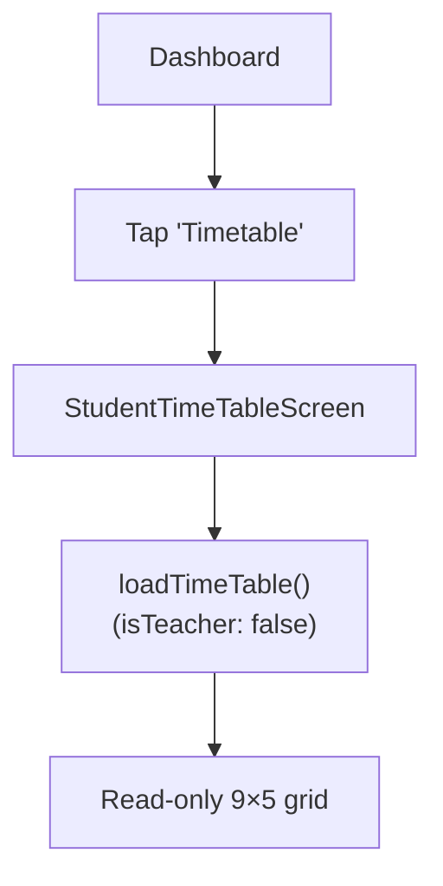

# Timetable Flow

## Overview

Teachers create and manage class timetables in a 9-period × 5-day (Mon–Fri) grid format. Students and parents view their timetable as read-only.

## Teacher Flow: Create / Edit Timetable



## Grid Structure

```
         | Period 1 | Period 2 | ... | Period 9 |
---------|----------|----------|-----|----------|
Monday   | Eng      | Math     | ... | PE       |
Tuesday  | Sci      | Eng      | ... | Art      |
Wednesday| Math     | Urdu     | ... | IT       |
Thursday | IST      | Eng      | ... | Free     |
Friday   | Urdu     | IST      | ... | Math     |
```

- 9 periods (subject1 through subject9) for each day
- 5 weekdays (Monday through Friday)
- Each cell holds a subject abbreviation string

## Data Model

```dart
AddTimeTableRequest {
  termId: 1,                    // Always term 1
  classSectionId: int,
  classTeacherId: int,
  createdBy: int,
  dayLists: [
    DayList {
      dayOfWeek: "Monday",
      periods: [
        Periods {
          subject1: "Eng",
          subject2: "Math",
          ...
          subject9: "PE",
        }
      ]
    },
    // ... 5 days
  ]
}
```

## Value Setting Logic

The `setValue(day, periodIndex, marks)` method has two modes:

1. **`isInitial = true`**: Stores in local `timetablelistValues` map
2. **`isInitial = false`**: Directly modifies the `TimeTableResponse` object's `dayLists`

On save, both sources are merged — local values override server values.

## Student / Parent Flow: View Only



The same `TimeTableProvider.loadTimeTable()` is used, but with `isTeacher: false` flag.

## Key Files

| File | Purpose |
|---|---|
| `provider/TimeTable/timetable_provider.dart` | Full CRUD + grid state |
| `screens/Teacher/TeacherTimeTableScreen/` | Editable grid screen |
| `screens/Teacher/TeacherTimeTableSectionScreen/` | Section selection |
| `services/TimeTable/timetable_service.dart` | Fetch timetable API |
| `services/AddTimetable/add_timetable_service.dart` | Save timetable API |
| `model/TimeTable/timetable_response.dart` | Timetable response model |
| `model/AddTimeTable/add_timetable_request.dart` | Save request model |

## Related Pages

- [[Teacher Flow]]
- [[Student Flow]]
