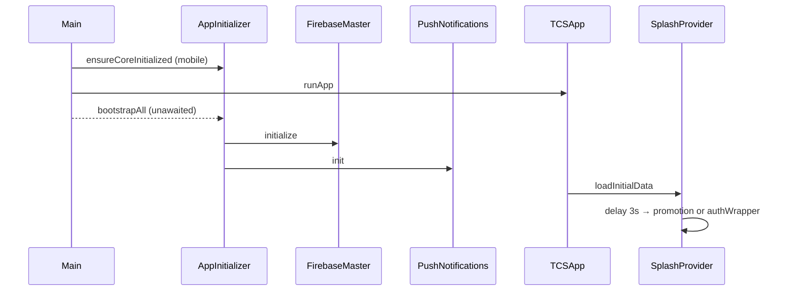

# Lifecycle

> Back to [[Home]] · [[Flutter/Index|Flutter]] · [[Diagrams/Master Architecture|Master Architecture]]

Sources: `lib/main.dart`, `lib/services/InitServices/app_initializer.dart`, `lib/services/InitServices/firebase_master.dart`, `lib/screens/SplashScreen/splash_screen_ui.dart`, `lib/provider/Splash/splash_provider.dart`.

## Entry: `main()`

1. `WidgetsFlutterBinding.ensureInitialized()`.
2. **Web (`kIsWeb`)**: `runApp(const TCSApp())` only — no FCM background handler, no `AppInitializer` calls in `main`.
3. **Mobile**:
   - Registers `FirebaseMessaging.onBackgroundMessage(_firebaseMessagingBackgroundHandler)`.
   - Background handler calls `AppInitializer.ensureCoreInitialized()` then `AppInitializer.push.showFromBackgroundSafe(message)`.
   - `await AppInitializer.ensureCoreInitialized()`.
   - `runApp(const TCSApp())`.
   - `unawaited(AppInitializer.bootstrapAll())` — fire-and-forget after first frame path starts.

## `AppInitializer.ensureCoreInitialized`

- Idempotent (`_coreInitialized` guard).
- `Firebase.initializeApp(options: DefaultFirebaseOptions.currentPlatform)`.
- Safe to call from any isolate (used by FCM background handler).

## `AppInitializer.bootstrapAll`

- Idempotent via shared `Completer`.
- Ensures core init, then:
  1. `FirebaseMaster.instance.initialize()`
  2. `PushNotifications.instance.init()`
- On failure: logs (debug), attempts `recordNonFatal`, completes with error.
- Exposes `analyticsObserver` from `FirebaseMaster` for `MaterialApp.navigatorObservers` (non-web only).

### `FirebaseMaster.initialize` (inside bootstrap)

Runs in parallel via `Future.wait`:

| Step | Status |
|---|---|
| `_initCrashlytics` | Active |
| `_initAnalytics` | Active |
| `_initRemoteConfig` | **Commented out** in `initialize()` |
| `_initFCMListeners` | Active |

See [[Firebase/Remote Config|Remote Config]] and [[Firebase/Index|Firebase Index]].

## `TCSApp`

- `MultiProvider(providers: appProviders)` — 30 `ChangeNotifierProvider`s in `lib/provider/app_providers.dart`.
- `MaterialApp`:
  - `title: 'Cityzens'`
  - `theme: AppThemes.lightTheme` (light only — see [[Flutter/Theme|Theme]])
  - `home: const SplashScreenUI()`
  - `initialRoute: AppNavRoutes.initialRoute` (`/`)
  - `navigatorKey: AppNavigation.navigatorKey`
  - `onGenerateRoute: RouteGenerator.generateRoute`
  - `navigatorObservers: [AppInitializer.analyticsObserver]` when not web

## Splash

- UI: `SplashScreenUI` — animations + `SplashProvider.loadInitialData()`.
- After ~3 seconds:
  - **Web**: `pushReplacementTo(authWrapperRoute)`.
  - **Mobile**: loads `PromotionRepository().getActivePromotion()`; if promotion is active (live window in release, or `isTesting` in debug), navigates to `promotionRoute`; else `authWrapperRoute`.

## Diagram (verified sequence)

