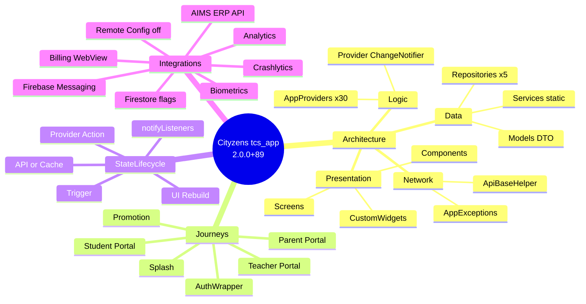
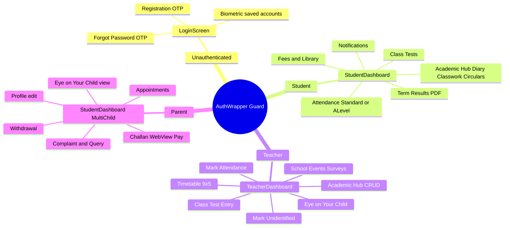

# Cityzens App Documentation

> [!tip] Single Source of Truth
> The master diagram below is the onboarding entry point. Every major node links to a deep-dive page. Prefer this vault over duplicating content in `README.md`.

## Project metadata

| Key | Value |
|---|---|
| **Package** | `tcs_app` |
| **Version** | `2.0.0+89` |
| **Flutter SDK** | `^3.8.1` |
| **State management** | Provider (`ChangeNotifier`) |
| **HTTP** | `package:http` via `ApiBaseHelper` |
| **Backend** | External AIMS+ ERP REST API (not in this repo) |
| **Firebase project** | `thecityschoolapp` |
| **Environments** | Test: `testcityzenapi.csn.edu.pk` · Live: `cityzenapi.csn.edu.pk` (active = **Test** in `AppConstants`) |

---

## Master architecture & flows

Canonical copy: [[Diagrams/Master Architecture|Master Architecture]]

```mermaid
flowchart TB
  subgraph Layers["Architecture Layers"]
    direction TB
    Pres["Presentation<br/>Screens · Components · CustomWidgets"]
    Logic["Logic<br/>30 ChangeNotifiers · MultiProvider"]
    Data["Data<br/>Static Services · 5 Repositories · Models"]
    Net["Network<br/>ApiBaseHelper · package http"]
    Pres <--> Logic
    Logic <--> Data
    Data <--> Net
  end

  subgraph Journeys["Primary Navigation and User Journeys"]
    direction TB
    MainEntry["main.dart<br/>Firebase + AppInitializer"]
    Splash["SplashScreenUI<br/>SplashProvider"]
    Promo{"Active Launch<br/>Promotion?"}
    AuthW["AuthWrapper<br/>tokenId guard"]
    Login["LoginScreen<br/>Student · Teacher · Parent"]
    StudDash["StudentDashboard<br/>Student + Parent"]
    TeachDash["TeacherDashboard"]
    StudMods["Student Modules<br/>Attendance · Hub · Results · Fees · Library"]
    TeachMods["Teacher Modules<br/>Mark Attendance · Academic Hub · Tests · Timetable"]
    ParentMods["Parent Modules<br/>Eye · Complaints · Appointments · Withdrawal · Pay"]
    MainEntry --> Splash --> Promo
    Promo -->|Yes| PromoUI["PromotionScreen"]
    Promo -->|No| AuthW
    PromoUI --> AuthW
    AuthW -->|No token| Login
    AuthW -->|Student| StudDash
    AuthW -->|Teacher| TeachDash
    AuthW -->|Parent| StudDash
    Login --> AuthW
    StudDash --> StudMods
    StudDash --> ParentMods
    TeachDash --> TeachMods
  end

  subgraph Lifecycle["Reactive Data and State Lifecycle"]
    direction LR
    Trig["UI Trigger<br/>initState · tap · refresh"]
    Act["Provider Action"]
    Call["Service or Repository"]
    Src{"Source"}
    API["POST cityzenapi /api"]
    Cache["LocalCache · SharedPrefs · SecureStorage"]
    Model["Parse Model"]
    Emit["notifyListeners"]
    Rebuild["Consumer / Provider.of rebuild"]
    Trig --> Act --> Call --> Src
    Src -->|Remote| API --> Model
    Src -->|Cache hit| Cache --> Model
    Model --> Emit --> Rebuild
  end

  subgraph External["External Integrations and Services"]
    direction TB
    FCM["Firebase Messaging + Local Notifications"]
    Crash["Crashlytics"]
    Anal["Analytics + NavigatorObserver"]
    FS["Firestore newFeatures<br/>payment flag"]
    RC["Remote Config apiBaseUrl<br/>init DISABLED"]
    ERP["AIMS+ ERP REST<br/>test or live host"]
    Bill["Billing WebView<br/>thecityschool.edu.pk"]
    Bio["local_auth + SecureStorage"]
    Upg["upgrader force update"]
  end

  Layers -.->|renders| Journeys
  Journeys -.->|mutates via| Lifecycle
  Lifecycle -->|HTTP| ERP
  Lifecycle -->|feature flag| FS
  External --> Layers
  FCM -->|route or openUrl| Journeys
  Bio --> Login
  Upg --> AuthW
  Bill --> ParentMods
  Net --> ERP

  classDef layer fill:#1E2A6B,stroke:#F3CD50,stroke-width:2px,color:#FFFFFF
  classDef journey fill:#485CC7,stroke:#F3CD50,stroke-width:2px,color:#FFFFFF
  classDef life fill:#303F9F,stroke:#FFF6D2,stroke-width:2px,color:#FFFFFF
  classDef ext fill:#003875,stroke:#F3CD50,stroke-width:2px,color:#FFFFFF
  classDef decision fill:#F3CD50,stroke:#1E2A6B,stroke-width:2px,color:#1E2A6B

  class Pres,Logic,Data,Net layer
  class MainEntry,Splash,AuthW,Login,StudDash,TeachDash,StudMods,TeachMods,ParentMods,PromoUI journey
  class Trig,Act,Call,API,Cache,Model,Emit,Rebuild life
  class FCM,Crash,Anal,FS,RC,ERP,Bill,Bio,Upg ext
  class Promo,Src decision
```

---

## Mind map — whole app

[[Diagrams/Mind Map Overview|Mind Map Overview]]

---

## Mind map — role journeys

[[Diagrams/Mind Map Journeys|Mind Map Journeys]]

---

## Node → deep-dive map

### Architecture layers

- [[Architecture/Index|Architecture Overview]] · [[Architecture/Layers|Layered Architecture]] · [[Architecture/Provider Map|Provider Map]]
- [[Architecture/State Management|State Management]] · [[Architecture/Navigation|Navigation]] · [[Architecture/Dependency Injection|DI]]
- [[Flutter/Networking|Networking]] · [[Backend/Index|Backend Integration]] · [[API/Index|API Catalog]]

### Navigation & journeys

- [[Flows/Splash and Startup Flow|Splash & Startup]] · [[Flows/Promotion Flow|Promotion]] · [[Flows/Authentication Flow|Authentication]]
- [[Flows/Teacher Flow|Teacher]] · [[Flows/Student Flow|Student]] · [[Flows/Parent Flow|Parent]]
- [[Flows/Index|All Flows]]

### State lifecycle

- [[Architecture/State Management|State]] · [[Flutter/Storage and Caching|Storage & Caching]] · [[API/Index|API Catalog]]

### External integrations

- [[Firebase/Index|Firebase]] · [[Firebase/Messaging|Messaging]] · [[Firebase/Crashlytics|Crashlytics]] · [[Firebase/Analytics|Analytics]] · [[Firebase/Firestore|Firestore]] · [[Firebase/Remote Config|Remote Config]]
- [[Flows/Fee and Payment Flow|Payment]] · [[Development/Environments|Environments]]

### Diagrams hub

- [[Diagrams/Index|All Diagrams]] · [[Diagrams/Master Architecture|Master Architecture]] · [[Diagrams/Mind Map Overview|Mind Map]] · [[Diagrams/Mind Map Journeys|Journey Mind Map]]
- [[Diagrams/Startup Flow|Startup]] · [[Diagrams/Notification Flow|Notification]] · [[Diagrams/Payment Flow|Payment]] · [[Diagrams/Result Flow|Result]]
- [[Diagrams/Theme Flow|Theme]] · [[Diagrams/Configuration Flow|Configuration]] · [[Diagrams/Deep Link Flow|Deep Link]]

---

## Vault structure

| Folder | Purpose |
|---|---|
| [[Overview/Index\|Overview]] | Purpose, platforms, stack |
| [[Architecture/Index\|Architecture]] | System design, providers, DI, nav |
| [[Flutter/Index\|Flutter]] | Lifecycle, routing, networking, storage, theme |
| [[Backend/Index\|Backend]] | Client API integration maps |
| [[API/Index\|API]] | Endpoint reference |
| [[Firebase/Index\|Firebase]] | Messaging, Crashlytics, Analytics, Firestore, RC |
| [[Flows/Index\|Flows]] | User journey docs |
| [[Features/Index\|Features]] | Feature status matrix |
| [[Design System/Index\|Design System]] | Colors, widgets, typography |
| [[Diagrams/Index\|Diagrams]] | Mermaid SSOT copies |
| [[Development/Index\|Development]] | Setup, makefile, environments |
| [[Deployment/Index\|Deployment]] | Android/iOS release |
| [[Handover/Index\|Handover]] | Vendor onboarding |
| [[Decisions/Index\|Decisions]] | ADRs |
| [[Troubleshooting/Index\|Troubleshooting]] | Common failures |
| [[Audit/Index\|Audit]] | Audit report, issues, quality, deps |
| [[Credentials/Index\|Credentials]] | Secrets template (gitignored values) |
| [[Notes/Index\|Notes]] | Working notes |

## Quick links

- [[Handover/Index|Start here if you are a new vendor]] → [[Development/Setup|Setup]] → [[Deployment/Index|Deploy]]
- [[Audit/Documentation Audit Report|Documentation Audit Report]]
- [[Audit/Known Issues|Known Issues]]
